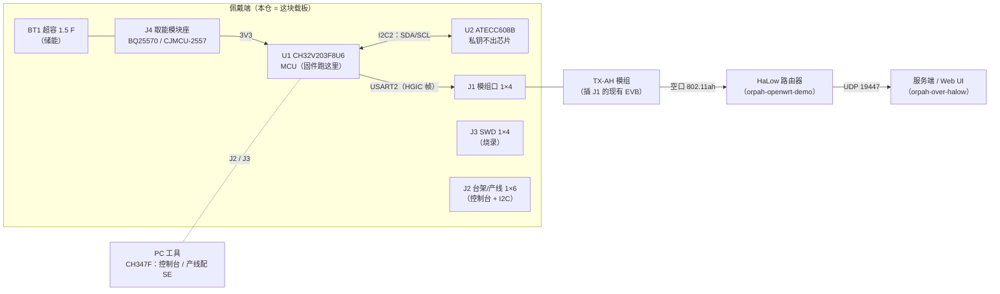
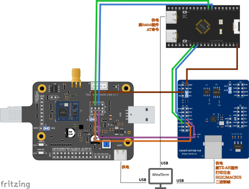
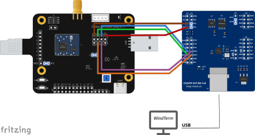
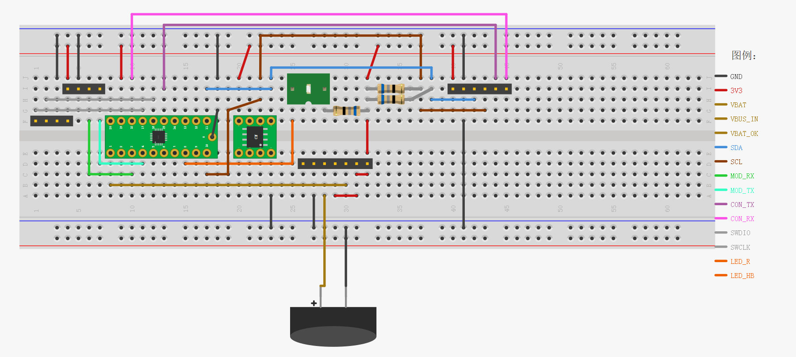

# orpah-client-demo — ORPAH 客户端（硬件 + 固件）

ORPAH（用无线技术找人）五仓里的**客户端侧**：**CH32V203 + 安全元件 ATECC608B + 泰芯 TX-AH
（802.11ah HaLow）模组**。目标是一台**免电池/低功耗**的客户端设备：周期性向 HaLow 路由器
上报「我还在」（Orpah ID 签名上报），必要时按电量降级，并配合服务端做定位与搜寻。

> **现状（2026-10-12 更新）**：六块拼图都已上机验过：
> ① **自家固件**（`firmware/`，c3-2b）—— 控制台 + 1 ms 时基 + 心跳灯（板载 `D1`=PA15）+
>    **模组数据口**（USART2 ↔ TX-AH，HGIC 命令/应答双向通）；接线 / 判据 / 四个真凶见
>    `docs/c3-2b-bench-bringup.md`；
> ② **协议内核**（`proto/`）与 Python 参考**零偏差**（`python proto\run_cross_test.py` → exit 0）；
> ③ **b 步台架**（PC ↔ 模组）—— 控制面、数据面端到端、L2 全链路（含已签 `ORPAH-ID-REPORT`
>    验签通过）都跑通，见 `docs/txah-uart-macbus.md` 与 `ROADMAP.md` §二；
> ④ **c4 + 安全元件（SE）全线通**（2026-10-11）—— 选级（ES256/HS256）/ 无 RTC（`ts=0`）/
>    自限频 / 已签上报全部上机 ✓；**两把钥都在 ATECC608B 里、都不出芯片** ✓：
>    ES256 在 Slot 0 签（`sign_src=se`）、HS256 在 Slot 4 算 HMAC（`nonce_src=se`）；
>    实测 `build_ms` ~9 s（软件 P-256）→ **481 ms**；整帧被上游 `verify_report` 接受
>    （`level=0` ⇒ `trust=high`；`level=1` ⇒ `trust=medium`）✓ —— 见 `docs/atecc608b-se.md`。
> ⑤ **模组侧那一半**（2026-10-12）—— 换到带模组的台架后 `idsend` ⇒ 模组口
>    `[mbus rx] **415** byte(s)`（= 帧 407 + 8 B HGIC 头 ✓），同一帧仍被上游接受 ✓
>    （一键 = `py tools\check_mod_side.py`，见 `docs/atecc608b-se.md` §8.31）。
> ⑥ **联合台架（SE + 模组）一跑到底全绿**（2026-10-12）：`sign_src=se` ✓、`build_ms` **704 ms** ✓、
>    模组口 `[mbus rx] 415` ✓、上游 **`accepted=True level=0 trust=high`** ✓；**HS256 腿同台也过** ✓
>    （`level=1 len=364`、`[mbus rx] 372`、`trust=medium`、两把钥都不出芯片）—— 顺带修掉真 bug：
>    ES256 的 `Nonce`/`Sign` 之间多发的那条唤醒令牌（`Sign` 间歇 `0x0F`，17% ✗ ⇒ **0/15** ✓），
>    见 §8.32。
> **未做（如实）**：`0x64` 那颗芯片的地址谜团（§9.0 唯一还开着的一条）；
> 低功耗与取能标定、d 步的**定制载板**、与 `orpah-over-halow` / `orpah-openwrt-demo` 的真机联调都未做。
> ⚠ `AT+TXDATA`/`FRAME:RX` 那条路（`docs/nano-ch32v203-uart-bridge.md`）在**真模组上不成立**
> （fmac 固件的 AT 没有用户数据命令）—— 实际走通的是 **UART-MACBUS（HGIC 帧）**，即上面 ③。

## 总图：这块载板在整个系统里站哪一格

先说三句话 ✓：

1. **ORPAH 要干的事** = 用 HaLow（802.11ah）**找走失的人**：佩戴端每 60 s 连一次路由器、
   发一条**已签名**的「我还在」；服务端攒多台路由器的观测来定位、超时就告警。
2. **本仓 = 佩戴端（客户端）**：**MCU + 安全元件 + 射频模组**。
3. **载板（`carrier-pcb.fzz`）= 把台架上那堆杜邦线，固化到一块 44×32 mm 的板子上** ✓
   —— 台架上已经验过的每一条，到了板上要**再验一遍**（判据见
   [`docs/carrier-board-spec.md`](docs/carrier-board-spec.md) §8）。



**四个排针就是"这块板跟外面怎么连"的全部答案** ✓：

| 座 | 接什么 | 载荷 |
|---|---|---|
| **J1**（1×4） | 现有 **TX-AH EVB**（将来插裸模块） | `3V3 / GND / MOD_RX / MOD_TX` —— 与模组之间的 **UART-MACBUS** |
| **J2**（1×6） | 台架 / 产线夹具 | `3V3 / GND / SDA / SCL / CON_TX / CON_RX`（控制台 + I2C 配 SE） |
| **J3**（1×4） | WCH-Link | `3V3 / GND / SWDIO / SWCLK` |
| **J4**（1×7） | 取能前端模块（`BQ25570` 模块，库仓刚做的 `svg/BQ25570`） | `INPUT / GND / BAT / OUTPUT / V_OK / V_EN / EN` |

## 台面长什么样（看图）

**c 步台架**（自家固件上机用的那套）：nanoCH32V203 + TX-AH EVB + CH347F 两个 PC 窗口 ——
CH347F 的 `P2`(UART0) 看我们的控制台、`P3`(UART1) 看模组的 AT/打印口：

[](hardware/wiring/cstep-ch347f-txah-evb-nanoch32.svg)

**b 步夹具**（PC ↔ 一块 TX-AH 模组；数据口 + AT/打印口各一路）：

[](hardware/wiring/bstep-ch347f-txah-evb.svg)

逐网规格与复验方式（用 `tools\fzz_nets.py` 把 Fritzing 网表逐网核对）见
[`hardware/wiring/README.md`](hardware/wiring/README.md)。

## 载板（carrier）：原理图与面包板

[](hardware/carrier/carrier-breadboard.fzz)

上图 = `hardware/carrier/carrier-breadboard.fzz` 的**面包板视图**（示意图 ✓，不是实物照片 ✓）。

- 网表**单一源** = `hardware/carrier/carrier_nets.py`（15 张网 ✓）；
  闸门 = 库仓 `tools/bb_probe.py`（网表 ⇔ 图 ✓）/ `bb_precheck.py`（摆位 ✓）/ `file_sanity.py`（线色 ✓）
  —— 当前：**14/14 网连通 ✓、短接 0 ✓、悬空 0 ✓**。
- **BT1（1.5 F 超级电容）画在板外、板下方** ✓，绕两脚中点转 **180°**（腿朝上 ✓）：
  `+` → `pin28A`（赭色，横段 + 竖段 ✓）、`−` → `pin30X`（黑色，**一段直线** ✓）；
  两根线的端点都接在**腿尖**（= 引脚再往外 2.54 mm ✓）。
- 原理图视图 = `hardware/carrier/carrier-schematic.fzz`（已在 Fritzing 里人工验收「布线完成」✓）。

## 五仓分工（改动该往哪个仓放）

| 仓库 | 内容 | 与本仓的关系 |
|---|---|---|
| `Protocol`（`F:\git\Protocol`） | 通信协议规范：`docs/OrpahIDProtocol.md`（SN/校验/签名/密钥/降级/限频）、`docs/orpah-over-halow/SPEC.md` | **唯一权威**，固件严格遵循 |
| `orpah-over-halow`（`F:\git\orpah-over-halow`） | 业务全链路：服务端（UDP 19447）、Router 桥、走失表、Orpah ID 验签、定位/告警、Web UI、`host_bus.py`、`client.py`（PC 参考客户端） | 参考其协议定义与仿真器接口；**与本仓联调** |
| `halow-demo`（`F:\git\halow-demo\simulator`） | 空口/设备侧：`host/sim.py`（空口 + host 数据口）、`tools/ui/`、`firmware/`（CH32V203 参考固件）、真机实测记录 | 复用其**测试数据**与**固件骨架** |
| `orpah-openwrt-demo`（`F:\git\orpah-openwrt-demo`） | 路由器端 OpenWrt 软件（daemon + 包壳 + LuCI） | **与本仓对接测试** |
| **本仓** | **客户端硬件 + 固件** | — |

## 硬件形态（2026-09-14 用户定）

- **MCU**：CH32V203（QingKe V2，64K Flash / 20K RAM 级别），裸机、无 RTOS、`-nostdlib`。
- **安全元件（SE）**：ATECC608B —— 协议 §5.3 指定的 ECDSA P-256 载体（私钥不可导出）。
- **射频模组**：泰芯 **TX-AH**（AH-SDK V2 系列）。**PC ↔ 模块的数据面走 UART**（用户 2026-09-14 定）：
  `AT+TXDATA=<len>` + 裸以太帧上行、`FRAME:RX <hex>` 行下行（PC 侧实现见
  `orpah-over-halow/host_serial.py`；纯 PC 排练见 `demo_client_uart.py`）。
  ⚠ 仓里两份记录不一致（TC-Halow-RJ45 手册有 `AT+TXDATA`，`halow-demo` 真机实测说 fmac 的 AT
  无用户数据命令）→ **未在真机验证**，上机首测先确认（见 `orpah-over-halow/docs/client_sim.md` §2.3）。
- **工具链**：`riscv-none-elf-gcc`（**MounRiver** 自带；`-DWCH_INTERRUPT_FAST` 必须用它）。
- **烧录**：WCH-Link + OpenOCD（或 MounRiver 下载按钮）—— **由用户执行**。

## 固件要实现的（来自规范，逐条对着读）

| 主题 | 规范位置 | 客户端要做的事 |
|---|---|---|
| SN 编码/字符集 | `OrpahIDProtocol.md` §2 | 解析 `CC-ORG-UNIQUE[-CHECK]`，只认合法字符集，不套 Crockford 限制 |
| 校验码 Damm32 | §3 / 附录 B | 只算 `ORG-UNIQUE`（**不含 CC**） |
| Unicode 规范化 | §4 | 上报前按规范规范化字符串 |
| 签名与报文 | §5.1 / §5.4 | 组报文、算预像、ECDSA P-256 签名（SE）、`b64url` 编码 |
| 防重放/时间 | §5.5 | nonce/时间窗；**无 RTC 时 `ts=0`**，不改报文里的 `ts` |
| alg 白名单 | §5.6 | 只发白名单内的算法；ES256 优先，降级到 HS256 为下限 |
| 限频 | §5.8 | 设备侧自限频（**延后**而非丢弃） |
| 密钥 | §6.1/§6.2/§6.3/§6.4 | 1 把 P-256 私钥 + 1 把 HMAC，**一代终身不轮换**；私钥不可导出 |
| 降级 | §8.1/§8.2 | 四级降级流程；**永不降到 L3**（不能确认在场时宁可沉默） |
| 能量/覆盖 | `SPEC.md` §5.2 (E1–E4) | 由能量决定上报间隔与降级；设计常态 **60 s** 一次连接；沉默要能归因 |
| host 数据口 | `SPEC.md` §6 / `host_bus.py` | 帧格式与语义对齐 SPI MACBUS `DATA_TX`/`DATA_RX` |

## 目录（2026-09-21 实际）

```
orpah-client-demo/
├── firmware/     # CH32V203 固件（Makefile/启动/驱动/模组数据口；平台层四个真凶已修）
├── proto/        # 协议内核 C 实现 + 测试向量 + 跨语言交叉测试（run_cross_test.py）
├── tools/        # 上位机/联调脚本（host 数据口、串口、真机轮询、网表核对 fzz_nets.py）
├── docs/         # 上机记录、接线、遇到的问题（见下表）
└── hardware/     # 接线图（Fritzing .fzz + .svg 导出）
```

`docs/` 已有：

| 文档 | 内容 |
|---|---|
| `docs/c3-2b-bench-bringup.md` | **上机记录**：台架接线表、上电判据、实测证据、**四个真凶**（链接基址 0x0 / `IRQn` +16 / `mstatus` / TIM `INTFR`）、可复用的排查手法 |
| `docs/txah-uart-macbus.md` | 模组侧的 UART-MACBUS（HGIC 帧）：为什么选 UART、接线、协议要点、首测判据与分层排查、**双模块上行/下行实测**、§8.1 顺带量出的七条硬规矩、未做项 |
| `docs/nano-ch32v203-uart-bridge.md` | nanoCH32V203 刷 `SimulateCDC` 当 USB-UART 桥（COM32）、AT 验证；含 `AT+TXDATA` 在真模组上不成立的结论 |
| `docs/ch347f-txah-spi-probe.md` | SPI/电气探测（判据 = SD-SPI 的 CMD0/CMD5 有没有合法 R1） |
| `docs/carrier-board-spec.md` | **d 步载板规格（草稿，未上机 ✗）**：器件表 / 引脚分配（**逐条标出处**）/ 电源树（电池 + 预留取能）/ 测试点与产线夹具接口 / **验收判据**（台架上验过的每一条都要在载板上再验一遍）/ 待定清单 |

## 构建与烧录（2026-09-21 实测；2026-10-12 补 Python 依赖）

```bash
cd firmware
make rebuild    # ★ 从零：mkdirs.py clean + make all（约 3 s）—— **固件构建一律用它** ✓
make            # 增量（自己迭代时用，不作为交付/闸门口径）
make clean
```

> ★ **构建需要 Python**（`py -3`，或 `make PY=python3`）：建/删 `build/` 目录由 `firmware/mkdirs.py` 干 ✓
> —— 干净的树（或 `make clean` 之后）直接 `make` 就能从零编完，**不需要先手工建目录** ✓、
> **路径含空格也没事** ✓（理由与实测见 [`firmware/Makefile`](firmware/Makefile) 头 + [`firmware/README.md`](firmware/README.md) 的「构建」节）。

```bash
# 烧录（用户执行）—— ★ 地址必须是 0x00000000（与 ld/link.ld 的链接基址一致）
openocd -f interface/wch-link.cfg -f target/ch32v20x.cfg \
        -c "program build/orpah-client.bin 0x00000000 verify reset exit"
# 或 WCHISPTool（下载方式 = USB，选 .bin/.hex）
# ⚠ 下载完**必须按一次 RST**（不按 = 什么也不发生，最容易被当成固件坏了）
```

## 自检（本仓口径）

**一键回归 = `python tools\run_checks.py`**（2026-10-11 加）—— 把**不需要台架**的闸门全跑一遍：
协议内核交叉测试（`proto/run_cross_test.py`，**16 组**）/ 接线图网表（`tools/fzz_nets.py`，9 张）/
标注扫描 / Python 语法 / **固件编译零 warning**；报告写到 `checks_report.md`（入库）。
接上板子再加 `--bench`（跑 `tools/check_c4g2_bench.py`：SE 唤醒·真随机数·**Slot 0 签名 + 上位机
独立验签**·`nonce_src`/`sign_src`·上游 `verify_report` 收帧）。
**CI（GitHub Actions）= 同一套离线闸门，换机器 / 换工具链 / 换系统再跑一遍** ✓ ——
`.github/workflows/checks.yml` 是**三系统矩阵**（`fail-fast: false` ✓），三栏跑的是**同一份**
`python tools/run_checks.py`（**不加** `--bench` ✓），差别只在"去哪拿 RISC-V 工具链" ✓：

| 栏 | 工具链 | 额外量到的东西 |
|---|---|---|
| **Linux** | apt `riscv64-unknown-elf-gcc` ✓ | 纯 POSIX 环境（`/bin/sh` ✓、`python3` ✓） |
| **Windows** | **xpack** `riscv-none-elf-gcc` + Git 的 `sh.exe` + choco 的 `make` ✓ | 本仓那套 **Windows 假设**（`find_sh()` 三个绝对路径 ✓、`mkdirs.py` ✓、`py -3` ✓）在**干净机器**上还成不成立 ✓ |
| **macOS** | **xpack** `riscv-none-elf-gcc` ✓（`make` 由 Xcode CLT 自带 ✓） | 另一套 Unix 变体（`/bin/sh` ✓、`python3` ✓） |

价值 = 换环境仍全过 ✓（补上"自己机器上过"这一环 ✗）。
★ **三条它不证明** ✗：① 那不是**烧录用**固件（烧录必须用 MounRiver ✓；★ Windows / macOS 两栏用的
**xpack** 恰恰是 AGENTS §1 里记的"中断模型不同、会跑飞"的同一族 ⇒ **更不能**当烧录固件 ✗）；
② 台架那栏跑不了 ✗（要板子/SE/模组 ✓）；③ `--from-keystore` 跑不了 ✗（要隔壁仓的真密钥库 ✓）
⇒ **CI 绿 ≠ 可以烧** ✗。
★★ **首次运行（2026-10-12）红了，而且红得有价值** ✓ —— 量出**两代工具链的两处口径差异**（现已做成显式旋钮 ✓）：
1. **`zicsr` 要两种写法** ✗：启动文件里的 `csrw` 在通用工具链（GCC 12+）上报 `requires extension 'zicsr'` ✗
   ⇒ 要 `-march=rv32imac_**zicsr**`；而 MounRiver 那份（GCC 8.2）**反而不认** `_zicsr` ✗
   （实测 `unsupported ISA substring '_zicsr'`）⇒ 用 `make ISA=rv32imac_zicsr` ✓（默认仍给烧录那条路 ✓）。
2. **WCH 的快速中断属性通用工具链不认** ✗：`interrupt("WCH-Interrupt-fast")` 逐处 `-Wattributes` 告警（12 处）
   ⇒ **我们那条“零 warning”规则当场抓住了“语义不同”** ✓ —— 通用工具链上 ISR 会退化成普通函数 ⇒ 就算编过也**不能烧** ✗。
   CI 传 `INTFAST=0`（走 `Core/board.h` 的泛型 `interrupt` 回退 ✓）⇒ 这一栏证明的是「**可移植配置**编得过」✓。
⇒ 两个声音分开说 ✗：CI = “换环境还编得过” ✓；**“烧录那份”永远是本机 MounRiver 那条闸门的事** ✓。
★★ **同日第三次运行全绿** ✓（`bfb08ef`，2026-10-12，整条含固件编译共 **26 s**）——
**三次运行的真实价值是把三处“在一套工具链上碰巧能过”变成了显式旋钮** ✓：`zicsr` 写法 ✗、
WCH 中断属性语义 ✗、链接 emulation ✗（每处都附实测报错原文，见 `firmware/Makefile` 注释 ✓）。
★★★ **三系统矩阵全绿** ✓（`978f1ee`，2026-10-12：macOS 35 s / Windows 1 m 13 s / Linux 36 s，
三份 `checks_report-<os>` 产物齐 ✓）—— **而它先抓到一个真缺陷** ✓：
`proto/id_cli.c` 少 include `ecdsa.h` ✗ ⇒ `ecdsa_sign_p256_msg()` 成了**隐式声明** ——
在 GCC 13 / MounRiver 8.2 / MSVC 上只是**警告**（本机 + Linux 一路编得过 ✗），
在 **GCC 14+ / Clang 15+ 上默认就是错误** ✗ ⇒ 两个新工具链的栏位当场红 ✓。
两处落实：补 include ✓；**把"隐式函数声明"主动当错误**（`run_cross_test.py` 加
`-Werror=implicit-function-declaration` ✓）—— 口径是 **本仓的闸门要比任何单一编译器都严** ✓。
（这就是"第三方环境交叉验证"的意义：**"在手上这台编得过"从来不算证据** ✗。）
**模组侧判据（2026-10-12 入库）= `python tools\check_mod_side.py`** —— 判「`idsend` 的帧真的进了模组」
（模组口 `[mbus rx] <帧长+8>` ✓）+ 「同一帧被上游接受」✓；**它故意不判 SE**
（无 SE 的台架上那几条必然失败；要判 SE 用 `tools\check_c4g2_bench.py`）✓。

**产线流程（2026-10-11 入库）= `python tools\se_provision.py <step>`** —— 步骤
`read`（逐字节核对出厂配置）/ `lock-config` ✗ / `genkey` ✗ / `lock-data` ✗ / `verify` / `all`；
不可逆步骤要 `--yes`，可 `--record <日志>` 留台账（登记公钥用）。
**离线自检 = `python tools\se_provision.py --selftest`**（9 条锚点：原厂/器件**实发实回**的字节，
含四条 `Read` —— 它钉住 `param2` 是**字地址**且**小端**，见 `docs/atecc608b-se.md` §8.12 ✓）。

- **协议内核跨语言零偏差**：同一批黄金样本/向量，Python 参考实现（`orpah-over-halow`）vs
  本仓 C 实现 —— 直接跑 **`python proto\run_cross_test.py`**（实测 **exit 0**；含 ATECC608B 报文层
  与**外部锚点**：器件/原厂实回的字节对）。
- 判定口径：退出码 0 **且** 输出无 `FAIL`/`Traceback`（有些脚本自己吞异常还会往下跑）。

## 还没做（如实）

- **`0x64` 那颗芯片的地址谜团**（稳定 ACK、命令全不回；需要那颗芯片 + `seaddr 64` + `se`）；
- 与 `orpah-over-halow`（服务端/仿真器）、`orpah-openwrt-demo`（路由器侧）的**真机联调**（e 步）；
- 功耗实测（免电池取能曲线）、d 步的**定制载板**、e 步的一体板。
★ **已结、别再说"未做"** ✗（2026-10-12）：**模组侧那一半**（`py tools\check_mod_side.py` —— 帧 415 B 进模组 + 上游接受 ✓）、
b 步物理通路（= **UART-MACBUS** ✓）、
**产线流程已在真片上跑完** ✓（`tools/se_provision.py`；**4 颗已配、公钥/降级钥已入库**，余 3 颗按用户决定保留不配 ✗）、
**降级 HMAC 钥已在 SE 的 slot 4 里** ✓（不再是"演示派生"）。

（**已完成、别再说「未做」**：`proto/` 协议内核（与 Python 参考零偏差）、
固件平台层 + 控制台 + 1 ms 时基 + 心跳灯 + 模组数据口（c3-2b 上机）、
b 步台架与 L2 全链路（含已签 `ORPAH-ID-REPORT` 验签通过）、
**ATECC608B 全线通**（双锁 + Slot 0 私钥不可导出 + 真随机数；`nonce_src=se sign_src=se`；
**HS256 的降级钥也在 SE 的 slot 4 里、同样不出芯片** ✓；整帧被**上游 `verify_report` 接受**
（`level=0`/`trust=high` 与 `level=1`/`trust=medium` **两条都过** ✓），见
`docs/atecc608b-se.md` §8.7–§8.30）、**台架总闸门 6/6** ✓（`run_checks.py --bench`，§8.30）。）

## 许可

**Apache-2.0**（与 `Protocol` / `orpah-over-halow` 一致；`LICENSE` 与 `orpah-over-halow` 逐字节相同，
SHA256 一致）。注：`Protocol` 另有一份 `NOTICE`（版权行），本仓按兄弟仓 `orpah-over-halow` 的做法
**只放 `LICENSE`**；若要补 NOTICE 请告知。

## 路线图

真机三步走（客户端 a→e / 路由器 a→e）与每步的交付物、判据、关键未知项见 **`ROADMAP.md`**。
其中 **a 步（软件里的客户端设备仿真器）已在 `orpah-over-halow` 完成**：
`client_sim.py`（`DeviceSim`）+ `demo_client_sim.py`（端到端验收）+ `docs/client_sim.md`。
