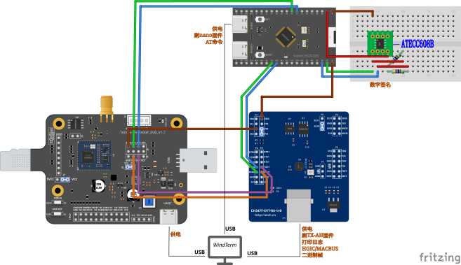

# ATECC608B 安全元件（c4-γ-2）：接线、命令来源、判据

> 这一步**只做一件事**：把 `payload.nonce` 的来源从**软熵**换成本仓 ATECC608B 的
> `Random(0x1B)`（规范 §5.4 要求 nonce 来自 SE 的 RNG）。
> **签名仍然是软件 P-256 替身** —— Slot0 私钥 / `Sign` / Config 锁 / 产线烧录都是 **d 步**。
> 这两件事必须**分开说**：`se` 命令与固件横幅里会同时打出 `se=stand-in(software P-256)`
> 和 `nonce_src=se|soft`，读的时候别合并成一句“已启用 SE”。

[](../hardware/wiring/cstep-ch347f-txah-evb-nanoch32-atecc608b.svg)

一张图说明这段接线（`.fzz` 工程与同名的 `.svg` 都在 `../hardware/wiring/`）：`nano` 的 `PB6/PB7`
走 I²C 到面包板上那块**绿转接板**（板上芯片印着 `CN`，就是 ATECC608B），旁边**两只 4.7 kΩ 上拉到 3V3**；
模组的口仍是 `PA2/PA3`，两个 UART 窗口还是 COM23 / COM24。
接线表见 `../hardware/wiring/README.md` 的「c4-γ-2 台架」一节；**逐根连线的网表复验**也在那里。
★ **只想验「nano 能不能读到 SE 的随机数」时用更小的一张**：
`../hardware/wiring/cstep-nanoch32-atecc608b.fzz`（**只有 nano + 608b**，单一主机、线最少；
PC 窗口靠一根外接串口，**不进 I²C**）—— 接线表在该 README 的「最小 SE 台架」一节。
图里那块绿转接板旁边有一行蓝字 **`ATECC608B`**（带一小段蓝引线指向它）—— 这行字与引线
**在 `.fzz` 工程里**（挂在面包板那个「logo 图片」项的 `shape` 上），重新导出不会丢；
板上芯片本身只有 `CN` 一个丝印。

## 1. 引脚与电气

| 项 | 值 | 出处 |
|---|---|---|
| 封装 | 8-lead SOIC（本仓用的是 SOIC-8 → DIP 转接板） | 摘要手册 DS40002239A 图 1 |
| `pin4` = GND、`pin5` = SDA、`pin6` = SCL、`pin8` = VCC | — | 摘要手册表 1 |
| VCC / IO 电平 | 2.0~5.5 V / 1.8~5.5 V ⇒ **3.3 V 直接接** | 摘要手册 §1 Features |
| I²C 速率上限 | 1 MHz（我们用 **100 kHz**） | 摘要手册 §1 |
| 7 位地址 | `0x60`（写 `0xC0` / 读 `0xC1`），本仓未改出厂默认 | CryptoAuthLib 缺省 |

**接线（用户 2026-09-22 确认）**：`PB6 = SCL`、`PB7 = SDA`（I²C1 默认引脚），
**外接 4.7 kΩ ×2 上拉到 3V3**。⚠ 没有上拉就不可靠（内部上拉约 40 kΩ，只在低速时勉强）。

## 2. 唤醒与看门狗（这几个数都是**下界**，来自你自己的摘要手册 §2.3 / 表 2-2）

| 参数 | 最小 | 含义 |
|---|---|---|
| `tPU` | 100 µs | 上电后到可以拉 SDA 的时间（"上电自检使能时会**长得多**"） |
| `tWLO` | 60 µs | 把 SDA 拉低这么久（唤醒脉冲） |
| `tWHI` | 1500 µs | SDA 拉高后到可以发数据（**未使能自检**的情形） |
| **`tWHIST`** | **20 ms** | ★ **使能自检**时的同一个等待 ⇒ 这时 1.5 ms 远远不够 |
| `tWATCHDOG` | 0.7 / 1.3 / 1.7 s | 唤醒后这么久没收到**合法命令**就自己回睡 |

★ **`tWHI` 的说明里那句"unless polling is implemented"是救命的**（2026-09-22 逐字核表 2-2 才发现）：
手册**明确允许**用"轮询"代替干等满这个时长 —— 也就是**发一次唤醒令牌、没 ACK 就等一会儿再发**。
我们原来**只等 1700 µs、且只发一次令牌** ⇒ 一颗**完全正常但自检使能**的芯片会一直回 NACK，
现象恰好是「`nack` 逐帧 +1 而 `timeout=0`」（总线全好、器件就是不应答）。
⇒ `Periph/atecc.c` 的 `atecc_wake()` 现在**每轮重做整段序列（脉冲 + tWHI + 令牌）、最多 6 轮**
（标称 ≈21 ms 的忙等，而 `i2c_delay_us()` 实测比标称慢 4~5 倍 ⇒ 真实窗口 ≈85~100 ms，覆盖 20 ms）；
`se` 的判据行会打 `tries=N/6` —— **"第几次才 ACK"就是这颗芯片到底要等多久的实测值**。

⇒ 我们 60 s 才发一条 ID，**每条命令前都必须重新唤醒**（`Periph/atecc.c` 就是这么做的）。
唤醒**不是靠猜时间**：拉完脉冲后发一个"唤醒令牌"（I²C 写地址 `0x00`），**收到 ACK 才算醒** ——
这是 CryptoAuthLib `hal_check_wake()` 的做法。

⚠ 拉低 SDA 那一下必须**先把 I²C 外设关掉**（`i2c_disable()`）：否则外设会把
"SCL 高时 SDA 下降"当成一次 START，后面等 `SB` 就会在错的时刻满足。

## 3. 命令集：我们手上没有 NDA 版手册，用公开实现（**逐条标出处**）

`D:\Downloads\ATECC608B.pdf` 是 **Summary Data Sheet**（28 页），开头就写明
"The complete document is available under NDA" ⇒ **它没有命令集**。所以命令层的事实
取自同厂开源的 CryptoAuthLib（`MicrochipTech/cryptoauthlib`）：

| 事实 | 值 | 出处 |
|---|---|---|
| `Random` 命令码 | `0x1B` | `lib/calib/calib_command.h`（`ATCA_RANDOM`） |
| 模式 | `0x00` 自动更新种子 / `0x01` 不更新 | 同上（`RANDOM_SEED_UPDATE` / `RANDOM_NO_SEED_UPDATE`） |
| 返回数据长度 | 32 B | 同上（`RANDOM_NUM_SIZE`） |
| 无数据命令包长 | `ATCA_CMD_SIZE_MIN` = count+opcode+param1+param2+CRC = **7**（不挂 CRC 时 5） | 同上 + `lib/calib/calib_command.c` 的 `atCalcCrc()` |
| 命令最多耗时 | 23 ms（另一张表 50 ms） | `lib/calib/calib_execution.c` |
| CRC 算法 | ~~poly `0x8005`、初值 0、**MSB-first**~~ ✗ **（2026-10-10 已纠正，见 §8.2 第四段）** 实为：**数据位低位先喂 + 寄存器左移** | `calib_command.c` 的 `atCRC()`：`crc_bit = crc_register >> 15; crc_register <<= 1` 且 `data_bit = (data[counter] & shift_register)`，`shift_register` 从 **0x01** 递增 |
| CRC 线上字节序 | **小端**（低字节在前） | 同上：`crc_le[0] = crc & 0xFF` |
| 响应 count | 32 B 数据的响应 = `ATCA_RSP_SIZE_32` = **35**（这是 CryptoAuthLib 内部计数口径） | `lib/calib/calib_command.h` |
| **I²C 字地址四元表** | `0x00` = **响应（读）**、`0x01` = sleep、`0x02` = idle、`0x03` = **命令（写）** | 见下面 ★★ |

★ 上面那个 CRC ✗ —— **2026-10-10 推翻**：原厂 atCRC 是“数据位低位先喂 + 寄存器左移”的**混合口径**，
**不是** CRC-16/BUYPASS ⇒ 原来那个 “目录校验值 `"123456789" → 0xFEE8`” 的说法**不成立** ✗
（详见 §8.2 第四段；新锚点 = 器件/原厂实回的字节对）
`proto/atecc_cli.c selfcheck` 里 —— 不是"我们自己算的、自己验的"。

## 3b. ★★ 字地址：**命令写 `0x03`、响应读 `0x00`**（2026-09-23 修，真 bug）

我们原先**读写都用 `0x03`** —— 这会让一辈子的命令都读不回响应，而现象**极易误判**：
**地址被 ACK、命令字节写进去了（`tx` 在涨）、但响应一个字节也读不回（`rx=0`）而 `nack` 在涨**
（现场就是这三条同时出现，见 §8）。

正确值从公开实现里能直接读到（**逐条标出处**）：

| 字地址 | 用途 | 出处 |
|---|---|---|
| `0x03` | **命令**（写） | 1 线侧写名：`lib/hal/hal_swi_gpio.h` 的 `ATCA_1WIRE_COMMAND_WORD_ADDR 0x03` |
| `0x00` | **响应**（读） | `lib/calib/calib_execution.c`：非 SWI 设备时 `word_address = 0;` → `atsend(iface, word_address, NULL, 0)`（注释就是 "Send Word address to device..."，只发那一个字节）→ `atreceive(...)` |
| `0x01` | sleep | `hal_i2c_sleep()`：`data[0] = 0x01; // sleep word address value`（多处 HAL） |
| `0x02` | idle | `hal_i2c_idle()`：`data[0] = 0x02; // idle word address value` |

（`0x00` 同时是**唤醒令牌**的地址 —— 两条含义在同一张表里，不矛盾。）

⇒ 现在 `transact()` **两种都试**：先 `0x00`，读不通就**重发一次命令**再试 `0x03`，
并把**哪个通了**记进 `s_st.resp_waddr` —— `se` 会打 `resp_waddr=0x00|0x03|unknown`，
**真机一眼确认，不再靠猜**（和 `crc_mode` 同一套做法）。

## 4. 两处**待上机确认**的假设（写在这里，不要猜）

1. **响应 count 的口径** → ★★ **2026-10-10 结案：`count` 只占 1 字节** ✓（数据从 `resp[1]` 起）
   ⇒ 期望线上读到 **33**（无 CRC）或 **35**（带 CRC）。出处 = 原厂 I²C HAL 的
   `read_length = rxdata[0];`（**只有 TA 器件**才 2 字节）+ 强制件证（唤醒应答**总共只有 4 字节**、
   库里是整体 memcmp 4 字节）✓；`ATCA_RSP_SIZE_32 = 35` 就是**同一个口径** ✓。
   ✗ 我们原来按"4 字节大端 count、响应 36/38"写 —— 那是**把单线的形状套到 I²C 上** ✗
   （器件回的 4 字节错误包因此被算成"长度离谱"，真话 `0xFF` 反而被吃掉 ✗，见 §8.2 第五段）。
   ★ **2026-10-11 上机确认** ✓：`crc_mode=crc(响应 35 B)`、`Random` 取出 32 B ✓。
2. **线上要不要挂 CRC**：取决于芯片 Config 区 `ChipMode` 的 I2C-CRC 位，而我们的摘要手册
   没给这个默认值 ⇒ 不猜：`atecc.c` **先按不挂 CRC 发一条，count 不是 36 再按挂 CRC 发一条**，
   哪一种通就**记住**（`se` 命令会显示 `no-crc(响应 33 B)` 或 `crc(响应 35 B)`）。
   ★★ **2026-10-10：答案 = 要带 CRC** ✓（两个独立证据）：
   · CH347F 侧发**带 CRC 的 7 字节** `Random` 包（`07 1B 00 00 00 6E DD`）⇒ **ACK 计数 = 9 = 全收** ✓；
   · nano 侧发**不带 CRC 的 5 字节**包（`05 1B 00 00 00`）⇒ 地址被 ACK ✓、但**第 3 个字节被 NACK** ✗
     （`tx=20 / nack=21 / nackbyte=3 / timeout=0`）。
   ⇒ ⚠ **固件目前先试 no-CRC、且只在"响应 count 不对"时才换档** ✗ —— 而这里**写就被 NACK 了**
   ⇒ 它永远走不到换档那一步。**这是要改的**（应 CRC 优先 / 把"写被 NACK"也当换档信号）。
   另：带 CRC 时 `count` 字节是 `07`（= 1 opcode + 1 p1 + 2 p2 + 2 CRC + 1 自身），响应期望长度相应变成 **35**
   （= 1 count + 32 数据 + 2 CRC）✓。

## 5. 代码分工（三层，别互相渗透）

| 文件 | 管什么 | 能否在 PC 上跑 |
|---|---|---|
| `proto/crc16.c` | 原厂 `atCRC()` 口径的 CRC（纯函数）★ 2026-10-10 改正 | ✅ 交叉测试 |
| `proto/atecc_msg.c` | Random 命令包 / 响应解析（纯函数） | ✅ 交叉测试 |
| `Periph/i2c.c` | 硬件 I2C1 主机（含**有上限**的等待） | ❌ 硬件 |
| `Periph/atecc.c` | 唤醒脉冲 + 事务 + 自检 + 给 `id_build` 的 nonce provider | ❌ 硬件 |
| `proto/id_build.c` | 流水线：**nonce 来源可注入**（`idb_set_nonce_fn`） | ✅ 交叉测试（不注入 ⇒ 软熵，可复现） |

对拍口径（AGENTS §4）：`python proto\run_cross_test.py` → 现在 **16 组**，其中
`crc-selftest`（7 行）/ `msg-selftest`（9 行）与 Python 参考**零偏差**。

## 6. 上机判据（跑完把实测的填进这张表）

一键跑法（PC 侧，**先把 WindTerm 等串口窗口关掉** —— Windows 串口独占）：

```
C:\Python313\python.exe tools\check_c4g2_bench.py                  # 全流程（SE + ID 上报 + 可选模组口）
C:\Python313\python.exe tools\check_c4g2_bench.py --no-idsend      # 只判 SE
C:\Python313\python.exe tools\check_c4g2_bench.py --from-file log.txt   # 离线解析一段日志
```

它会自己判下面 1–5 条（退出码 0 = 全过 / 2 = 有 FAIL / 1 = 环境问题），并把
**`crc_mode` 与 `nonce_src`** 打在最后让你填回这张表。

| # | 命令 | 期望 | 实测 |
|---|---|---|---|
| 1 | 控制台 `se` | `[se] 唤醒判据 = …：是 ✓` + `[se] Random(0x1B) 32 B ok` + `前 16 B = …` | ★ **2026-10-11：`是 ✓` + `Random(0x1B) 32 B ok`，前 16 B = `3D3EFA3E1F89958AC4C108E4E44CCEDD`** ✓✓（同轮 `crc_mode=crc(响应 35 B)`、`resp_waddr=0x00`）|
| 2 | `se` 显示的 CRC 模式 | `crc(响应 35 B)` | ★ **要带 CRC** ✓（§4 第 2 条的两个独立证据）；**2026-10-11 固件实测就是 `crc(响应 35 B)`** ✓（= 器件回的 `count` 字节 `0x23` = 35）|
| 2b | `se` 显示的**响应字地址** | `resp_waddr=0x00` | ★ **2026-10-11：`resp_waddr=0x00`** ✓ ⇒ §3b 那条"响应读 `0x00`"的推断**上机确认** ✓ |
| 3 | 连按两次 `se` | 两次 32 B **不同**（RNG 真的在动） | ★ **2026-10-11：不同** ✓（`3D3EFA3E…` / `EFB379CD…`）——★ 但**第 2 次那条"唤醒判据"会报 `不是 ✗`**（器件本来就醒着，读到的是上一条响应的 count `23 …`）⇒ **不是故障** ✓，见 §8.8 |
| 4 | 控制台 `id` | `nonce_src=se`（拔掉 SE 则**如实**回退 `soft`） | ★★ **2026-10-11：`nonce_src=se`** ✓✓ —— **c4-γ-2 的判据达成** ✓（2026-10-06 那条 `soft` 是 **CRC 修好之前**的状态 ✓）|
| 5 | 控制台 `idsend` + COM24 | 模组侧 `[mbus rx] <帧长+8> byte(s)`、上游 `verify_report` 接受 | ★ **上游那一半 2026-10-11 深夜已过** ✓：`idlevel auto` ⇒ `level=0` `alg=ES256` `frame_len=407` ⇒ 上游 `accepted=True level=0 trust=high` ✓；`idlevel sign_fail` ⇒ `level=1` `alg=HS256` `frame_len=364` ⇒ `accepted=True level=1 trust=medium` ✓（两条都用**真密钥库** `orpah.db` 里登记的那两把钥验 ✓，见 §8.28）。**模组侧那一半仍缺** ✗（本台架**没有模组** ⇒ 帧发到 USART2、无人接）。★ 帧长从旧的 **395 → 407** 是**真片 SN 更长**造成的（`CN-T1AN1V-X3HANM2E20-H` = 23 字符 vs 旧演示 SN 17；SN 在帧里出现**两次** ⇒ +12 字节 ⇒ 395+12=407 ✓）—— **不是格式变了** ✓ |

★ **2026-10-06 上机记录（最小 SE 台架 + PC 窗口，`cstep-ch347f-nanoch32-atecc608b`）**：
- **控制台通了** ✓（`AT` → `OK`；横幅 `[id] sn=CN-WH01-9AF3C1D2 gen=1 fw=0.1.0-c4g1`）。
  在此之前**连听三轮（300 / 600 / 150 s）零字节** —— 用户查出一处接线错误并改正后才说话
  （**具体是哪一根未记录**；症状就是这个：全程静音、连按 `RST` 也没有横幅）。
- **SE 全程无 ACK**（见上表第 1 行）⇒ 当轮结论 = **从机不应答**。主机侧是好的：
  `tx=19` 证明 SCL/SDA 都动过、字节发出去了 ⇒ 别往固件/外设方向查。
- ⚠ **别顺手改 `ATECC_RESP_LEN_*`**：`last_resp_len=0` 是"一个字节都没回来"，
  与"回来 36 还是 38"是两件不同的事；那两条常量只在**真收到字节**时才有得改 ✓。
- **对照（同一天 + 2026-10-10 复测）**：同一颗 608b 在 **CH347F 当主机**那套上（按 B 方案图重接），
  `0x60` **双向 ACK** ✓、带 CRC 的 `Random(0x1B)` **命令被完整收下（ACK 计数 = 9 = 期望）** ✓、
  夹具正对照 `health` **10/10** ✓ ⇒ **芯片本身没坏**（那一轮 90 ℃ 的担心可排除）。
  细节、以及"为什么这条路径读不出数据"（读回的是 DLL 伪影）见 `docs/ch347f-i2c-crosscheck.md` §4b。
  下一轮先量 **nano 这一侧**（万用表，断电/带电各一步）：
  ① 面包板上 SE 的 `pin8↔pin4` 有没有 **3.3 V**（没有 = 没供上电 / 插在没接轨的列上）；
  ② `PB6`(SCL) / `PB7`(SDA) 空闲时是不是被上拉到 **~3.3 V**（≈0 V 或悬空 = 上拉/接线没到位）；
  ③ **SCL/SDA 有没有接反**（`PB6→pin6`、`PB7→pin5`）—— 接反的症状**正是全程一个 ACK 都没有**。
- 电气隐患（同轮发现，已处理）：nano 接上 608b 时其**降压芯片烫到 90 ℃ 以上**（≈150 mA 级电流，
  远超 608b 的 mA 级）⇒ 查"3V3 轨上是不是并了两个电源"（B 方案那根 CH347F `3V3` 跳线要拔掉）
  与"转接板/芯片有没有短路、方向有没有插反"。**电没修好之前不要跑 `se`**：
  短路的症状（无应答）与固件问题会混在一起，白测一轮。
- **2026-10-10（第二回，SE 改吃 CH347F 的 3.3 V 后）**：nano 侧仍**无任何地址应答** ——
  `sewake` 的两遍扫描（未脉冲 / 脉冲+tWHI 后；每址 3 探、≥2 次 ACK 才算）都是「**无任何器件应答**」；
  `se` 的统计是 **`tx=0` + `nack` 在涨**（固件 `i2c.c` 注释里写明：`tx=0` 且 nack 涨 =
  **地址字节就被 NACK**，此时 `last_step=3`）⇒ 从 nano 这边看，**一个从机都没有**。
  ★ 但**同时**量到 **`SCL=1 SDA=1`** —— `diag_levels()` 是**把两脚放开成开漏写 1 再读回**
  （不是内部上拉）⇒ 这两个 1 说明 **nano 的 `PB6/PB7` 确实接在"有 4.7 k 上拉、且没被按住"
  的 I²C 网上** ✓ ⇒ nano 侧的 SDA/SCL 接线与上拉**是通的**。
  ⇒ 剩下的可能只有三种，按这个顺序量：
  ① **SE 到底在不在这条网上**（断电、通断档：nano `PB6` ↔ SE `pin6`、nano `PB7` ↔ SE `pin5`）；
  ② **SE 与 nano 共不共地**（SE 供电改吃 CH347F 的轨之后，这根地最容易漏 ——
     量 `CH347F.GND ↔ nano.GND` 应 ≈ 0 V）；
  ③ **器件是不是睡着而唤醒脉冲没生效**（帮它重新上电抓 Idle 窗口：边跑 `se` 边把 SE 的 VCC 拔插一次）。
  另：CH347F 侧同日测得 `0x60` **双向 ACK**（见 `docs/ch347f-i2c-crosscheck.md` §4b）
  ⇒ "芯片坏了"已排除，别再去怀疑芯片。
- **2026-10-10 稍后（用户把 nano↔SE 那根地线断开后再测）**：`sewake` 读数与上面**逐字相同**
  （`SCL=1 SDA=1`、①/② 两遍扫描都是"无任何器件应答"、`Random` rc=-3）⇒ **断那根地线没改变任何东西**。
  ★ 推论（这正是现在这个组合的形状）：**悬空的地不会让上拉失效** —— 上拉只挂 `3V3↔SDA/SCL`，
  所以两条线照样读到 `1` ✓；而器件自己的参考地若与 nano 不同/悬空，它就**拉不低总线** ⇒
  **永远拿不到 ACK** ✓。⇒ 下一步量四个点（命令见本轮）：
  `SE.pin4↔CH347F.GND` 导通？`CH347F.GND↔nano.GND` 导通（带电 ≈0 V）？带电 `SE.pin8↔pin4` ≈3.3 V？
  以及 `nano.PB6↔SE.pin6` / `nano.PB7↔SE.pin5` 通断。
  （另：台架命令期间 COM23 被别的进程占过一次 ⇒ 跑之前先关掉 WindTerm/串口助手。）
- **2026-10-10 再往后（接线改回 `cstep-ch347f-nanoch32-atecc608b` 后）**：结果与前面**逐字相同**
  （`tx=0 / start=2 / nack=20 / step=3`、`NO ACK`）⇒ **"SE 吃哪一路 3V3"这个变量与现象无关** ✓；
  再把速率降到 **50 kHz** 复测（`seclk 50`）**仍然 `NO ACK`**（日志 `hz=50`）⇒ **时钟余量也不是原因** ✗。
  ★ 于是唯一**从未被验证过**的一环是：**nano 这条 I²C 主机路本身**（`c4-γ-2` 一次都没过，
  它从没跟任何"已知好器件"说过话）。⇒ 判定实验：把那两根 I²C 线从 SE 挪到 **CH347F `P5` 的 SDA/SCL**
  （**按丝印认**，我们的"pin1=SDA/pin2=SCL"未核实）、**两只 4.7 k 上拉留在原地**、共地，
  然后跑 `sewake` ⇒ 期望扫到板上 **24C02 `0x50`**（今天用 CH347F 侧验证过的好器件）：
  扫到 ⇒ nano 主机好、问题在 SE 那两根线/朝向；扫不到 ⇒ **主机路本身有问题**（去查 `i2c.c` 的
  引脚与实物引脚是不是同一对）。

## 7. 如实边界（别包装成"已支持"）

- **签名不是 SE 做的**：`level=0` 仍是演示级的软件 P-256 ⇒ `se_ok` 仍为 1 的含义
  只是"能做 ES256"，与"SE 在签"**不是一回事**。
- **唤醒脉冲宽度没上示波器**：靠忙等（`i2c_delay_us`，近似、只保证"至少"，
  并且两处约束都是**下界**所以宁可长）；**没有实测过真实宽度**。
- **I²C 时钟假设 APB1 = 8 MHz**（无 PLL、无分频）。改主频/分频要同步改 `Periph/i2c.c`
  里的 `I2C_FREQ_MHZ`，否则会表现为地址 NACK 或读出全 `0xFF`。

## 8. 逐颗验收（2026-09-23）：一颗芯片一行判据

这一轮把**软件侧能自证的都证完了**，SE 仍然**零电气响应**。已排除项（每一条都有可复跑的判据）：

> ⚠⚠ **本节开头这句话当天就被推翻了，保留在此当教训**：真正的现象不是“零电气响应”，
> 而是“**地址被 ACK、命令字节写进去了、响应一个字节也读不回**”（`rx=0` 而 `nack` 在涨）。
> 根因是**我们读响应用错了字地址**（读 `0x00`，我们写了 `0x03`）—— 见 §3b。
> “命令全不过 ⇒ 很可能不是 ATECC”**这条推论已作废**。

| 已排除 | 怎么排除的 |
|---|---|
| 线序 / 哪只脚在哪 | `seline` 把 SCL/SDA 当 GPIO 开漏翻转（**SCL 2 Hz / SDA 1 Hz**）⇒ 逐脚量：`pin6` 快翻转 = SCL 网、`pin5` 慢翻转 = SDA 网、`pin8` = 3.3 V、`pin4` = 0 V，与手册表 1 一致 |
| 供电 | 同上（`pin8` 实测 3.3 V、`pin4` 0 V） |
| 上拉 | 4.7 kΩ ×2 到 3V3（两线静态都是高） |
| 速率 | 100 kHz 与 50 kHz 都试（`seclk`） |
| 唤醒语义 | 改成"轮询 + 最多 6 轮"（§2），仍无 ACK |
| **地址** | `sewake` 扫 `0x01~0x7F`（脉冲前后各一遍）⇒ **没有任何地址 ACK** |
| 驱动层 | 全程 `timeout=0`（没卡在等待里），`nack` 计数与"NACK"一致 |
| 单次 ACK（`0x64`） | ★ **现场只出现过一次**：`sewake` 扫到 `0x64(ACK)`，紧接着 Info/Read/Random 全 NACK。⇒ 判定为**偶然**（见 8.1 第 4 条），不当器件 |

★ 这一轮**真抓出一个固件 bug**（就是这条工装的价值）：`i2c_probe()` 原来**先等 `SB` 再发 START**
⇒ 每次探测都白等到 20 ms 超时 ⇒ `ok` 恒为 0、`nack` 与 `fail` 同步 +1（提交 `b28a78b` 已修）。

### 8.1 一条命令出结论：`sewake`

```
sewake
```

打印（下面示例是"有芯片且未锁"的样子，逐字照 `Periph/atecc.c` 里的格式串）：

```
[sewake] I2C=100 kHz，命令地址当前=0x60
[sewake] 空闲电平：SCL=1 SDA=1（**都该是 1**；有一个是 0 ⇒ 那根线被按住，后面的 ACK 就不一定可信）
[sewake] ① 未脉冲：扫 0x01~0x7F（每址 3 探，≥2 次 ACK 才算）-> 0x35(ACK 3/3, R 3/3) （共 1 个）
[sewake] ★ 器件在 0x35 ⇒ 已把命令地址改成它，接着逐项验：
[sewake] ③ Info(0x30)  -> ok(无CRC)：00 00 60 03   ← 器件版本
[sewake] ④ Read cfg@0x54 -> ok(无CRC)：55 00 00 00   ⇒ **配置区 unlocked（0x55）**
[sewake] ⑤ Random(0x1B) -> ok：前 16 B = …
[sewake] ===== 结论：addr=0x35 rev=ok cfg=unlocked random=OK =====
```

**只看最后那一行**：

| 结论行 | 含义 | 处置 |
|---|---|---|
| `addr=0x00 … random=失败` | 整条总线**没有任何地址**应答 ⇒ 器件侧没反应 | 换下一颗；若颗颗如此，查焊接 / 供电 / 坏件（**"地址写错"已排除**） |
| `addr=0xNN rev=ok cfg=unlocked random=OK` | **这颗能用**（地址 = 0xNN） | 记下 NN：`seaddr NN` 钉住，或把 `i2c.h` 的 `I2C_ADDR_ATECC` 改成它 |
| `… cfg=locked … random=OK` | 别人锁过，但 **`Random` 照样能用**（锁只挡**写**，不挡读/随机） | 本步（γ-2 只要 nonce）**可用**；到 **d 步**要写 Slot0 就必须换颗未锁的 |
| `rev=无`（有地址但读不出信息） | 应答了、但不按 ATECC 协议回 ⇒ 多半是**别的器件占了这个地址** | 记下地址；别当它是可用的 SE |

★ 另外看**空闲电平那一行**：只要有一个是 0 ⇒ 先查那根线（被按住/搭到 GND/虚焊），
**不要**在那种状态下得出\"器件是坏的\"的结论。

★ **单次 ACK（`仅 1/3`）该怎么读**：它证明\"**这条线上确实有东西答过一次**\" ⇒ 连接不是全断，
而是**时通时不通** —— 这正是**虚焊 / 排针接触不良 / 转接板压不紧**的典型签名。
处置：① 重烫那一颗的 8 只脚（尤其 `SDA`/`SCL`/`GND`）；② 再连跑几次 `sewake`：

- 偶发几次、地址还可能变 ⇒ 基本就是焊接/接触问题；
- 每次都稳定同一个地址，但 Info/Read 全 NACK ⇒ 那地址上是**别的器件**（或该芯片已不按 ATECC 协议回）；
- 一次都不再出现 ⇒ 当偶然处理，但先把那 8 只脚补烫一遍再判。

★★ **2026-09-23 当天更新：上面这段里“单次 = 虚焊”的读法被现场推翻了。**
用户随后报告那个 `0x64` 的 ACK **100% 可复现** ⇒ 它不是毛刺，而是**一个稳定应答的东西**。
所以：**“一次 ACK”只能说明“还没测够”** —— 要分清楚必须靠**重复采样**，
这就是下面 `sescan` 存在的原因。
（注：那块板是**当天刚焊好的**；而 100% 复现说明 **“虚焊”这个解释也站不住** ——
成因到现在**仍未查明**，已知仅“答地址、但 `Info(0x30)` 不过”。）

三条实现上的讲究（也在 `Periph/atecc.c` 的注释里）：

1. **扫 `0x01~0x7F`，跳过 `0x00`**：`0x00` 是"唤醒令牌"的写地址，探它会把两种含义混在一起
   —— 而手册第 13 页写明 608B 的 I²C 地址**上锁后可编程**，所以**不能假定 0x60**。
2. **① 命中就不再脉冲**：器件本来就醒着；脉冲是留给"一个都不应答"那种情形的（少一次折腾）。
3. **一个都扫不到时也不早退**：照样在旧地址上写一条命令、**照样打结论行**
   —— ① 万一是探测本身有毛病；② 一颗芯片一行判据，逐颗试的时候不用去分辨"没打结论"是哪种情形。
   （配套：`random_try()` 改成**令牌没 ACK 不早退** —— 器件若已在 Idle，它对 `0x00` 本来就会回 NACK。）
4. ★ **一次 ACK 不算命中（2026-09-23 实测教训）**：现场出现过**仅一次**应答 `0x64`、
   随后 Info/Read/Random 全 NACK。而探针一趟只发一次地址 ⇒ **一次毛刺就能冒充器件**
   （第九个时钟采样到低就是"ACK"，SDA 被按住/线容/噪声都可能造出这一下）。
   现在每个地址**探 3 次、≥2 次 ACK 才算命中**；只 ACK 一两次的会打成
   `[0x64 仅 1/3 ⇒ 偶然，不当器件]` —— **当线索留着看，不当结论**。
   同时先打一行**两线空闲电平**：有一个是 0 ⇒ 那根线被某处按住，
   而这种状态恰好就是"偶然 ACK"的温床（先修线，再谈器件）。
5. ★ **命中那行还带读方向**（`ACK 3/3, R 3/3`）：探针默认发**写**方向（`addr<<1`），
   命中时额外发 3 次**读**方向（`addr<<1 | 1`）。真从机两个方向都该 ACK ⇒
   **`R 0/3` 是"这个 ACK 可疑（不是正常从机）"的一条判据**，且不需要发任何命令。
6. **`se` 会先打一行目标地址**（`[se] 命令发往 addr=0xNN…`）：
   ★ **重烧/复位后 `s_addr` 回到缺省 `0x60`**，而“那颗芯片”在 `0x64` ⇒
   不先 `seaddr 64` 就跑 `se`，得到的是一份**必然失败**的报告（我们 2026-09-23 就这么错过一次）。

### 8.2 其它三条工装

| 命令 | 用途 | 读法 |
|---|---|---|
| `sescan [n]` | **重复扫描统计**：一轮 = 完整唤醒序列 + 扫 `0x01~0x7F`；默认 10 轮、上限 60 | 末几行的表 + 结论行，见下 |
| `seline [1-30]` | SCL/SDA 当 GPIO 开漏翻转 N 秒（**SCL 2 Hz / SDA 1 Hz**）；★ 每拍**读回**实际电平（2026-10-11 加） | 逐脚量：快翻转 = SCL 网、慢翻转 = SDA 网、恒高 = VCC、恒低 = GND、不动 = NC；**读回不一致 ⇒ 有线被顶着**（短路 / 两线互短 / 被别的源拉死）；⚠ **“没接”判不了**（悬空的脚会跟着驱动走）⇒ 那一条仍要万用表量通断 |
| `seclk <khz>` | 运行时改 I²C 时钟（10~400 kHz） | 唤醒令牌必须 ≤ 100 kHz |
| `seaddr <hex>` | 改命令用的 7 位地址 | `sewake` 扫到谁就自动设成谁；也可手动钉住 |
| **`i2crd <a7> <n> [--waddr <h>]`** | **通用读**（2026-10-10 加）：`START+addr\|W+字地址+RESTART+addr\|R+读 n` 字节，n ≤ 32 | 例 `i2crd 50 8 --waddr 0` ⇒ 打 `rc` + 数据 + **本命令的计数器增量**（`tx/rx/nack/timeout/step`）|
| **`i2cwr <a7> <hex…> [--waddr <h>]`** | **通用写**（2026-10-10 加）：`START+addr\|W[+字地址]+数据+STOP` | 例 `i2cwr 50 12 34 --waddr 0` ⇒ 打 `rc` + 增量（24C02 写完要 ~5 ms 再 `i2crd` 读回）|

★ 上面这两条是**2026-10-10 加**的，为的是把"**nano 这条 I²C 主机到底行不行**"变成**可量的**：
在它们之前台架上没有"读任意器件"的手段（`se` 只走 ATECC 专用时序、`sescan` 只探 ACK），
所以"**扫到 ≠ 读得出字节**"这一层一直测不到。标准用法 = 拿 **CH347F-EVT 板载 24C02（`0x50`）**
当已知好器件：`i2crd 50 8 --waddr 0` 出字节、再 `i2cwr` 写进去读回来对得上 ⇒ 主机路就是好的 ✓。
⚠ **不覆盖** AHT20/SHT3x 那种"先写多字节命令、再读"的形状（那要在 `i2c.c` 里另加一段带 RESTART 的
写+读事务）—— 别把它当"传感器全支持"。

★★ **2026-10-10 上机实测（第一次拿真器件把这条主机路跑通）** —— 用
`hardware/wiring/cstep-ch347f-nanoch32-i2ctest` 那张图（目标 = CH347F-EVT 板载 24C02 `0x50`）：

```
[i2crd] addr=0x50 waddr=0x00 n=8 rc=0 数据: ff ff ff ff ff ff ff ff      ← 空白 EEPROM
[i2crd] tx=+1 rx=+8 nack=+0 timeout=+0
[i2cwr] addr=0x50 waddr=0x00 n=2 rc=0                     （tx=+3 nack=+0）
[i2crd] addr=0x50 waddr=0x00 n=2 rc=0 数据: 5a a5         ← **写进去、读回来一致** ✓✓
```

⇒ **nano 的 I²C 主机路（`i2c.c` 的写/读时序 + `PB6/PB7` + 外接 4.7 k 上拉）已证好** ✓
（`nack=0`、`timeout=0`、写后读回逐字节一致）；板载 24C02 的 0/1 两字节现为 `5a a5`
（**故意留的标记**：以后读到 `5a a5` 就说明"还是这颗、还是这次接法"）。
★ 推论：**`se` 报「没应答」不是主机的问题** ⇒ 范围收窄到 SE 那一段（接线/朝向/地址）
或 SE 专用的唤醒/包格式 ✓ —— 下一步最好把 SE 挂到**同一条已验证的线**上两侧交叉看。

★★ **2026-10-10 把 SE 挂到那条"已验证的线"上之后（本轮最重要的两条）**：
- `sewake` ① 未脉冲扫描命中**两个**地址：`0x08` 与 `0x50`（都报 `ACK 3/3, R 3/3`），而 `0x60`
  （ATECC 缺省地址）**不在**其中；固件随即把命令地址切到 `0x08` ⇒ 后面 Info/Read/Random 全失败。
  ⚠ **顺带记一条待改**：`sewake` 命中多个地址时是"选第一个就改地址" ⇒ 它**永远不会去验 `0x60`** ✗ ——
  应当"先按 `s_addr` 试，再把每个命中都验一遍"。
- ★★ **新发现的判据缺陷：`R 3/3`（读方向也 ACK）不是"真器件"的充分证据** ✗ ——
  SDA 被按住 / 被读成低时，**两个方向都会"ACK"**。实测：读路（已被 `0x50` 证明是好的 ✓）去问 `0x08`：
  `i2crd 8 4 --waddr 0` ⇒ **`rc=-2`（超时）**、`tx=+0 rx=+0 nack=+0 timeout=+1 step=3` ⇒
  **地址阶段根本没过去** ⇒ `0x08` 报的 "3/3 ACK" 是**假 ACK** ✓。⇒ 那条"读方向"只能当线索，**不能当判据**。
- **`sescan 2` 的结论是「不稳定」**：轮 1 命中 3 个地址（`0x08`/`0x50`/`0x60`）、轮 2 **命中 0 个** ✗。
  ★ 里面**包括 `0x50`** —— 而 `0x50` 在**没挂 SE 时**是满分的（`i2crd 50 8 --waddr 0` 出 8 B、
  `i2cwr 50 5a a5` 后读回 `5a a5` ✓✓）⇒ 结论：**SE 挂上把整条总线拖得不稳** ✗（连 24C02 都被影响）。
  与 2026-09-23 那次"SE 把总线拖住"的老现象一致 ✓。
- ⇒ 下一步（按代价从小到大）：① **摘掉 SE**，再用 `i2crd 50 8 --waddr 0` 复测 ⇒ 应变回干净 ✓
  （这一步能钉死"就是 SE 那一段"）；② 若确实如此，核 SE 的**朝向**（`pin1` 缺口）、量 `pin8↔pin4`
  应有 3.3 V、`pin4↔GND`、`pin5↔PB7`/`pin6↔PB6` 的**通断**，并看它**烫不烫**
  （供电反接会钳位 + 发热 ⇒ 就是 90 ℃ 那条的老病因）。
- ⚠⚠ **2026-10-10 定案（真因）：SE 的 `SDA`/`SCL` 接反了** ✓（用户自己查出并改正）。
  这一条能解释整串怪现象：反接时 SE 把**错的那根线**往下拉 ⇒ ① 探针看到**假 ACK**（那个 `0x08`
  的 `ACK 3/3, R 3/3` ✗）；② 写/读路**超时**（`rc=-2`、`tx=+0` ✗）；③ 反复插拔的毛刺还会把
  **主机的 I²C 外设卡住** ✗ —— 卡住后**所有** I²C 操作全废，看起来就像"器件不见了"。
  ⇒ 所以前面两条归因（"SE 拖总线" / "接触不良"）**都不准确** ✗（当时下的结论太早，教训照旧：
  §0 第 3 条 —— 两个还没分开的原因，不能写成结论）。
- ★★ **新发现（真的、且影响很大）：I²C 外设会卡住，而固件没有恢复路径** ✗ ——
  实测：卡住后 `i2crd 50 8 --waddr 0` 连续三次都是 `rc=-2` 超时；**而 `seclk 100` 就能立刻恢复** ✓
  （它内部会调 `i2c_init()`，含 `SWRST` 外设软复位 ✓），恢复后 `rc=0`、读回 `5a a5 ff…` ✓✓。
  ⇒ ① 台架规矩：**每次插拔线之后先发一条 `seclk 100`**（一行命令的事）；
  ② 固件待改：`se`/`sewake`/`i2crd` 在连续超时时应**自己重新初始化一次**（现在只有上电和 `seclk` 会 init ✗）。
- ★ **另一条口径（要记住）**：**"空闲电平 SCL/SDA = 1" 不能证明外部上拉在** ✗（悬空脚也可能读 1）。
  要证明"上拉在 + 跳线通"，就用万用表**断电量 `SDA ↔ GND` ≈ 4.7 kΩ**（一条量同时验两件事）✓。
  旁证：**CH347F 侧能正常读写同一条线** = 上拉/器件在位的一个独立证据 ✓（它每次都能看到 `0x50`）。

★★★ **2026-10-10 晚：找到真因（写通了、读错了）** —— 用 `i2cwr`/`i2crd`（刚加的工装）手工拼"写命令 → 读响应"：

```
[i2cwr] addr=0x60 waddr=0x03 n=7 rc=0      （循环里大量命中：tx=+8 nack=+0）← 命令包被**完整收下** ✓✓
[i2crd] addr=0x60 waddr=0x00 n=32 rc=0 数据: 04 11 33 43 ff ff … ← ★★ 这是 **ATECC 的唤醒响应**
```

- **`04 11 33 43` 不是垃圾** ✓：它是 CryptoAuth 家族**被唤醒时的固定应答** ⇒ ① **器件确实是 ATECC 家族** ✓；
  ② 读到它就说明"**器件刚醒、还没有命令结果**" ⇒ **写命令与读响应之间必须"等/轮询"** ✗（CryptoAuthLib 就是
  轮询地址直到 ACK 再读 ✓）—— 而 `se` 现在是**写完立刻读** ✗ ⇒ 所以**写通了、读扑空** ✓✓。
- 器件会在**秒级**在醒/睡之间来回（循环里"2 轮命中、1 轮 NACK"交替 ✓）⇒ 这就是 `se` 时好时坏、
  以及 `tx=+16`（包被重发一次 ✓）的由来 ✓。
- ⚠ **要改的（固件）**：`transact()` 写完命令后应**轮询地址**（或按手册等 tEXEC）**再读响应** ✓；
  读到 `04 11 33 43` 就当成"还没执行完"重试，而不是当失败 ✗。
- ★ **顺带纠正一条旧结论（重要）**：`docs/ch347f-i2c-crosscheck.md` §4 把 CH347F 读到的
  `04 FF 01 42 …` 整个记成"DLL 伪影" ✗ —— 现在 nano 侧拿到同一形状时开头是 **`04 11 33 43`**（真应答 ✓）
  ⇒ **那个开头的 `04` 是器件侧真实特征**（响应长度 4 ✓），**只有后面的字节** 才是不可信的 ✓。

`sescan` 把三种情形**一眼分开**（这是“一次 ACK”做不到的；就不用拿示波器去抓那一下了）：

`se` 的 i2c 行里还有一栏 **`step=`**（失败步号）：1 = 等 BUSY 超时、2 = 等 SB 超时（START 没发出去）、
3 = **写方向的地址阶段失败**、4 = 数据字节阶段失败、5 = 最后字节 BTF 失败、
6 = 读方向字地址字节失败、7 = 读方向 RESTART 后地址失败、8 = 读字节失败。
**“在哪一步失败”是一次运行就能读到的数**，别用现象去猜。

| 表里看到 | 结论行 | 含义 |
|---|---|---|
| `0xNN：N/N 轮` | `**稳定器件 0xNN**` | 线上有个**稳定**应答的东西 ⇒ 接着 `sewake` 逐项验（Info/锁/Random） |
| `0xNN：k/N 轮`（k<N） | `**不稳定**` | **时有时无 = 虚焊/接触不良的典型签名** ⇒ 先重烫那 8 只脚再跑 |
| 表为空 | `连着 N 轮一个地址都没答过` | 真没反应（不是“偶然没答”） |
| — | `唤醒令牌：k/N 轮 ACK` | 额外一栏：令牌本身就探 `0x00`，它的 ACK 率是**独立的**一个接触指示灯 |

★★★ **2026-10-10 深夜（本轮）：`se` 的"坏消息"终于读懂了 —— 器件说"命令没被正确收到"** ✓

用 **CH347F 当独立主机**做了字节级对照（临时脚本；结论都能用工具复现）：

1. **`04 FF 01 42` 不是总线/驱动产物** ✓（判定干净的对照）：同样读形状读
   **不存在的地址** ⇒ 传输层失败 + 全 0；读**板载 24C02（`0x50`）** ⇒ `5A A5 FF…`（我们早先写的标记）；
   只有读 **`0x60`** 才给出那 4 字节 ⇒ **器件真的在说话** ✓。
2. **它的形状 = 4 字节错误包**：`count(=4)` + **状态码** + 2 字节。出处
   `lib/calib/calib_command.c::isATCAError()`（原文注释 "error packets are always **4 bytes long**"）：
   · `04 11 33 43` → 状态 **`0x11`** = "chip was successfully woken up"（唤醒应答 ✓）
   · `04 FF 01 42` → 状态 **`0xFF`** = "bad crc found (**command not properly received by device**)
     or other comm error" ⇒ **器件收到了我们的命令、但认为它没被正确收到** ✓（不是"没反应"）。
3. ★★ **我们自己的真 bug（本轮改掉）**：响应里 **count 只占 1 字节**、数据从**第 2 字节**起。出处 =
   CryptoAuthLib 的 I²C HAL（`lib/hal/hal_sam_i2c_asf.c` / `hal_i2c_start.c` / `hal_uc3_i2c_asf.c`）
   里的 `hal_i2c_receive()`：`read_length = rxdata[0];`（**只有 TA 器件**才 2 字节）；
   单线侧 `ATCA_1WIRE_RESPONSE_LENGTH_SIZE 0x01` 同为 1 字节。
   强制件证：唤醒应答**总共只有 4 字节**、且库里是**整体 memcmp 4 字节**（`atca_hal.c::hal_check_wake`
   期望 `{04 11 33 43}`、自检失败 `{04 07 C4 40}`）⇒ count 若占 4 字节那两包就该是 7 字节 ✗。
   ✗ **我们原来按"4 字节大端 count、数据在第 5 字节、响应 36/38"写** —— 那是把**单线**形状套到 I²C 上 ⇒
   器件回的 4 字节错误包被算成 `0x04FF0142` ⇒ 报"长度离谱"，**真话（状态 `0xFF`）反而被吃掉** ✗。
   现已改为：count 1 字节 / 数据偏移 `resp[1]` / `Random` 响应 **33**（无 CRC）或 **35**（带 CRC）/
   `Info`·`Read` **5** 或 **7**；并把状态码**翻成文字**打出来（`atecc_msg_status_name()`，措辞照库里原话）。
   `proto/test_vectors_atecc.txt` 新增 `errpkt` 向量（含上面两条**实测**字节）⇒ 交叉测试 16 组全过 ✓。
   ★ 顺带一条教训：**"两边一致 ≠ 正确"** —— 生成器 bug 把"带 CRC 的正路径"写成 `ERR:-2` 时，
   C 与 Python **照样逐行一致、16 组全 PASS** ✗；是靠**人读向量文件**才抓出来的 ✓。
4. ⚠ **PC 侧（CH347F）这条路现在还走不通，原因很具体**：读 `0x60` 正常、**写 `0x60` 全部 NACK**
   （5 种包形状都一样 ⇒ 命令根本没被收进去 ✗）⇒ 方向性坏掉 = **电平基准**的典型样子。
   我们接线规则写的是「**P5 的 VIO 留空**」✗，而 2026-09-23 那次（**VIO 接 3V3**）是**写命令 60/60 全 ACK** ✓
   ⇒ 下次把 **P5 第 4 脚 VIO 接到 3V3** 再测；并按 `tools/ch347_i2c.py` 文件头的要求：
   测时**把 nano 断电或按住 RST**（一个总线只留一个主机 ✓）。
   ★ **2026-10-11 已核实：`P5` 第 4 脚 `VIO` = 3.3 V（用户实测）✓** ⇒ 「电平基准」这个变量已排除，
   本段那条"下次接 VIO"**到办项关闭** ✓（⚠ 它是参考电平，别当电源接 ✗）。
5. 另记一条**独立**的失效模式（与器件无关）：**nano 的 I²C 外设会把总线按住** ✗ ——
   实测板载 24C02（`0x50`，永远在）从 **100% 掉到 0%**，在 nano 侧跑一次 `seclk 100`
   （= 重做 `i2c_init()`，含 SWRST）后**立刻回到 100%** ✓ ⇒ "总线卡死"是一个真实故障，
   任何主机都会读不到东西 ⇒ 排查时先把它排除（否则会把它当成器件/协议的问题 ✗）。

★★★ **2026-10-10 深夜（第二段）：唤醒应答原来是"没读掉"的旧包 ✗ —— 修好之后结论反而更硬**

**已修并已上机的两处**（提交 `e0c1483`）：
1. **唤醒判据按 CryptoAuthLib**（`hal_i2c_start.c::hal_i2c_wake()` + `lib/hal/atca_hal.c::hal_check_wake()`）：
   脉冲后**从字地址 `0x00` 读 4 字节**、核对 `04 11 33 43`（或自检失败 `04 07 C4 40`）**并读掉它** ✓。
   我们原来只"探地址"**不读** ✗ ⇒ 那 4 字节留在输出缓冲里，之后读命令响应时读到的**正是它** ✗。
   ★ 同时纠正一条**错判据**：对地址 `0x00` 写 0 字节**本来就 NACK**（库里原话 "part will NACK,
   so don't check for status"）⇒ 原来那句 `wake: NO ACK ⇒ 查三件事` 方向是错的 ✗。
   上机实测（新口径）：`唤醒判据 = 读回的 4 字节应等于 04 11 33 43：是 ✓`（第 1 轮命中 ✓）。
2. **等响应改成"轮询到器件答地址再读"，上限 60 ms**（原来 8 ms ✗）：依据 = 库里执行时间表
   `Random` = **23 ms**（`calib_execution.c` 的 `device_execution_time_108[]`）；
   实测：下命令后 10 ms 读地址被 NACK（器件正忙）✓、210 ms 时它已睡 ✓。

**修完之后器件仍稳定回 `04 FF 01 42`** ✓（3/3、跨轮跨天一致 ✓）= 4 字节错误包，状态 `0xFF`
= "bad crc found (**command not properly received by device**) or other comm error"。

**本轮被排除的（都是实测，不是推理）**：
- ❌ "读太早"：等 **40 ms**（≥ tEXEC 23 ms）再读，**还是** `04 FF 01 42` ✓；
- ❌ "CRC 写法不对"：**18 种**（poly/初值/补数/字节序/覆盖范围）全试，**应答一字不变** ✗；
- ❌ "命令字地址不对"：**9 种**字地址（含"完全不发字地址"）也全一样 ✗；
- ❌ "线上字节被写坏"：同一台主机往板载 24C02 写 **7 字节** `11 22 33 44 55 66 77` →
  **逐字节读回一致** ✓（写通路字节是干净的 ✓）；
- ❌ "读的形状（一段 vs 库里那种分段）"：按分段读试，第 1 字节仍是 `04`（4 字节包的 count）✗；
- ❌ "唤醒应答冒充响应"：已修（见上 ✓），修完结果不变 ✗。

**⇒ 只剩"器件侧"这一种解释** ✓：它对"库里有记载的 608B 包"一律判"没被正确收到"，
**而它对唤醒应答是正确的** ✓（`04 11 33 43` 正是库里的常量 ✓）—— 也就是说：
它**会**按 CA 家族的规矩应答唤醒，却**不执行**任何命令 ✗。

**下一步（按判据强度排）**：
1. ★ **换一颗 SE 做对照** ✓（最便宜）：同型号另一颗、或另一个来源 ——
   若另一颗正常 ⇒ 这颗有问题 ✓；若另一颗**也一样** ⇒ 回头查台架 ✓（两种结果都是干净判据 ✓）；
2. **用 Microchip 自己的代码驱动**（`test/` 的 `cryptoauth_test`，或 python 绑定）✓ ——
   它缺的只是"我们这台主机"的 HAL；CH347F 那条路原来还要求"先把 **P5 的 VIO 接 3V3**"
   （接线规则原来写的"VIO 留空"是错的 ✗ —— 实测留空时**读得到、写不了** ✗）
   ★ **2026-10-11 已核实 `VIO` = 3.3 V ✓（用户实测）⇒ 这项前提已满足，不再是待办**；
3. 若 1/2 都指向"这颗是假货/型号不符" ⇒ 按 §8.3 的采购验收流程走 ✓。

★★★ **2026-10-10 深夜（第三段）：换到第三颗，症状一字不差；并量出"它认多长的包"**

**台架折腾（都是物理层，与协议无关 ✗）**：换件过程中出现"总线传不了数据"⇒ 固件量出
`空闲电平 SCL=1 SDA=0`（**SDA 被按住** ✗），独立主机（CH347F）读板载 `0x50` 也从 100% 掉到 0% ✓。
**两处原因**：① **共地线掉了** ✗；② **SDA 线松了** ✗（用户查出 ✓）。修好后 `scan` 恢复
**`0x50` + `0x60` 两个方向都 ACK** ✓。
★ 教训：`CH347F health=100%`（读它的**板载** 24C02）**只能证明桥那侧** ✗ —— 它证明不了面包板那段
（我一度这么读，已撤回 ✗）。判面包板那段要看 **nano 侧的空闲电平 + 扫描** ✓。
★ 另一条：**坏/松的线会让固件报 `step=1`（等 BUSY 超时）** ✓ —— 这个"BUSY 不走"就是"有线被拉住"的指纹 ✓。

**第三颗的实测（与第一颗逐字节相同 ✗✓）**：
```
[se] 唤醒判据 = 读回的 4 字节应等于 04 11 33 43：是 ✓        ← 第三颗也会正确答唤醒 ✓
[se] 试 no-crc 第N次：包(5 B) -> rc=-3 … step=4 nackbyte=3   ← 5 字节包在第 3 字节被 NACK ✗
[se] 试 crc   第N次：包(7 B) -> rc=0 … 器件回了 4 字节错误包：状态 0xff  ← 3/3 一致 ✓
```

**包长扫描（新的硬事实 ✓）**：把 `count = 包长`、opcode=`0x1B`、其余填 0，长度 4..14 逐个发：

| 包长 | 结果 |
|---|---|
| **4 / 5 / 6** | **写就被 NACK**（卡在第 3 个数据字节 ✗） |
| **7 ~ 14** | **整包 ACK** ✓ |

⇒ 它的规则 = **"命令必须 ≥ 7 字节"** ✓，正是 CryptoAuthLib 的 `ATCA_CMD_SIZE_MIN = 7`
（注释原文 "minimum number of bytes in command (from count byte to second CRC byte)" ✓）
⇒ **它要求带 CRC** ✓。

**但**：7 字节以上的包里，**18 种 CRC 写法全都回 `04 FF 01 42`** ✗，而且
**从没见过 4 字节以外的任何应答** ✗ ⇒ **它从不执行命令，只发 4 字节状态包** ✓。

**⇒ 结论（当前能下的最硬一句）**：这颗（以及第一颗）**会**按 CA 家族规矩应答唤醒 ✓、
**会**按"最小 7 字节"拒绝过短的包 ✓，但**从不**把命令执行结果交出来 ✗ ——
黑盒探测已经到顶 ✗（因为应答与内容无关 ✗，所有"包该长什么样"的假设都不可证伪 ✗）。
往下只能靠**外部参照**：
1. **用 Microchip 自己的代码**（`test/` 的 `cryptoauth_test` / python 绑定）按声明的器件类型组包 ✓
   —— 需要一台"我们能提供 HAL"的主机；CH347F 那条路原来要先修 **P5 VIO 接 3V3**（留空时读得到、写不了 ✗）
   ★ **2026-10-11 已核实 `VIO` = 3.3 V ✓（用户实测）⇒ 这项前提已满足**；
2. **确认这颗到底是什么**（丝印/购买来源/是否 TrustCustom 预配置件 ✓）；
3. 有示波器/逻辑分析仪的话，看**包尾那两个 CRC 字节后器件有没有再动作** ✓（黑盒到此为止的补刀 ✓）。

★★★ **2026-10-10 深夜（第四段）：★ 根因定案 —— 我们的 CRC 算法是错的 ✗**

**怎么找到的（用户要求"尽快试试原厂的代码" ⇒ 用 Microchip 官方库当参照）**：
1. `pip install cryptoauthlib`（官方包，win_amd64 二进制 wheel，含 `cryptoauth.dll` + 纯 Python 绑定 ✓）。
2. 该 DLL **没编 CUSTOM HAL**（`hal_custom` 符号 0 次、`hal_iface_init(6)` 回 `0x1F` ✗），
   也没有 I2C/SPI/SWI/GPIO（只编了 **UART/HID/KIT** ✓）。但 `atca_hal.c` 的
   `hal_iface_register_hal()` **允许顶掉已有槽位** ✓ ⇒ 我们把自定义 HAL（6 个函数指针，
   照 `atca_iface.h` 的 `ATCAHAL_t` 字段顺序）注册到 **HID(4)** 槽位 ✓，
   再用 `iface_type=4` 调 `atcab_init` ⇒ **原厂栈真的调到了我们的 `halinit/halsend/halreceive`** ✓✓。
   ⇒ 此后 **组包 / CRC / 重试 / 响应解析全由原厂负责**，我们只搬字节（CH347F 当主机）✓。
3. 唤醒：`control(0)` 里发**"向地址 0x00 写 0 字节"**（我们固件早已实测这就是唤醒令牌 ✓），
   再读 4 字节 ⇒ 实回 `04 11 33 43` ✓ —— 原厂栈的 `hal_check_wake` 判据也过 ✓。
4. 原厂**自己组的两条命令**（实测发送日志）：
   `07 30 00 00 00 03 5D`（`atcab_info`）、`07 1B 00 00 00 24 CD`（`atcab_random`）✓
   —— 前 5 字节与我们固件**逐字节相同** ✓，**只有 CRC 两字节不同** ✗
   （我们算 `6E DD`，原厂算 `24 CD`）⇒ **根因** ✓。

**原厂的口径**（`lib/calib/calib_command.c::atCRC()`；下面只写**口径/行为**，不转代码 ✗）：

- 数据位的喂入顺序是**低位先**（等价说法：**先把字节按位倒过来、再按高位移出**）；
- 寄存器**左移**，末位（`>>15`）与数据位不同则异或 poly `0x8005`；
- 初值 0；输出**低字节在前**；覆盖范围 = count..最后一个数据字节（不含 CRC 自身）。

★ 本仓的实现**不搬它的代码** ✓：`proto/crc16.c` / `run_cross_test.py` 用的是**我们自己那份
教科书式 MSB-first 写法 + 一个 `rev8()`**，两者**逐位等价**（喂入位序相同、寄存器更新规则相同）
⇒ 四个锚点全中 ✓（新写法照样过全部交叉测试 ✓）。
⇒ 这是**"低位先入数据 + 高位移出寄存器"的混合口径** ✓ —— **不是任何标准 CRC 变体**
（不是 BUYPASS / CCITT / ARC / MODBUS…）✗ ⇒ 我们一直用的 **CRC-16/BUYPASS 是错的** ✗。

**四个样本全中（都是器件/原厂实回的字节）** ⇒ 算法钉死 ✓：

| 数据 | 原厂 `atCRC()` | 实测 |
|---|---|---|
| `04 11`（唤醒包） | `33 43` | `33 43` ✓ |
| `04 FF`（状态包） | `01 42` | `01 42` ✓ |
| `07 1B 00 00 00` | `24 CD` | `24 CD` ✓（原厂实发） |
| `07 30 00 00 00` | `03 5D` | `03 5D` ✓（原厂实发） |

**★ 顺带纠正我前两段里的一条错判 ✗**：我曾用"标准变体穷举"（1048560 组参数）得出结论
"`04 11 33 43` 不是 CRC 而是固定 magic" ✗ —— 那是**穷举空间选错**（只覆盖了标准反射/不反射
两种，漏了原厂这种混合口径）⇒ **穷举错的空间也会给出很自信的错答案** ✓。
按 `isATCAError()`：`0x11` = **"chip was successfully woken up"** ✓、`0xFF` = **"bad crc found
(command not properly received by device)"** ✓ —— 所以 `04 FF 01 42` 一直就是它在说
**"你这包的 CRC 不对"** ✓，而我们把这句话错读成了"不执行" ✗。

**⇒ 结论（一句话）**：器件没问题、协议没问题、我们的组包也没问题 ✓ ——
**错的是我们那个 CRC 算法** ✗ ⇒ 修掉它，`Random(0x1B)` 就该出 32 字节 ✓。

**要改的地方（下一步，逐处）**：
`proto/atecc_msg.c`（算法本体）＋ `proto/run_cross_test.py` 的 `py_crc16`（参照实现）＋
`proto/test_vectors_crc16.txt`（向量要按新算法重生成 ✗ 旧的检验值 `0xFEE8` 属于标准 BUYPASS）＋
`tools/ch347_i2c.py` 的 `crc_ok/atecc_pkt`（复用同一份）＋ 固件里所有 CRC 调用点；
`docs/*` 里凡写 "CRC-16/BUYPASS" 的地方都要改成这个口径 ✓；改完必须**重跑交叉测试**并用
**原厂那两条实发包**当新向量（它们是最好的真值 ✓）。

★★★ **2026-10-10 深夜（第五段）：★ 硬件当场证明 —— 器件开始执行命令了 ✓**

改完 CRC（`proto/crc16.*` 换成原厂 `atCRC()` 口径）后，**不烧固件**、直接用 CH347F 当主机验
（判据脚本见下），两次只差**一个变量**：

| 变量 | 器件回什么 | 判读 |
|---|---|---|
| 修好 CRC，但**命令字地址用 0x00** ✗ | `04 11 33 43`（4 B） | 状态 `0x11` = **唤醒成功** ⇒ **不再说 bad crc** ✓（修 CRC 前是 `04 FF 01 42` = `0xFF` bad crc ✗） |
| 修好 CRC + **命令字地址 0x03** ✓ | `23 \| FF FF 00 00 ×8 \| 41 1A`（**35 B**） | **count=0x23** ✓ + 响应 **CRC 自洽** ✓ ⇒ **器件执行了 `Random(0x1B)`** ✓✓✓ |

★ 结论：**根因就是 CRC** ✓ —— 修掉它，器件立刻开始干活 ✓（从 c4-γ-2 到今天，
我们发过的每一条命令都是"CRC 错"被丢弃的 ✗）。

★★ **两条硬事实（本次新得，写进本仓规矩）**：
1. **命令的 I²C 字地址 = `0x03`** ✓（读响应才是 `0x00`）—— 出处：原厂
   `hal_is_command_word()` 认的就是 `0x00/0x03/0x10` 里的 **`0x03`**（0xFF 是 legacy）✓。
   ⚠ 我们的自定义 HAL 把原厂栈传来的 `word_address=0x00` 原样转发 ✗ ⇒ 器件把它当成
   "读/唤醒" ⇒ 只回 4 字节状态包 ✗（这也是为什么"原厂代码也拿不到数据"那一轮看起来像器件的问题 ✗）。
2. **这颗件的 Config 区还没锁定**（`LockConfig` 未做）✓ —— 证据：`Random` 回的是
   `FF FF 00 00` 重复模式 ✓（原厂 `atcab_random` 的 docstring 原话："if the configuration zone
   isn't locked yet (LockConfig) then it will return a 0xFFFF0000 repeating pattern instead" ✓）。
   ⇒ 想要**真随机数**要先按流程配 Config + LockConfig ✓（d 步的事 ✓）；现在拿到的是
   "能通信、能执行"这个更重要的结论 ✓。

**复现**（PC 侧，10 秒；台架 = CH347F 当唯一主机，nano 断电 ✓）：
`python proto\run_cross_test.py --refresh && python proto\run_cross_test.py`（十六组 exit 0 ✓）
＋ 一次性判据脚本：唤醒令牌（向 `0x00` 写 0 字节）→ 写 `[addr|0][0x03] + 07 1B 00 00 00 24 CD`
→ 等 30 ms → 从 `0x00` 读 count 再续读 ⇒ **应当 35 字节**（`FF FF 00 00`×8 + CRC）✓。

### 8.3 许可与版权（2026-10-11 用户提问后核实）

- **原厂包 `cryptoauthlib` 是 Microchip 专有许可** ✗：PyPI 元数据写着
  `License: Other` / `Classifier: License :: Other/Proprietary License`，正文是
  “you may use Microchip software and any derivatives **exclusively with Microchip products**”
  ⇒ **只在本机当“参照物/测试工装”用** ✓；**不入库、不随产品分发、不让产品依赖它** ✗。
- **本仓里没有任何原厂文件** ✓（`git ls-files` 可核查）；它只以 **pip 包**形式装在本机
  `site-packages` 下（仓库外）✓。
- **本仓的 CRC 实现是自己写的** ✓：只引用「口径/行为」（数据喂入顺序、移位方向、poly、
  输出字节序）——那是**接口/算法层面的事实** ✓，不属可版权的表达 ✗；代码用我们自己的
  MSB-first 写法 + `rev8()`（等价改写 ✓，四个锚点验过 ✓）。
- **测试锚点 = 器件/原厂实回的字节** ✓（`04 11→33 43` 等）—— 实测数据，不是原厂的创作物 ✓。
- 文档里对原厂行为的**描述引用**都带出处（文件名+函数名）✓，且不再转录代码 ✗。

### 8.4 **只读**摸清出厂状态（2026-10-11；写/锁之前必做 ✓）

**怎么读的**（**只读命令**，不可逆的动作一个都没做 ✓）：PC 侧用**原厂库**（借 HAL 槽位，
并把命令字地址强制成 `0x03` ✓，见 §8.2 第五段）+ CH347F 当主机（nano 断电 ✓）。

| 项 | 实测 | 判读 |
|---|---|---|
| `Info(0x30)` | `00 00 60 03` | **ATECC608 家族** ✓ ⇒ 不是山寨件 ✓ |
| `Random(0x1B)` | `23 \| FF FF 00 00 ×8 \| CRC`（35 B） | **Config 未锁定**（原厂 `atcab_random` 文档写明的模式 ✓）|
| `Read` config 128 B | `cfg[86..87] = 55 55` | **Config 锁 & Data/OTP 锁都还没锁** ✓（与上一条**互相独立地**互证 ✓）|
| 同上 | `cfg[16] = C0` | I²C 已使能、地址 = `0x60` ✓ |
| 同上 | `cfg[0..8] = 01 23 ED D5 00 00 60 03 27` | SN 前 8 字节 + Rev（`00 00 60 03`）+ AES 使能字段 ✓ |

Config 区 128 B 原始值（`Read` 四条 32 B 块，地址 `0x00/0x08/0x10/0x18`、param1=`0x80` 32 字节模式 ✓；
★ 那四个数是**字地址**、且 **param2 小端** —— 2026-10-11 已用我们自己的读法复核，见 §8.12 ✓）：
```
cfg[  0] 01 23 ED D5 00 00 60 03 27 7C 8C E3 EE 61 59 00
cfg[ 16] C0 00 00 00 83 20 87 20 8F 20 C4 8F 8F 8F 8F 8F
cfg[ 32] 9F 8F AF 8F 00 00 00 00 00 00 00 00 00 00 00 00
cfg[ 48] 00 00 AF 8F FF FF FF FF 00 00 00 00 FF FF FF FF
cfg[ 64] 00 00 00 00 00 00 00 00 00 00 00 00 00 00 00 00
cfg[ 80] 00 00 00 00 00 00 55 55 FF FF 00 00 00 00 00 00
cfg[ 96] 33 00 33 00 33 00 1C 00 1C 00 1C 00 1C 00 1C 00
cfg[112] 3C 00 3C 00 3C 00 3C 00 3C 00 3C 00 3C 00 1C 00
```
★ 这张表是**下一步"写什么"的输入** ✓（槽位配置/密钥配置要按 Protocol §6 的要求来 ✓：
**Slot 0 = ECDSA P-256 私钥** + 一把 **HMAC 降级密钥**）。⚠ `LockConfig` **不可逆** ✗
⇒ 顺序必须是：**先写、读回逐字节核对 ✓，确认无误再锁** ✓（写之前锁是自由的、可覆盖 ✓）。

★ **抓到的固件 bug**（2026-10-11）✗：诊断命令 `sewake` 扫完地址后**自动把命令地址改成
"第一个应答的地址"** ⇒ 台上同时有板载 **24C02（`0x50`）** 与 SE（`0x60`）时它会挑中 **`0x50`** ✗
⇒ 对着 EEPROM 读"cfg"、报出**假的** `cfg=locked` + `Random 失败` ✗（实际它压根没跟 SE 说话 ✓）。
⇒ 修法（**2026-10-11 已修** ✓）：**“地址应答”不算认器件** ✗ ⇒ 逐个候选试
**能不能答 `Info(0x30)`** ✓，只认第一个答得上的；没人答得上就**不改地址** ✗ 且**不做后面的判据** ✓
（谁都不许凭“ACK”就改地址 ✓）。

### 8.5 槽位摸底：**锁定前问不出结果** ✗（2026-10-11）

**想法**（试图"不猜布局"✓）：`GenKey(mode=0x04)` 只有"密钥槽"才会执行 ⇒ 逐个槽试，
被接受的槽就是能放私钥的槽 ✓。**实测结果：slot 0..4 全部被拒** ✗，状态都是
**`0x0F` = "cannot execute command"**（`isATCAError()` 的口径 ✓）。

★ **这条不能下结论** ✗：`0x0F` **同时兼容**两种解释 ——
① 这些槽**本来就不是**密钥槽 ✗（本颗件的出厂 config 不是通用默认值，见 §8.4 ✓）；
② **Config 未锁定**导致所有密钥类操作被挡 ✗（`Random` 在未锁时回 `FFFF0000` 模式 ✓
说明"未锁"确实会改变器件行为 ✓）。
⇒ 二者**分不开**（要分开就得先锁 ✗，而锁不可逆 ✗）。
⇒ **结论**：**槽位没法在锁定前摸清** ✓ ⇒ 计划改为 **写一份我们自己确定的 config** ✓
（内容明确、写后读回逐字节核对 ✓），而不是去"解读"一份来源不明的出厂配置 ✗。
⚠ 该探测**会**在被接受的槽里真生成私钥 ✓（本次全被拒 ⇒ 没写任何东西 ✓）。

★ 另记一条原厂口径参考（不是我们这颗件的实测 ✗）：原厂自己的测试夹具
`test/api_calib/test_calib_config.c` 里，**签名/GenKey 用 slot 2、HMAC 用 slot 4**
（`{TEST_TYPE_ECC_SIGN,2}` / `{TEST_TYPE_HMAC,4}` ✓）—— 只作对照 ✓。

### 8.7 ★★ 打通：槽位表 → 锁定 Config → 真随机数 → 私钥生成（2026-10-11）

**解码器 = 原厂自带的结构体** ✓（`cryptoauthlib/device.py::Atecc608Config` + 位域 ✓；
布局出处 = `lib/calib/calib_device.h::atecc608_config_s` ✓）。解我们这颗件的**出厂** 128 B：

| 槽 | `IsSecret` | `Private` | `KeyType` | `Lockable` | 判读 |
|---|---|---|---|---|---|
| **0 / 1 / 2** | 1 | **1** | **4**（P-256） | **1** | **ECDSA 私钥槽** ✓ |
| 3 / 4 | 1 | 0 | **7**（SHA/HMAC） | 0 | **HMAC 槽** ✓ |

其余顶层字段：`I2C_Enable=1`、地址 `0x60` ✓；`AES_Enable=1`；`CountMatch/ChipMode=0`；
`SlotLocked=0xFFFF`（出厂默认 ✓ 与原厂测试向量一致 ✓）；**`LockValue/LockConfig = 55 55`** ✓（未锁 ✓）。

★★ **结论：这颗件的出厂配置本来就是我们要的** ✓ —— **Slot 0 = ECDSA P-256 私钥槽** ✓
（`IsSecret=1` ⇒ 私钥读不出 ✓，`Lockable=1` ✓），与 Protocol §6 逐字对得上 ✓
⇒ **一个字都不用改** ✗✓（先前"它不等于通用默认 ⇒ 要重写"的担心，改成"不同但正好合适" ✓）。

**做了三件事（PC 侧，原厂库 API + 我们那条修好的传输；命令字地址强制 `0x03` ✓）**：

| 步 | 动作 | 实测 |
|---|---|---|
| ① | `atcab_read_config_zone()` | `LockValue/LockConfig = 55 55`（未锁 ✓） |
| ② | **`atcab_lock_config_zone()`** ← **不可逆** ✗ | 发 `07 17 80 00 00 39 8D` ✓ |
| ③ | 再读 | `55 **00**` ⇒ **Config 已锁** ✓；`LockValue` 仍 `55` ⇒ **数据区未锁** ✓（故意留 ✓） |
| ④ | `atcab_random()` ×3 | 三次各不相同、**不是 `FFFF0000` 模式** ✓✓ ⇒ **真随机数** ✓ |
| ⑤ | `atcab_genkey(slot 0)` | 回 **67 B**（`43` + 64 B 公钥 + CRC）✓ ⇒ **私钥在器件里生成、永不导出** ✓ |

★ **教训（对我们固件也适用）**：`GenKey`/ECDH 这类命令要**几十毫秒**才算完 ✓，在那之前器件的
**地址是不 ACK 的** ✓ ⇒ 传输层必须**把 NACK 当"还没好"来重试** ✓（原厂 HAL 就是按 `rx_retries` 轮询 ✓）。
我们第一版 `cb_recv` 一次性读 ⇒ `GenKey` 当场失败（`st=-27` ✗）；**加"失败即重试（40×5 ms）"后
第 11 次读到** ✓（≈50 ms ✓）—— 这也**顺带证实**了"读得太急"这个诊断 ✓。
⇒ 固件侧同样口径：`Periph/atecc.c` 读响应那一处要按这个重试（`wait_ready()` 已有 60 ms 轮询 ✓）。

### 8.8 ★ 上机复现 + 双锁完成（2026-10-11 收官）

| 步 | 动作 | 实测 |
|---|---|---|
| ① | 固件（含"250 ms 等待"版）烧录 + RST 后跑 `se` | 唤醒判据 ✓；`07 1b 00 00 00 24 cd` `rc=0` ✓；**`Random(0x1B) 32 B ok`，前 16 B = `790D59EB72BF6DC2BE5FCF4BA1F765B4`** ✓✓（**不是** `FFFF0000` 模式 ✓）|
| ② | （PC 侧）`atcab_lock_data_zone()` | `LockValue/LockConfig = 00 00` ✓ ⇒ **配置区 + 数据区全锁** ✓ |
| ③ | 锁后再验 `Random` | `13E453FE53ACDDC2B1534C7BB774A42D…` ✓ ⇒ 锁定后 RNG 照常 ✓ |
| ④ | **现板**（= 上面①那颗已通、已在跑的固件）再跑过一遍工装 `tools/check_c4g2_bench.py --no-idsend` | ★★ `[id] nonce_src=se` ✓✓ ⇒ **装配进流水线的那条路确实在用 SE 的 RNG** ✓（`id` 里 `nonce=BECC57D5…` 就是它取的 ✓）；同轮 `crc_mode=crc(响应 35 B)` ✓、`resp_waddr=0x00` ✓、`se` 连按两次 32 B **不同** ✓（`3D3EFA3E…` / `EFB379CD…`）|
| ⑤ | 同轮：`se` 的第 2 次 | 唤醒判据报 `不是 ✗`、`最后一轮读到：23 00 00 00` —— ★ 已查明**不是故障** ✗：`0x23` = 35 = **上一条 `Random` 响应的 count** ✓；器件本来就醒着时**不会**重新产生唤醒应答 ⇒ 读到的是**输出缓冲里的旧内容** ✓（紧接着的 `Random` 照样成功 ✓）|

★ **至此 SE 全线通** ✓：通信 ✓ / 配置锁 ✓ / 数据锁 ✓ / 真随机数（PC 与固件都验过）✓ /
**nonce 真的来自 SE 的 RNG（`nonce_src=se`）✓** / `GenKey(slot 0)` 生成 P-256 私钥（只导出公钥）✓
⇒ **私钥物理上不可导出** ✓。

★ **两条工装教训（都是"判据本身"出错，不是器件出错 ✗）**：
1. **唤醒判据只在「它从睡眠里被叫醒」时才有意义** ✗ —— 器件本来就醒着时它必然报"不是"（读到
   上一条响应的 `count`）；原来那句 `⇒ 查 3V3 供电 / 接线 / 上拉` **会把人带偏** ✗
   （实测：报"不是"的同一次里 `Random` 是**成功**的 ✓）。**算数的只有两处**：
   ① 随后那条命令成不成功 ✓；② `i2c:` 行的 **`rx` 有没有涨** ✓（`rx` 不涨 + `nack` 涨 = 连地址都要人答）。
   固件已改口径 ✓、文档与工装同步 ✓。
2. **工装会过时** ✗：`tools/check_c4g2_bench.py` 的判据 1 还在等**旧格式** `[se] wake: ACK`
   （而 `e0c1483` 早就改成"读 4 字节比对"了）⇒ 五项里四项 PASS、却被它判 `FAIL … `se` 未输出` ✗
   ⇒ 「闸门说不过」先看**它判的是哪一版口径** ✓（已同步 ✓）。

★ **工装教训**（值得记）：看板子输出要用**逐行实时**的工装 ✓；把输出攒到最后一起打印的工装 ✗
会被终端当成"长时间无输出 ⇒ 跑完了"而**提前截断** ✗ ⇒ 表现为"命令发了、板子像死了" ✗
（今天因此白查了两轮 ✗，实际是**接线松了** + **工装截断**两件事叠在一起 ✓）。

★ **备件数**：手上 **3 颗**（同批里坏过 1 颗 ✗）+ 用户新追加 **5 颗** ⇒ **8 颗可用** ✓。

### 8.9 采购与验收（买回来先跑哪几条）

拆机 / 散新件最常见的三种"还能用但不像新的"：

- **已被锁**：只挡写（`sewake` 的 `cfg=locked` 看得见）。
- **被改成 SWI 配置**（`SSHCZ` 系列）：数据只走 `pin5` **一根线**、`pin6` 变 GPIO、
  时序是 UART 形（230400-7N1）⇒ **我们这套硬件 I²C 完全用不了**，而且它在 I²C 上
  **一个地址都不应答**（在 `sewake` 里与"坏件"长得一模一样 —— 分不出来，只能靠外观/丝印/批号）。
- **地址被改成非 `0x60`**（手册第 13 页允许）：`sewake` 的 `addr=` 看得见。

⇒ 收货一律先跑 `sewake`：`cfg=` 分锁没锁、`addr=` 分地址、`random=OK` 才算"能干活"。

★★ **地址本身就是一条鉴伪线索（2026-09-23 已核实，出处 = CryptoAuthLib 源码）**：

| 家族 | 默认 I²C 地址（8 位写地址 / 7 位） | 出处 |
|---|---|---|
| **ECC 家族**（ATECC508A / 608A / 608B） | `0xC0` / **`0x60`** | `lib/atca_cfgs.c` 的 `cfg_ateccx08a_i2c_default` |
| **SHA 家族**（ATSHA204A） | `0xC8` / **`0x64`** | 同上，`cfg_atsha20xa_i2c_default`；另 `python/tests/test_device.py` 的 `ATSHA204A_DEVICE_CONFIG['I2C_Address'] = 0xC8` |
| 几个新件 | `ecc204/206/TA010 = 0x66`、`sha104 = 0x62`、`sha105 = **0x64**` | `harmony/config/device_instance.py` 的 `_DEFAULT_I2C_ADDRESS` |

⇒ 一颗**按 ATECC608B 卖的芯片却在 `0x64` 稳定应答**，本身就是"**很可能不是 ATECC**"的第一条外部证据
（打磨/换标件的典型形状）。注意这是**线索不是结论**：手册第 13 页确实允许**改地址**，
所以“地址对不上”单独不能定罪 —— 要结合“命令认不认”一起看（见 §9）。

### 8.10 ★ d 步第一刀：Slot 0 **真的会签**（2026-10-11，台架）

台架接线图（现成那张：**nano + SE + CH347F 的 PC 窗口**）：

[](../hardware/wiring/cstep-ch347f-nanoch32-atecc608b.svg)

★ **这张图 2026-10-11 已按 d 步台架改过** ✓（用户改的）：`P5` 的 `SDA/SCL` **画在图上** ✓、
**SE 与两只上拉的 3V3 都从 CH347F 出**（**只一个 3V3 源** ✓，nano 的 `VDDA` 不并进来 ✓）、
三块共地 ✓；`tools/fzz_nets.py` **9/9 全对（exit 0）** ✓。
（改图时它还**抓到一根漏画的线**：两只上拉的 3V3 端当时悬空 ✗ ⇒ 当天补到 `U7.3V3` ✓ —— 说明那张期望表是真闸门 ✓。）

★ **规矩不变：同一时刻只让一个 I²C 主机干活** ✓ ——
**跑固件判据**时 nano 当主机（CH347F 在线但不下命令）✓；
**用原厂库当参照**时反过来（CH347F 当主机），那时 **nano 应断电/按住 RST** ✓。
⚠ 我 2026-10-11 那几次没断 nano 的电（它在线、但没被命令驱动 I²C）—— 开漏总线不会互相损坏 ✓，
只是撞车会让两边都失败；实测 `Random`/`GenKey`/`Sign` 三条路径都没撞 ✓（如实记下，不当"已经安全" ✗）。

台架 = CH347F 当 I²C 主机 + **原厂库**驱动（借 HAL 槽位、命令字地址强制 `0x03`，
见 §8.2 第五段）；被测芯片 = 上面那颗**已双锁**、Slot 0 里已有 P-256 私钥的 608B ✓。
四步全做了，**一个都没写芯片**（`Sign` 只算不存 ✓）：

| 步 | 动作 | 实测 |
|---|---|---|
| ① | `atcab_get_pubkey(0)`（由已有私钥算公钥） | 包 `07 40 00 00 00 00 05` ⇒ 回 67 B：X = `91B25AACF84A88E8B457D04F289CDF9A079F96FF5F4331C5EA382A445CB1AB44`、Y = `657458472353C3BE6B4C9CE64257A5EAF09713D655DB4776611272980B53F306` ✓ |
| ② | `atcab_sign(0, SHA-256("ORPAH d-step probe v1"))` | 原厂栈**自己组包**：`27 16 43 00 00 <32B 摘要> 30 1A` + `07 41 A0 00 00 7B 85` ⇒ 回 67 B 签名 ✓ |
| ③ | **独立实现**验签（python `cryptography`，`Prehashed(SHA256)`） | **PASS** ✓ —— 外部实现认这把钥签出来的东西 ✓ |
| ④ | 反例：摘要翻 1 bit 再验 | **InvalidSignature** ✓ ⇒ 第 ③ 条是**真**验签 ✓（不是"验了个空的"✓）|

★ **两条包的形状（= 我们固件要发的字节）** —— 数值一律以**实测**为准：
- `Nonce(0x16)`：param1 = **`0x43`**（按原厂 `atcab_nonce_load()` 的说明，这一档是
  「pass-through + 目标 = Message Digest Buffer」⇒ 外部给的 32 B **直接当摘要** ✓，不再自己哈希）；
  count = `0x27` = 39 ✓；器件回 4 字节 `04 00 03 40`（**状态 `0x00` = 成功** ✓）。
- `Sign(0x41)`：param1 = **`0xA0`**（"外部消息"那一档）；param2 = **槽号** ✓；
  回 67 B = `43 | r(32) | s(32) | crc` ✓ —— **r||s 各 32 B 大端**，与
  `orpah_id` 的 `sig` 字段（软件签名器的输出）**逐字同形** ⇒ 报文字段不用动 ✓。

★ **入库（同一提交）**：这两条包 + 签名解析进 `proto/atecc_msg.{h,c}`
（`atecc_msg_nonce_load()` / `atecc_msg_sign()` / `atecc_msg_resp_sign()`）；
交叉测试新增 `nonce` / `sign` / `respsig` 三类向量（`test_vectors_atecc.txt` **29 行全过** ✓），
并把**原厂实发的包字节**当**外部锚点**（`crc16_anchors_check()`：我抄错一个字节，import 就 assert 失败 ✓）。

★ **踩到的坑（值得记）**：`atcab_read_pubkey()` **只对槽 8–15** 有效（那是"可明读"的公钥槽 ✗）——
对 Slot 0 会当场回 `ATCA_BAD_PARAM`（**-30**）、**连一条 I²C 包都不发** ✓；
Slot 0 这类私钥槽只能走 `atcab_get_pubkey()`（= `GenKey(0x40)`，**由已有私钥算**、不新建钥 ✓）。

⚠ **截至本次：固件还没接** ✗ —— 下一步 = 签名器注入点（`idr_sign_fn`）+ `Periph/atecc.c` 的
`atecc_sign_pre()` + 控制台那一行；**上机判据** = 控制台 `id` 不再写"软件替身"、且上游
`verify_report` 收下 SE 签的整帧 ✓。现在**别**把 `se_ok` 读成"SE 已在签" ✗。

### 8.11 固件侧接上 + **上机确认**（2026-10-11）

| 处 | 改了什么 |
|---|---|
| `Periph/atecc.{h,c}` | `atecc_sign_digest()`（`Nonce(0x16)` + `Sign(0x41)`，复用 `transact()` 的"轮询到器件答地址再读"+重试）+ `atecc_sign_pre()`（**预像 → SHA-256 → Sign**，形状 = `idr_sign_fn`）；`atecc_stats_t` 增 `sign_ok/sign_fail/sign_slot`（**单独计**，不混进 Random 的 `ok` ✗）|
| `proto/id_report.{h,c}` | ES256 的**签名器可注入**（`idr_sign_fn`）：注入后 `ec_priv` **不需要给** ✓（私钥不进 MCU）；失败仍走 §8.2 Step2 降级 |
| `proto/id_build.{h,c}` | `idb_set_sign_fn()` + `last_sign_src`（与 nonce provider 同一套路）；`idb_init()` **显式清零**函数指针 —— 不清零就是拿栈垃圾当函数指针调用 ✗（同 `have_ec` 那类教训）|
| `Core/id_core.c` | 装上 SE 签名器；控制台改成 `[id] se=ATECC608B (Slot 0 里签，私钥不出芯片)` 与 `[id] nonce_src=… sign_src=…`（**两者分开说**，别合并成一句"已启用 SE" ✗）|
| `Periph/atecc.c` 自检 | `se` 现在会**对固定摘要签一次**并打出 `r||s`；判据在 **PC 侧**：用 Slot 0 公钥独立验签 ✓（板上**不**自己验自己 ✗）|
| `tools/check_c4g2_bench.py` | 新判据：`sign_src=se` ✓ + 用 Slot 0 公钥**独立验签** ✓；板上还是旧固件时**只 warn 不误判** ✓ |

**PC 侧已锁的两条**（`python proto\run_cross_test.py` → 16 组 exit 0 ✓）：
① 注入"外部签名器"后报文/信封/帧与软件替身**逐字节相同** ✓；
② 签名器报错 ⇒ 降级到 L1（`reason=slot0_sign_failed`、`fell_back=1`）✓。

⚠ **上机判据（2026-10-11 已过 ✓✓）** —— 烧录 + RST 后跑 `python tools\check_c4g2_bench.py`：

```
[id] se=ATECC608B (Slot 0 里签，私钥不出芯片)          ← 不再是“软件替身”✓
[se] Sign(slot 0) ok; r=03c274546e5c84e6… / [se] s=…   ← 板上真签了一次 ✓
[id] nonce_src=se sign_src=se                         ← 两个来源**分开**打的 ✓
PASS 板上那条签名被 **Slot 0 的公钥独立验过**（Prehashed(SHA256)）✓
帧长 395 B  level=0  alg=ES256
密钥库：登记的是**给的那把公钥**（Slot 0 / 产线登记），不是 demo 派生钥 ✓
服务端判定：accepted=True level=0 trust=high error=None     ← ★★ 上游收下了 SE 签的整帧 ✓
```

★★ **d 步到此完成** ✓：ES256 的签名**在 SE 里做**、私钥物理不出芯片 ✓，而
"服务端收得下"这条判据是用**上游 `verify_report` 本体**跑的 ✓（密钥库里登记的是这颗芯片的
公钥 = 产线烧录/登记那一步，见 §6.2；演示密钥库里那把是**从 SN 派生的另一把** ✗ ⇒
不换钥必然 `signature_invalid`，那不是 bug ✓）。

★ **性能**：`[id] sent … build_ms=1031`（原来软件 P-256 那套约 **9 s** ⇒ 降了约 9 倍 ✓）。
剩下的 1 s **不是密码学**，是等器件就绪的轮询（`wait_ready` 250 ms × 2 条命令 + 每次唤醒最多 6 轮）；
想再快是另一件事（不在 d 步范围）。

★ **台架播出来的两条真 bug（都已修 ✓，值得照这个模式再查）**：
1. **传输层还按「命令最多 7 B」算** ✗：`transact()` 的守卫把 39 B 的 `Nonce` 包直接判成
   参数错（**根本没上线**），而 `cmd_write()` 的包缓冲是 `1+7=8 B` ⇒ 真发出去会**栈溢出** ✗。
   修法：单一常量 `ATECC_CMD_LEN_MAX`（= Nonce 带 CRC 的 39 B）供给**守卫与缓冲两处** ✓。
2. **失败分支静音** ✗：`transact()` 返回非 0 时循环里 `continue` 而**不打一行** ⇒ 现场只看到
   "装摘要失败"、看不到原因 ✗ ⇒ 已补上（“判据必须打出来”那条老教训）。

★ **一条待查观察（线索，不是结论 ✗）**：`se` 的一轮里出现过
`[se] 器件回了 4 字节错误包：状态 0xee（unknown）` —— `0xEE` **不在**原厂状态表里
（`isATCAError()` 只到 0x0F + 0x11/0xFF）⇒ 更像"从输出缓冲里读到了不干净的字节"
（同一轮的下一次就成功了 ✓），**不当器件故障** ✗；以后再见到就记下来。

### 8.12 ★★ 报文层三处口径：**实测**钉死（2026-10-11 晚）

起因：同一批命令，**原厂库读得通 ✓、我们自己发的读不通 ✗**（响应 CRC 全错 / 多取一段就重来 / 读回垃圾）
—— 根因不是器件，是我们自己的报文层有**三处**猜测 ✗。**判据只有一条：去抓对端真实发出的字节** ✓
（方法 = §8.2 第五段：借原厂库的 HAL 槽位 + 命令字地址强制 `0x03`）。

**实测原样（四条 `Read`，原厂栈读我们这颗 608B 的配置区 128 B）**：

```
07 02 80 00 00 09 AD        ← 字地址 0x00（= 字节 0x00）
07 02 80 08 00 0A 4D        ← 字地址 0x08（= 字节 0x20）
07 02 80 10 00 0A 1D        ← 字地址 0x10（= 字节 0x40）
07 02 80 18 00 09 FD        ← 字地址 0x18（= 字节 0x60）
```

| 事实 | 怎么从上面读出来 | 我们原来的写法 |
|---|---|---|
| **param2 = 字地址**（不是字节地址） | 四条**只差 `00/08/10/18`**，且 4 块 × 32 B = 128 B = 整个配置区 ⇒ 步进是 **8 个字**（32 B）⇒ 单位是**字**（4 B）✓。字节地址就该是 `00/20/40/60` ✗ | 字节地址 ✗（`Read` 锁字写了 `0x54` ✗）⇒ 改成 **word `0x15`** ✓ |
| **param2 小端** | 字 8 在线上是 `08 00`（不是 `00 08`）✗ | 大端 ✗（`slot` / `addr` 都写反）⇒ 一律改成小端 ✓ |
| **param1 两家写法不同、都实测可用** | 原厂 = `0x80`（"32 B 块读"那一档，§8.4 已记）；本仓 = zone（配置区 `0x00`）+ 字数 | 两种都能读通 ✓ —— **不要拿 param1 当锚点** ✗ |

★ 我们**自己**这套（param1 = zone `0x00` + **字地址**）也**实测可用** ✓，两条独立证据：
① 固件 `se` 读锁字回的值与 PC 侧原厂库读到的**同一位**一致（`55` 未锁 → 锁后 `00` ✓）；
② `tools/se_provision.py read` 读完 128 B，与 §8.4 那张**出厂**原始值表**逐字节相同** ✓
（现在只剩 86/87 两个锁字节不同 —— 那是我们锁的 ✓）。

★ **锚点留在哪两处**（`Read` 这类命令**没进** `test_vectors_atecc.txt` —— 那份只装
`cmd`/`resp`/`errpkt`/`nonce`/`sign`/`respsig` 六类 ✓）：
① `proto/atecc_cli.c` 的自检（固件同源的那份报文层 ✓）；
② `tools/se_provision.py --selftest`（产线工具 ✓，**离线**跑）。
两处都按下面两条来：
- **CRC 锚点用原厂那 5 字节原样算** ✓（`CRC16(07 02 80 00 00) = 09 AD`、`CRC16(07 02 80 08 00) = 0A 4D`）
  —— 这样锚的是「**我们的 CRC ↔ 器件真发/真回的字节**」，与我们的包构造无关 ✓；
- 包构造那条**只钉 param2 两个字节** ✓（字 8 ⇒ `08 00`）—— 不钉 param1 ✗（两家不同 ✓）； <br>
  ⚠ 我第一版把「整包相等」当锚点 ✗ ⇒ 自检当场 **BAD**（param1 对不上）✓ —— **这就是锚点在干活** ✓。

★★ **交叉测试抓到一次真漂移（值得记形状）**：C 侧改小端之后，
`test_vectors_atecc.txt` 里 **29 行有 2 行不符**（`sign 2 1` / `sign 15 1`）✗ ——
根因是 **Python 参考实现还是大端** ✗（`py_atecc_cmd_sign`）⇒ 也就是
「**两份实现里改了一份**」这种事，**只有交叉测试会喊**（单看 C 侧自检全绿 ✓）。
⇒ 教训：**改"线上字节序"这类口径，改完立刻跑交叉测试** ✓，别只看一边的自检 ✗。

⚠ **仍未实测（别当成已知）** ✗：
- `Sign(slot)` 的 param2 小端是**同字段推断** ✓（槽 0 = `00 00`，两种写法**相同** ⇒ 对我们实际用的
  Slot 0 **无影响** ✓；槽 2/15 那两条向量是按同字段规则写的 ✓）。要到槽 2/15 上机才复核。
- `Lock(Data)` 的 param1 = `0x00` 仍是**推断** ✗（只实测了 `Lock(Config) = 0x80` ⇒ `07 17 80 00 00 39 8D` ✓）
  ⇒ **第一颗新片上机时先抓原厂 `atcab_lock_data_zone()` 的真包**再照抄 ✓（`se_provision.py` 里也标了 ✓）。

### 8.13 ★★ 参数值：**引原厂源码**核对（2026-10-11，一次抓出我们两个错 ✗）

做产线流程时还剩两个"猜的值"（`Lock(Data)` 的 param1、`GenKey` 的模式 ✗）——
**没上机就不许猜** ✓ ⇒ 改去读**原厂源码**（`MicrochipTech/cryptoauthlib`；只**引数值与口径**，
不搬代码 ✗ —— 与 §8.3 同一条界线 ✓）。结果**当场抓出我们工具里两个错** ✗：

| 项 | 值 | 出处（原厂源码，逐文件可核 ✓） | 与实测/我们 |
|---|---|---|---|
| `Read` 的 **32 B 位** | param1 `0x80` = `ATCA_ZONE_READWRITE_32` | `lib/calib/calib_command.h` | **实测同值** ✓（§8.12 那四条 `07 02 80 …`）——原厂读配置区正是靠这一位 ✓ |
| `Read` 的**地址单位** | config/OTP：`(block << 3) \| offset`；data：`slot<<3 \| offset \| block<<8` | `lib/calib/calib_basic.c::calib_get_addr()` | **实测同值** ✓（四条地址 `0x00/0x08/0x10/0x18` = **字地址** ✓，正好是 4 个 32 B 块 ✓） |
| `param2` **小端** | `packet->param2 = ATCA_UINT16_HOST_TO_LE(param2)` | `lib/calib/calib_command.c::atCalcCrc()` | **实测同值** ✓（`08 00`）——两个**互相独立**的来源都指向小端 ✓ |
| `Lock` 锁 **Config** | `0x80` = `LOCK_ZONE_NO_CRC｜LOCK_ZONE_CONFIG` | `calib_lock.c::calib_lock_config_zone()` + `calib_command.h` | **实测同值** ✓（`07 17 80 00 00 39 8D`）⇒ 证明这套常量读对了 ✓ |
| `Lock` 锁 **Data** | **`0x81`** = `LOCK_ZONE_NO_CRC｜LOCK_ZONE_DATA`（`CONFIG=0x00`/`DATA=0x01`/`NO_CRC=0x80`） | 同上，`calib_lock_data_zone()` | ✗ 我们原来写 **`0x00`** ⇒ **错**（那是"config、不带 CRC"，会锁错区/报错）⇒ 已改 ✓；⚠ **仍未实测** ✗ |
| `GenKey` = **创建私钥** | **`0x04`** = `GENKEY_MODE_PRIVATE` | `calib_genkey.c::calib_genkey()` | ✗ 我们原来用 `0x00` ⇒ **错**（`0x00` 是"只按已有钥算公钥"✗）⇒ 已改 ✓；⚠ **仍未实测** ✗ |
| `GenKey` = **只算公钥** | `0x00` = `GENKEY_MODE_PUBLIC` | `calib_genkey.c::calib_get_pubkey()` | **实测同值** ✓（`07 40 00 00 00 00 05`，§8.10 第 ① 步就是它 ✓） |
| `Sign` 外部消息档 | `0xA0` = `SIGN_MODE_EXTERNAL(0x80)｜SIGN_MODE_SOURCE_MSGDIGBUF(0x20)` | `calib_command.h` | **实测同值** ✓（`07 41 A0 …`） |
| `Nonce` 装入摘要档 | `0x43` = `NONCE_MODE_TARGET_MSGDIGBUF(0x40)｜PASSTHROUGH(0x03)` | `calib_command.h` | **实测同值** ✓（`27 16 43 …`） |

★★ **教训（比数值本身值钱）**：
1. **"猜一个能跑的" ≠ "对"** ✗ —— 那两个错**都不会立刻报错**：`Lock(Data)=0x00` 会去锁
   **配置区**（已锁 ⇒ 可能只回 `0x0F`、看起来像"已经锁过了" ✗），`GenKey=0x00` 会**返回一个
   不是槽里那把钥的公钥** ⇒ 拿它登记进密钥库，**全部验签不过** ✗✗（而且是在芯片锁死之后才发现 ✗）。
2. ⇒ **凡"要发给器件"的值，要么实测、要么引权威源** ✓ —— 两者能**互证**最好（上表里
   5 条的"引证值 = 实测包" 就是这种互证 ✓）。**只凭"大概是这样"就上产线是不行的** ✗。
3. ⇒ **引证值也别当实测** ✗：上表两条带 ⚠ 的，首片上机时的判据**不是"包长得对"**，而是
   **读回锁状态**（`LockValue` 变 `0x00` ✓）与 **"锁后按槽内钥重算公钥 = 登记公钥"** ✓
   （已写进 `se_provision.py` 的 `verify` ✓ —— 它就是"创建那一步真生效了吗"的第二个声音 ✓）。

### 8.14 ★★ 降级 HMAC 密钥要放进 SE：**先把"这槽能不能写"问清**（2026-10-11）

用**原厂自带的结构体**（`cryptoauthlib.device.Atecc608Config`）解我们那颗的 128 B 配置，
把 16 个槽的关键字段列出来（`SlotConfig` / `KeyConfig` ✓）：

| 槽 | IsSecret | WriteKey | **WriteConfig** | KeyType | Lockable | 判读 |
|---|---|---|---|---|---|---|
| 0/1/2 | 1 | 0 | 2 | **4 = P-256** | **1** | ECDSA 私钥槽 ✓（Slot 0 就是我们要的 ✓） |
| **3/4** | 1 | **15** | **8** | **7 = SHA/HMAC** | 0 | **HMAC 槽** ✓，但写它要**带 MAC** ✗ |
| 5/6/7/15 | 1 | 15 | 8 | 7 | 0 | 同类（15 是"父钥"槽 —— 被 3–7 当 WriteKey ✓） |
| 8–14 | 0 | 0 | **0** | 7 | 1 | **明文可写** ✓（原厂 `calib_write_pubkey()` 就是明文写 8–15 ✓ —— 这是"`WriteConfig=0` = 明文写"的**代码级证据** ✓） |

★★ 写 HMAC 槽（3/4）不能像写一个普通数据那样一条 `Write` 了事 ✗ —— 原厂自己走的是
`calib_write_enc()`（出处：`lib/calib/calib_write.c`，我们只**引口径/顺序** ✓）：
`Nonce(随机)` → 主机算 TempKey（`atcah_nonce`）→ `GenDig(GENDIG_ZONE_DATA, WriteKey槽, OtherData)`
→ 主机算会话钥（`atcah_gen_dig`）→ 主机算 `atcah_write_auth_mac` → `Write(zone|ENCRYPTED, addr, 密文, MAC)`
⇒ **主机侧那三段 TempKey/MAC 计算要我们自己实现** ✗（公式在**数据手册**里 ⇒ ⚠ 我们手上那份是
**NDA 摘要版、没有命令集/真值表** ✗ ⇒ 要么找到全本手册 ✓、要么先拿原厂库把这套**逐字节核对**一遍 ✓）。

★ **两条路（取舍要说清，别偷偷选 ✗）**：

| | (A) 保留出厂配置 + 实现**加密写** ✓ | (B) 改配置：把要用的槽 `WriteConfig` 8→**0** ✓ 然后明文写 |
|---|---|---|
| 工作量 | 大（主机侧 TempKey/MAC ✗） | 小（一条明文 `Write` ✓ 但要**改配置** ✗） |
| 时序 | **不要求**在锁之前做完 ✓ —— 原厂 `calib_write_enc()` 的 docstring 原话："**Data zone must be locked** and the slot configuration must be set to encrypted write for the block to be successfully written" ✓ ⇒ 加密写正是**锁后**还能写的手段 ✓ | **必须**在 `lock-config` **之前**改 ✗（配置一锁就改不了 ✗） |
| 安全 | 每次写都要 WriteKey(槽 15) 的 MAC ✓ ⇒ 想在总线上偷偷换掉这把钥**也办不到** ✓ | 锁数据区之前的那段时间里，总线上**任何人都能覆盖**这把钥 ✗（差一档 ✓） |
| 适用于**已双锁**的现在这颗 | ✓（加密写仍然可用 ✓） | ✗（配置已锁 ✗） |

★★ **⇒ 可执行结论**：这两条路**决定"要不要先锁"** ⇒
**新片在决定之前一律先别锁** ✗（`lock-config`/`lock-data` 都不可逆 ✓）——
现在那颗已锁的片子只做读/签/验 ✓，**不要**拿它试写 HMAC ✗。
⚠ 标注：`WriteConfig = 8` 的"encrypt"含义**没有手册表可引** ✗（我们那份是摘要版 ✗）—— 上表是
**从原厂库的实际行为反推** ✓（8–14 明文可写 ↔ `WriteConfig=0` ✓；3–7 走 `calib_write_enc()` ✓）
⇒ 首片用**原厂库 `atcab_write_enc`** 写一次、并**读回核对**，当场把这条钉死 ✓。

★★ **用户 2026-10-11 选定 (B)，已实现进 `tools/se_provision.py`**（`config-hmac` / `write-hmac` /
`hmac-verify` 三步 ✓）—— 三处**报文形状**都引原厂源码（不是猜 ✓）：

| 步 | 发什么 | 出处 / 为什么是这个形状 |
|---|---|---|
| `config-hmac` | `Write` param1 = **`0x00`**（zone，**不带** 32 B 位）、param2 = **字地址 `7`**、数据 4 B | ⚠ **只能按 4 B 字写** ✗：config 前 16 B（序列号）不可写 ✓（原厂 `calib_write_config_zone()` 自己就 "skip the first 16 bytes" ✓）⇒ 32 B 块写会连序列号一起写、必然失败 ✗ |
| `write-hmac` | `Write` param1 = **`0x82`**（data｜32 B 位）、param2 = **`0x20`**（slot 4 ⇒ `4<<3` ✓）、数据 32 B | 数据区未锁时**只允许 32 B 写** ✓（原厂 `calib_write_bytes_zone()` 的 docstring 原话）⇒ 必须整块写 ✓ |
| `hmac-verify` | `SHA(0x47)`：`param1=0x04, param2=slot` → 若干 `param1=0x01, param2=64` → `param1=0x02\|0x00, param2=尾巴<64` | 顺序/模式照原厂 `calib_sha_hmac_{init,update,finish}()` ✓；**608 的 HMAC 结束码 = `0x02`** ✓（`SHA_MODE_608_HMAC_END` ✓）；落点 `0x00`=TempKey（同 `NONCE/KDF_MODE_TARGET_TEMPKEY` ✓）；⚠ 响应里**总是**回 32 B 摘要 ✓ ⇒ 落点不影响取值 ✓。**HMAC 不走 `Nonce`** ✓（原厂 `calib_sha_hmac_init()` 里没有 ✓）⇒ 密钥不出芯片 ✓ |

★ **补丁的字节位置不是猜的** ✓（`config-hmac` 里那三个常量）：由原厂结构体的字段顺序推出
`SlotConfig` 从 **byte 20** 起、每槽 2 B 小端 ⇒ slot 4 的 word 在 **byte 28**、`WriteConfig` = 高 4 位 ✓；
旁证两条：① `Counters` 的字节偏移 **52** 正好 = 20 + 16×2 ✓（原厂写计数器用的就是 `52 + i*8` ✓）；
② 拿解码结果对账：slot 0 = `83 20`(LE `0x2083`) ⇒ ReadKey=3/IsSecret=1/WriteConfig=2 ✓、
slot 4 = `8F 8F`(LE `0x8F8F`) ⇒ ReadKey=15/WriteKey=15/WriteConfig=8 ✓✓ 与解码表**逐字段一致** ✓。
⇒ 补丁 = `0x8F8F → **0x0F8F**`（只动 **byte 29** 一个字节 ✓）。

★ **`--selftest` 里加了这条的数值真值校验**（纯离线 ✓），而且它**当场抓到我一个错** ✗：
我原来断言"会差 byte 28/29 **两个**字节" ✗ —— 实际 `0x8F8F→0x0F8F` 只改**高字节** ✓。
⇒ 不变量应当写成"**只允许**在这两个字节里变" ＋ "**word 值对**" ✓（不是"必须变两个" ✗）；
**同一条错也在 `config-hmac` 的读回判据里**（真上机时会假报 FAIL ✗✗）⇒ 一并改掉 ✓。
另：本机装了原厂包时会**再用它的结构体解一遍**做第二个声音 ✓（`crc_ok` 那套思路 ✓），
没装就跳过并说明 ✓。

### 8.15 ★★★ 2026-10-11（晚）：**最小台架整条判据链全绿** + 当天四个真因（都量出来了）

台架 = `hardware/wiring/cstep-nanoch32-atecc608b`：**只有 nano + SE + 两只 4.7 kΩ**
（`P5` **不接**、3V3 与地都由 **nano 就近供**；CH347F 只当 UART0 窗口 ⇒ 它的 `P5` SDA/SCL **拔掉**）。
固件 = HEAD（`b24f305`）。

**一次 `se`（全绿 ✓）**：

```
[se] 唤醒判据 = 读回的 4 字节应等于 04 11 33 43：是 ✓（ok=2 fail=3 轮=1/6）
[se] 试 crc 第1次：包(7 B) 07 1b 00 00 00 24 cd -> rc=0 tx=+10 nack=+4 timeout=+0 step=3
[se] cmd=5 ok=2 fail=0 crc_mode=crc(响应 35 B) resp_waddr=0x00
[se] Random(0x1B) 32 B ok; 前 16 B = B7F48B14AB0F0E58EA55B063D9866ED5
[se] Sign(slot 0) ok; r=3553b7bcd442142522580a990590eeda3390a845ce6ffa8ef0bdfa56acf7de98
[se] s=3e9868222d60ea123ef00bb0ac0c41ab43bd74c6cc1e3868d4534192c6e36830
[se] sign_ok=1 sign_fail=0（摘要 = SHA-256("ORPAH d-step probe v1")）
```

**PC 侧独立验签 ✓**（用 `tools/check_c4g2_bench.py` 里登记的那把 Slot 0 公钥
`X=91b25aac…1ab44 / Y=65745847…3f306`）：

```
PASS 板上那条签名被 **Slot 0 公钥独立验过** ✓（Prehashed(SHA256)）
PASS 反例（摘要翻 1 bit）被拒 ✓ ⇒ 上面那条是真验签 ✓
```

⇒ 这条链现在是**四段都硬**的：唤醒 ✓ → `Random(0x1B)` 32 B ✓ → `Sign(slot 0)` ✓ → **PC 侧独立验签 ✓**。

**当天四个真因（每条都有实测；别再重走 ✗）**：

| # | 现象 | 真因 | 判据 / 口径 |
|---|---|---|---|
| ① | 整条总线像死了 —— **连 CH347F 自己板载的 24C02 都不答** ✗ | **`nano.GND` 没真正并上**：实测 `nano.GND ↔ CH347F.GND` = **1.5 kΩ** ✗ | 导线/孔**虚接**就是 kΩ 级；对数字电路**等于断** ✗。判共地**只有两个口径**：**断电**量电阻/蜂鸣 **≲1 Ω**、**带电**量两点电压 **≈0 V** ✓ |
| ② | 时好时坏；`nack=0 + timeout` 那种怪形状 | **I²C 外设卡死**（还能把**别的**主机一起拖住 ✗） | 卡死后**所有**事务都是 `nack=0+timeout`；`seclk <任意>`（重做 `i2c_init()`，含 **SWRST**）**立刻恢复** ✓ |
| ③ | `Sign` 回 **`0x0F cannot execute`** | 那颗是**新片**（槽 0 里**没有私钥**）⇒ **本该如此** ✓ | ★ 判据：`Random`/`Info`/`Read` 全好、**只有 `Sign`=0x0F** ⇒ 先问"**这颗跑过 `genkey` 吗**" ✓（今天差点被它带偏 ✗） |
| ④ | `i2cwr`/`i2crd`（**不带唤醒脉冲**）给 `nack=+1` | 器件**在睡** ⇒ **必须**唤醒脉冲 ✓ | 固件那条带脉冲的路 `rc=0` ✓ ⇒ **脉冲是必需的**（"脉冲有害"的假设作废 ✗）。⚠ `nack` 里含唤醒令牌那几次 —— 它**本来就该 NACK**（库里原话 “part will NACK, so don't check for status”）|
| ⑤ | ★ **固件当主机时，SE 与板载 24C02 两颗都不答** ✗（`i2crd 50 8 --waddr 0` → `nack=+1 step=3`；`se` 同样全 NACK）；
      而 `seline 5` 的 20 拍**读回 0/20 不一致**（引脚与上拉都是好的 ✓）、空闲电平 `SCL=1 SDA=1` ✓ | ★ **CH347F 还并在同一条 I²C 上**（`P5` 的 `SDA`/`SCL`）✗ ——
      即使**没跑** `ch347_i2c.py` / `se_provision.py`（未被 `CH347I2C_Set` 使能时它是高阻 ⇒ 空闲读到 `1 1` ✓），
      只要它**插着 USB** 就能把从机的应答吃掉 ✗ | ★ **做法：固件当 I²C 主机时，把 `P5` 那两根 I²C 跳线摘掉** ✓。
      实测（2026-10-11）：拖掉后 `se` 立刻全好 —— 唤醒 ✓ / `Random(0x1B)` 32 B ✓ / `Sign(slot 0)` ok ✓（一行不用改固件）。
      ★ 分辨它是“卡死”还是“第三方在总线上”：卡死 = `nack=0 + timeout`（见 ② 条）；
      第三方 = `nack>0` + `step=3`、**而且把目标换成板载 24C02 也不答** ✓ |

**两种 `nack` 形状（机器已按此分档 ✓，`b24f305`）**：

★ ⑤ 条的补充：**“第三方主机还在总线上”也是一种“没人 ACK”**（`nack>0`）；
  它和“器件在睡/没接”的现象**一模一样** ✗ ⇒ 分不开时就用**换目标**那招（拿板上另一个器件试），
  或者干脆把另一个主机的 I²C 线**摘掉**再跑一遍 ✓（比猜快得多 ✓）。

| Δ 计数 | 含义 |
|---|---|
| `nack > 0` | 地址**真发出去了**、只是没人 ACK ⇒ 器件 / 接线 / **共地** / 上拉 ✓ |
| `nack = 0 且 timeout > 0` | **连地址阶段都没走完**（时钟被拉住）⇒ **主机这边卡住** ✗（外设卡死 / 被另一方主机按住）|
| `start = 0` | 一个 START 都没发出去（外设没使能 / 更早就返回了）|

⇒ 固件两处已按此改：**①「连续 3 次超时/总线错 ⇒ 事务前自动 SWRST 自愈」**（★ **NACK 不算失败** ✓ ——
否则每敲一次 `se` 都会空转一次复位）；**②`sewake` 结论按上表分档**（原来那句"器件侧确实没反应"
会把 ② 误报成"器件坏" ✗）。

**`seline` 的读回（2026-10-11 加）**：`seline [1-30]`（SCL 2 Hz / SDA 1 Hz）每拍**读回**实际电平 ——
实测 **40/40 一致** ⇒ **上拉在工作、没有东西把线按住、无短路/互短** ✓（★ "放开"之后能回到高，
**悬空的脚做不到** ⇒ 这能反证**上拉确实存在** ✓）。⚠ **"线有没有接到板子上"它判不了** ✗
（悬空的脚会跟着驱动走）⇒ 那一条只能**万用表量通断** ✓。

**装机口径一条**：`SE.pin8 ↔ pin4 = 3.3 V` **不能**当供电判据 ✗（**地悬空时照样读 3.3 V**）
⇒ 判供电要**对 `nano.GND` 量**：`pin8 ↔ nano.GND` ≈3.3 V ✓、`pin4 ↔ nano.GND` ≈0 V ✓。

### 8.16 ★★★ 2026-10-11（深夜）：`read` 卡在**我们自己那条"探地址"**上 —— 换成固定等待 ⇒ 全好（附一条收回的结论）

**现象**（用户上机）：`tools/se_provision.py read` 读到**第 1 块**成功、**第 2 块**抛
`CH347StreamI2C 失败（USB/DLL 层）`；之后**连板载 `0x50` 都读不到** ✗。

**量出来的**（只读量尺 = `%TEMP%\se_meter.py`，CH347F 当主机、`Read` 配置区一块 32 B）：

| 做法 | 结果 |
|---|---|
| **"探地址"等就绪**（原来 `_ready()`：`START + 地址 + STOP`，**不带数据**） | **3 / 12** ✗；失败后**整条总线哑掉**（`0x50` 也读不到），等 50/200/1000 ms 都不行 ✗ |
| **固定等待 5 ms**（不探地址） | **12 / 12** ✓ |
| 同上，**整份 128 B**（4 块 × 5 轮） | **20 / 20** ✓，CRC 全对、字节稳定 |
| 试过**无效**的三个旋钮 | `CH347I2C_SetStretch=1`（时钟拉伸）✗、`CH347I2C_SetDelaymS` ✗、读改走 `RetACK` ✗ |
| 20 kHz（更慢） | **更差**（8 轮全挂）⇒ **不是**上升沿/余量问题 ✗ |

★ 同形状的**唤醒令牌**（对地址 `0x00` 写 0 字节）**没有**这个副作用 ✓ ——
实测**去掉它反而更差** ⇒ **该发还得发** ✓（"唤醒令牌有害"的假设作废 ✗）。

**结论**：⇒ **别拿"探地址"当"器件算完了吗"的判据** ✗；改用**固定等待**（宁多勿少）✓。

**改了什么**（`tools/`，都是主机侧、不碰 SE/协议 ✓）：

| 文件 | 改动 |
|---|---|
| `se_provision.py` | `_ready()`（探地址轮询）**删除** ⇒ `_settle(ms)` 固定等待（`WAIT_MS_DEFAULT=20` / `WAIT_MS_CRYPTO=150`，**台面余量、不是 tEXEC** ✗）；传输层加 `_dll()`：**DLL 报错 ⇒ 关设备+重开 ⇒ 重试本步**（有界 ✓ 计数可见 ✓） |
| 同上 | ★ **有状态的命令不许自动重发** ✗（`retry_write=False`）：`GenKey(0x04 创建)`（重发会重新生成钥 ⇒ 登记的公钥作废 ✗✗）、`SHA HMAC_UPDATE`（会把同一段数据再喂一遍 ✗）、`HMAC_END`（语义不明 ✗）——失败就**停下报错**，让人先确认器件状态 ✓ |
| `ch347_i2c.py` | 新增 **`reopen()`**（`CH347CloseDevice` + `OpenDevice` + I²C 初始化）；`scan` 遇错 ⇒ 重开会话后**重探同一地址** ✓；`health` 的恢复路从"重设速度"改成 `reopen()` ✓；`probe()` 的 docstring 写明"**别拿它当就绪判据**" ✗ |

**结果（同日实测）**：`se_provision.py read` ⇒ **PASS** ✓（4 块 × 32 B 全读到、126 B 与参照
逐字节一致、`LockValue=0x00 / LockConfig=0x00` 双锁 ✓）。

**★ 一条要收回的结论**（"不许自证"那条纪律的又一次现形 ✗）：我曾把 **"关设备再打开就能救"**
当**通则** ✗ —— 不对：它在**轻卡死**（失败后立刻重开，量尺里救回来过 ✓）有效，
但**重卡死**救不回来 ✗（实测：`health` 连跑 3 次、每轮都 `reopen`，仍 **0/10** ✗；
`xfer 50` 的 ACK 计数 = **0** ⇒ 整条总线无人应答 ✗）。**那次是"拔插 CH347F 的 USB"才恢复** ✓。

**还开着的两问**（如实记，别当已解决 ✗）：
1. **"重卡死"的确切触发点未定** —— 有一次 `scan` 之后桥就死了（此后 `health` **0/10** ✗），
   所以**那次"扫描只看到 `0x50`、看不到 `0x60`"的结果作废** ✗（桥已死 ⇒ 后面所有地址都会被漏判）。
   而加了 `reopen` 之后的 A/B 复跑：`health` **100%** ✓ → `scan`（**报出 `0x50` + `0x60`** ✓）→
   `health` **100%** ✓ ⇒ **`scan` 本身不是必然致死的** ✓；"睡着的 608B 不答自己的地址"仍是
   "扫不到 `0x60`"的合理解释 ✓。⇒ 触发点**尚未**定位 ✓；
2. **没有软件复位手段** ⇒ 遇到"重卡死"只能**拔插 USB**（`i2c_usable()` 重设速度 ✗、`reopen()` ✗
   都试过）。

### 8.17 ★★★ 2026-10-11（当夜）：**只读 HMAC 半证**过关 + 它当场抓出一个真 bug（`count=4` 的状态包被当成错误 ✗）

**背景**：`Se.sha_hmac()` 的三条命令（`SHA HMAC_START` → `HMAC_UPDATE` → `608 HMAC_END`）是
**照原厂源码（`calib_sha_hmac_{init,update,finish}`）写的、此前从未在硬件上跑过** ✗ ——
`hmac-verify` 得先把钥写进槽 4 ⇒ 只能在**新片**上跑；而**已锁的片子**写不了
（数据区锁了 ✗、配置区也锁了 ⇒ 连 `WriteConfig` 都改不了 ✗）。

**做法（用户 2026-10-11 选定 B）= `se_provision.py hmac-readonly`（★ 只读，一个字节也不写 ✓）**：
① 挑一个**可读**的槽（默认 slot 8：出厂 `SlotConfig = 0x0000` ⇒ `IsSecret=0`、`ReadKey=0` ✓）
⇒ 把它的 32 B **读出来**当"已知钥"；② 在**器件里**算 HMAC（钥不出芯片 ✓）；
③ PC 侧用**同一把钥**算 HMAC（标准库 `hmac` ✓）⇒ **逐字节比对** ✓；④ 两条消息各跑一遍。

**实测（2026-10-11 当夜，`PASS：step=hmac-readonly`）**：

| 消息 | 走的路径 | 结果 |
|---|---|---|
| `SELFTEST_MSG`（23 B） | `HMAC_START` → `HMAC_END`（无 UPDATE） | 器件内 HMAC = 软件 HMAC ✓（`07 F3 EC E5 42 6C 77 D5…`）|
| `bytes(range(100))`（100 B） | `START` → `UPDATE`（1×64 B）→ `END`（36 B 尾巴） | 器件内 HMAC = 软件 HMAC ✓（`6F 0F B3 74 BD DE 7D 22…`）|

⇒ **HMAC 命令序列（含"多块 UPDATE"那条路）在这一台上可用** ✓ —— 那几条"引原厂源码、未经硬件
验证"的命令档，现在被硬件钉住了 ✓。（slot 8 那把钥的指纹 `af961376…`；**钥本身不记录** ✗。）

★★ **它当场抓出一个真 bug**（这正是"没上机过的路径必须先验"的理由 ✓）：
第一次跑时 `HMAC_START` **明明成功**，工具却报
`FAIL … 4 字节错误包：状态 0x00（ok）` ✗。根因在 `Se.cmd()`：
**它把 `count == 4` 的响应一律当"4 字节错误包"** ✗ —— 而 `count=4` 也可能是
**"命令成功、无数据"的合法状态包** ✓（`Write` / `Lock` / `SHA HMAC_START` / `HMAC_UPDATE` /
`Nonce` 成功时**就只回这 4 字节** ✓）。

- **判据本来就是现成的**：`firmware/Periph/atecc.c:502`
  `atecc_msg_err_pkt_status(…) == 0 && st == ATECC_STATUS_OK` = **成功的状态包** ✓
  —— **固件侧口径一直是对的** ✓，是**Python 侧漏了** ✗ ⇒ 已按**同一份口径**改成
  `count==4 且 状态 0x00 ⇒ rc=0` ✓（`calib_command.h` 的 `CMD_STATUS_OK 0x00` ✓）。
- ⚠ **这个 bug 的形状很危险** ✗：它会让 `config-hmac` / `write-hmac` 在**成功**时报 FAIL ✗
  ⇒ 人会以为"没写进去"而**重写**（`Write` 重发无害 ✓）或**停下不知所以** ✗；
  而这两个步骤恰好是**还没上过机**的那两条 ⇒ 早一步抓出来 ✓。

**未做（如实）**：slot 4 的"写入 + 复验"整条（`config-hmac` / `write-hmac` / `hmac-verify`）仍要
**一颗新片**才能跑 ✗（7 颗新片还没配 ✓）。

### 8.18 ★★★ 2026-10-11（深夜，第 1 颗新片）：撞出**两条**自己的错 —— 判据太严 ✗、步骤顺序反了 ✗

**背景**：拿**第 1 颗新片**跑产线（逐步）。前两步分别撞出一条错，两条都**不是器件的问题** ✓。

#### ① `read` 的"与参照一致"判据**太严** ✗（会把每一颗新片都拒掉）

现象：新片 `read` 报
`FAIL 与参照配置有 7 处不同（cfg[2] ED→F2, cfg[3] D5→12, cfg[8] 27→2D, cfg[9] 7C→3A, cfg[10] 8C→27, cfg[11] E3→FC, …）`。

量出来的（两颗同型号、都没被动过 ✓）：**7 处差异恰好全落在 `cfg[0..15]`** ✓ ——
那是**每颗都不一样**的**身份字节**（`SN03(4) + RevNum(4) + SN48(5) + AES/I2C…`，字段顺序见 §8.4）；
而**功能位段 `cfg[16..127]` 逐字节全同** ✓（`SlotConfig` / 计数器 / `KeyConfig` / 锁状态 ✓）。

⇒ 判据已改成：
- **判据 = 功能位段** `cfg[16..127]`（跳过 86/87 两个锁字节 ✓）逐字节与参照一致 ✓
  —— 产线流程**只依赖这一段**（槽能不能读/写、钥类型、地址…）✓；
- `cfg[0..15]` 的差异降为 **`info`** ✓（并打印出来给人看 ✓）。

★ 教训（可复用）：**"每颗都不一样"的字段不能进判据** ✗ —— 序列号、出厂标识这类东西，
拿去做"是不是同批/被动过"只会**永远报错** ✗；判据要钉在**流程真正依赖的那一位段**上 ✓。

#### ② ★★ 步骤顺序反了：**数据区写必须在 `lock-config` 之后** ✗

现象：`config-hmac` PASS ✓（`Write(config 字 7)` = `0B 12 00 07 00 8F 0F 8F 8F 88 B3`，ACK=13 ✓、
读回只差 byte 28/29 ✓、`WriteConfig 8→0` ✓）；紧接着 `write-hmac` **被器件拒** ✗：
`FAIL 写 slot 4 失败：4 字节错误包：状态 0x0F（cannot execute command）`。

**先做对照实验（单变量，`%TEMP%\slot_write_probe.py`）**：怀疑是"slot 4 是 `IsSecret=1` ⇒ 不许明文写"✗
⇒ 那就拿**空槽 8**（`SlotConfig = 0x0000` ⇒ `IsSecret=0`、`WriteConfig=0` ✓，原厂自己明文写的就是 8–15 ✓）
试同一条 `Write`（param1=0x82、param2=slot<<3 ✓）：
**slot 8 也回 `0x0F`** ✗ ⇒ **与"哪个槽/IsSecret"无关** ✓（猜错，但量出来了 ✓）。

**真因**（我们**自己的文档里早有** ✗）：*未锁配置时器件拒绝密钥类操作* ✓（§8.5/§8.7 记的是 `genkey`；
同一规则对**一切数据区写**都成立 ✓ —— 数据槽写就是"密钥类操作" ✓）。
⇒ 正确顺序是 **`config-hmac`（改配置，必须在锁前 ✓）→ `lock-config` → `write-hmac` → `hmac-verify`
→ `genkey` → `lock-data` → `verify`** ✓（`write-hmac` 仍必须在 `lock-data` **之前** ✓）。

两条改动（`tools/se_provision.py`）：
1. **`STEPS` 顺序改正** ✓（原来把 `write-hmac`/`hmac-verify` 放在 `lock-config` 之前 ✗）+ 文件头把
   "数据区写必须在锁配置之后"写成**硬规则** ✓（原来只对 `genkey` 写了这条 ✓，没推广到 `write-hmac` ✗）；
2. **`step_write_hmac` 加前置守卫** ✓：`LockConfig != 0x00` 时**当场拦下**并说清原因 ✗
   （原来是写出去、让器件回一个 **`0x0F`** 让人猜 ✗）——实测生效 ✓。

★ 教训：**"某条命令的约束"要先问"这条约束对哪一类命令成立"** ✓ —— 当时只把"未锁配置不准动钥"
记在 `genkey` 名下 ✗，而它其实管着**整个数据区写** ✓。

#### ③ 第 1 颗新片的实测记录（到不可逆步之前）

| 步 | 结果 |
|---|---|
| `read` | **PASS** ✓ 功能位段与参照逐字节一致、身份 7 处不同（info ✓）、`LockValue=0x55 / LockConfig=0x55`（**两把锁都没锁** ✓）|
| `config-hmac` | **PASS** ✓ 读回只差 byte 28/29、`slot 4 WriteConfig = 0` ✓ |
| `write-hmac`（在错误的顺序下） | **FAIL 0x0F** ✗ ⇒ 已定性为**顺序问题**（不是器件/槽 ✗）|
| `hmac-readonly`（同片，改判据前） | 只在**参照片**上跑过 ✓（§8.17）|

**未做**：`lock-config` / `write-hmac`（按新顺序）/ `hmac-verify` / `genkey` / `lock-data` / `verify`
—— 后三条不可逆，**等用户点头** ✗（本轮到此停 ✓）。⚠ `lock-config` 的包字节是**唯一有实测支撑**的
不可逆命令（`07 17 80 00 00 39 8D` = 原厂栈实发 ✓）；而 `Lock(Data)` 的 `0x81`、`GenKey(创建)` 的
`0x04` 仍只是**引原厂源码** ✗ ⇒ 首片要按"读回锁状态 / 公钥重算"判 ✓。

### 8.19 ★★★ 2026-10-11（当夜续）：**第 1 颗新片整条产线跑通**（两把锁 + 私钥 + HMAC 钥全验过）

**顺序（已按 §8.18 修正 ✓）**：`read` → `config-hmac` → `lock-config` → `write-hmac` → `hmac-verify`
→ `genkey` → `lock-data` → `verify` ✓，**逐步跑、每步停下看判据** ✓。实测：

| 步 | 关键实测 | 结果 |
|---|---|---|
| `read` | 功能位段与参照逐字节一致、身份 7 处不同（info ✓）、`0x55/0x55` | PASS ✓ |
| `config-hmac` | `0B 12 00 07 00 8F 0F 8F 8F 88 B3`（ACK=13 ✓）、读回只差 byte 28/29 | PASS ✓ |
| `lock-config` | `07 17 80 00 00 39 8D`（ACK=9 ✓）、状态 `0x00` ⇒ 读回 `LockConfig = 0x00` ✓ | PASS ✓ |
| `write-hmac` | `27 12 82 20 00 <32 B 钥> CRC`（ACK=41 ✓）、回 `04 00 03 40`（状态 0x00 ✓） | PASS ✓ |
| `hmac-verify` | **器件内 HMAC = 软件 HMAC**（`4F E9 E2 81 … 09 47 D6 EA` 逐字节相同 ✓） | PASS ✓ |
| `genkey` | `07 40 04 00 00 83 87`（**创建那档首次实测** ✓）+ `07 40 00 00 00 00 05` 重算 ⇒ **公钥逐字节相同** ✓ | PASS ✓ |
| `lock-data` | `07 17 81 00 00 3A 07`（**首次实测** ✓）、状态 `0x00` ⇒ 读回 **`0x00 / 0x00` 双锁** ✓ | PASS ✓ |
| `verify`（锁后复验） | 真随机 ✓ / **按槽内钥重算公钥 = 登记公钥** ✓ / `Nonce`+`Sign` + **独立验签** ✓ / 反例被拒 ✓ | PASS ✓ |

⇒ **第一颗（`se1`）交付状态**：配置区+数据区**双锁** ✓、Slot 0 私钥已创建且**公钥可复现** ✓、
Slot 4 HMAC 钥**在器件内验过** ✓；台账 `%USERPROFILE%\orpah-se-keys\se1.ledger.txt` ✓（**仓库外** ✓）。

**★ 本轮另加的两道闸门**（都是为了让"不可逆的那一步"可判、可退 ✓）：

1. **`genkey` 里"创建后立刻重算"** ✗→✓（`step_genkey`）：
   创建完**马上**用 `GenKey(0x00)`（**只算公钥**，这条**有实测字节** ✓）再算一遍、要求与刚导出的公钥
   **逐字节相同** ✓。为什么必须有 ✗：`0x04`（创建）当时只是**引原厂源码** ——
   若它其实"只算公钥、不创建"，**要等 `lock-data` 之后重算才会发现** ✗，那时槽 0 里没钥、
   **片子就废了** ✗✗；本闸门在**锁数据之前**就能判 ✓、判不过就停 ⇒ **片子还救得回来** ✓。
   实测生效 ✓（本轮就是靠它把"创建真生效"钉在锁数据之前 ✓）。
2. **`verify --pub-hex <X||Y 各 32 B 的 hex>`** ✓：
   不给这个参数时，**单独跑 `verify`** 只能"报公钥"、**比对不了**（"与登记公钥对比"那条只在
   `all`（`genkey`→…→`verify` 同一进程）里才带着内存里的登记公钥 ✓）—— 这是**判据会静默退化**的形状 ✗。
   给了就能比 ✓（本轮锁前/锁后两次复验都用了它 ✓）。

**未做（如实）**：① **第 2 颗**（可重复性对照；换片后 `read` 认一下再 `all --yes` ✓）；
② **公钥登记**进密钥库（`orpah-over-halow` 侧，跨仓 ✗）；③ **HMAC 降级路径端到端**
（设备用 SE 里的 HMAC 出降级报文 → 服务端验 ✓ 还没做）；④ 剩余 5 颗。

### 8.20 ★★★ 2026-10-11（当夜末）：**第 2 颗也整条跑通**（`all` exit 0）+ 三处"只有连着跑才会暴露"的修正

第 2 颗按计划**连着跑** `all` ✓ ⇒ 正好逼出三处**逐步跑（一颗一颗敲）看不见**的问题 ✗，三条**都不是器件的问题** ✓：

1. **快照传导** ✗（判据对、接线错 ✓）：`step_lock_config` 原来**只回 `rc`、不回新的 `cfg`** ✗
   ⇒ `write-hmac` 的守卫拿到的是**锁之前那份**（`LockConfig = 0x55`）⇒ **误报把好片子拦下** ✗
   （现象：`lock-config` 明明 PASS ✓、下一条却说"配置区还没锁" ✗）。
   ⇒ 改：`step_lock_config` **回传锁后的 cfg** ✓（两个调用点同步 ✓）+ `write-hmac` 的守卫**自己重读一遍** ✓
   （判据必须看**当前状态**，不赌调用方传来的快照 ✗）。
2. **判据要能"续跑"** ✗（否则重跑 `all` 会自我误判 ✓）：
   - `config-hmac`：**先判** `WriteConfig` 是不是**已经 0** ✓ ⇒ 是就 PASS（"不必改 ✓"）
     —— 它本来会因"配置区已锁"而 FAIL ✗；同理，它与参照比对时要**排掉本步要管的那两个字节**
     （`byte 28/29` ✓），否则会把自己改对的地方报成不一致 ✗；
   - `read`：判据改成**"多个已知好状态任一命中即可"** ✓（`ref_variants()`）：
     ① 出厂（slot 4 `WriteConfig=8`）② 已跑 `config-hmac`（`=0` ✓）；
     并**打印命中的是哪一份** ✓。✗ 原来只拿出厂那份比 ⇒ 在**已跑过 config-hmac** 的片上
     把 `cfg[29] 8F→0F` 报成 FAIL ✗（实测踩到 ✓）。
3. **`0x11`（唤醒应答）混进命令响应** ✗：中途一次"重开会话"自愈之后，`HMAC_START` 读回
   `04 11 xx xx` = **唤醒应答**（器件输出缓冲里还留着旧内容 ✓，与 §8.8 那条**同形状** ✓）
   ⇒ 原来一律当错误包 FAIL ✗。⇒ 改：`cmd()` 遇到 `ATECC_STATUS_WAKEUP (0x11)` ⇒
   **不当错误**，**重新同步 + 重发本命令** ✓（`ATECC_STATUS_WAKEUP` 常量本仓 Python 侧原来没有 ✗，已补 ✓）。

**第 2 颗实测（`all --yes`，退出码 0）**：8 步全 PASS ✓ —— `read`（命中"已跑 config-hmac" ✓）、
`config-hmac`（幂等 PASS ✓）、`lock-config` ✓、`write-hmac` ✓、`hmac-verify`（器件内 HMAC = 软件 ✓）、
`genkey`（**创建后重算公钥逐字节相同** ✓）、`lock-data`（**双锁 `00/00`** ✓）、`verify`
（真随机 ✓ / 公钥 = 登记 ✓ / 签名独立验过 ✓ / 反例被拒 ✓）；台账 `se2.ledger.txt` ✓；
过程中**会话自愈重开 2 次** ✓（自愈照设计生效 ✓）。

⇒ **两颗（`se1` / `se2`）都完整通过** ✓ = **可重复性对照成立** ✓；两台**各自的**钥与公钥都不同 ✓
（HMAC 钥指纹 `47c09f91…` / `a617f563…` ✓）。

### 8.21 ★★★ 2026-10-11（当夜末续）：台账记 **SE 序列号** + 四处韧性修正 —— 第 3 颗 `all` **exit 0**（3 颗齐）

**① `se_sn` 记进产线台账** ✓（协议 §6.2 要把 SE 自己的序列号绑上 ✓，此前台账缺它 ✗）：
取**原厂结构体的 SN 三段** —— `SN03`(4 B) + `RevNum`(4 B) + `SN48`(5 B) = `cfg[0..12]` **13 B** ✓
（出处 = 原厂 `cryptoauthlib/device.py` 的 `Atecc608Config` 字段顺序 ✓ —— 不是猜的 ✓；
Microchip 常说的"9 字节序列号"是它的**前缀** ✓；记全段免得只差后 4 字节的两颗看起来一样 ✗）。
台账每行新增 `se_sn=<26 位 hex>` ✓、`read` 也会打出来 ✓。
⚠ **已配好的 `se1`/`se2` 那两行没有 `se_sn`** ✗（写在我的改动之前 ✓）⇒ 补法二选一：
把芯片重新插上跑一次 `verify --record` ✓（顺带再验一遍 ✓，最权威）；或按当天的 `read` 输出核出
`se1 = 0123f212000060032d3a27fcee`、`se2 = 01234a310000600346a3da8fee` ✓（可用，但**要注明来源** ✗）。

**② "表外状态 / 唤醒应答 / CRC 没收对" ⇒ 一律重同步重发** ✓（`cmd()`）：`0x11`（唤醒应答 ✓）、
`0xFF`（`bad crc found` ⇒ 命令没被正确收到 ✓）、**不在原厂状态表里的值**（实测 **`0xEE`** ✓ ——
§8.15 早就把它当"输出缓冲里的不干净字节"记作线索 ✗）⇒ 统一按"**没读到这条命令的响应**"处理 ✓，
**不当命令失败** ✗，重发并**打一行说明是哪种** ✓。第 3 颗一轮里扭过 **4 次** ✓。

**③ `genkey` 幂等** ✓：数据区**已锁**时"创建"必然回 `0x0F` ✗ ⇒ 改成"**按槽内已有的钥算公钥**"
（`GENKEY_MODE_PUBLIC` ✓，不写芯片 ✓）⇒ 续跑/重跑 `all` 不再白失败 ✓。
★ 代价如实：这条路上"创建真生效了吗"**不由本步**证明 ✗，交给 `lock-data` 之后的
`verify`（重算公钥 = 登记公钥 + 独立验签 ✓）证明 ✓。

**④ `step_lock_config` 的返回形状** ✗：上一轮只改了主返回、**漏了几处早期 `return 2`** ✗
⇒ 调用方 `rc, cfg = …` 直接 `TypeError: cannot unpack non-iterable int` ✓，
而且它把"**锁后读回失败**"这个真问题**掩盖**了 ✗（教训：改返回形状要**整个函数一起改** ✓）。
另：`lock-data` 的读回失败**续跑即可** ✓（`lock-data` 幂等：已锁 ⇒ 器件回 `0x0F` ⇒ 按读回判 ✓）——
第 3 颗正是这样续上的 ✓。

**第 3 颗实测（`all --yes`，退出码 0）**：8 步全 PASS ✓（含 §8.19 的两道闸门 ✓）、
**双锁 `00/00`** ✓、`se_sn = 0123b43800006003484dcf25ee` ✓、HMAC 指纹 `33c7fb53…` ✓、
途中会话自愈重开 1 次 ✓。

⇒ **今晚共 3 颗（`se1`/`se2`/`se3`）全部完整通过** ✓（逐步 1 颗 + 连着跑 2 颗 ✓）。

---

### 8.22 ★★★ 2026-10-11（跨仓）：3 颗的**公钥/降级钥登记进服务端密钥库** + SN 定名 + 两条台账格式事实

**① 为什么必须另写一个导入器** ✗（不是"顺手加个功能" ✓）：`orpah-over-halow` 现成的两条登记路
（`ui_server._api_keys` 的 `issue` / `client_sim.register_keystore`）**都走 `oid.Device(...)`** ✗
⇒ 造的是**演示派生密钥** ✓，**登不了真机公钥** ✗（硬写会往库里放一把**对不上**的钥 ✗ ⇒
真机报文全 `signature_invalid` ✗）。而 `keystore.KeyStoreDB.register()` 只读
`sn/pubkey/hmac_key/se_sn` **四个属性** ✓ ⇒ 传一个"小壳对象"即可 ✓，**协议层一行没改** ✓。
工具 = `orpah-over-halow/import_keys.py`（提交 `16626f2` ✓；那边 `run_checks.py` **27/27** ✓）：
默认 **dry-run** ✓、`--apply` 才写 ✓、**写后读回核对**（公钥逐字节 ✓＋HMAC 指纹 ✓）、
SN 必须能解析且**默认拒绝库里没有的 SN** ✓（`--allow-new` 才放行 ✓）、
**已有 active 且公钥不同 ⇒ 拒绝** ✗（`register()` 幂等 ✓）、HMAC **只打指纹**、绝不打印钥 ✓、
离线 `--selftest` **12 项 PASS** ✓（临时库 ✓ 不碰真库 ✓）。

**② SN 定名（用户 2026-10-11 定，机构码 = 中文名「天逯」）**：
直写拼音 `TIANLU` ✗ —— 协议 §2.5 的 **Crockford Base32 禁用 `I L O U`** ✗
（旁证 = 本仓权威表 `damm32.py:34` ✓），`TIANLU` **三个全中** ✗；`ORPAH` 中 `O` ✗。
⇒ 合规化 = **`T1AN1V`** ✓（`I→1`、`L→1`、`U→V`，都是 Crockford 官方等价映射 ✓；
6 位**正好**是 ORG 上限 ✓）。**CHECK 由 `ORG-UNIQUE` 重算**（协议 §3.2 ✓，不含 CC ✓）。

| # | SN（`CC-ORG-UNIQUE-CHECK`） | 公钥指纹（sha256 前 4 B） | 降级钥指纹 | SE 序列号（`se_sn`） |
|---|---|---|---|---|
| se1 | `CN-T1AN1V-Y85RKWXTWV-N` | `7ff76b7a…` | `47c09f91…` | `0123f212000060032d3a27fcee` |
| se2 | `CN-T1AN1V-SEM5KMA1NK-D` | `86a082e7…` | `a617f563…` | `01234a310000600346a3da8fee` |
| se3 | `CN-T1AN1V-P9ZSPVPGWS-P` | `7a9cca8a…` | `33c7fb53…` | `0123b43800006003484dcf25ee` |

★ 协议 §2.3 第 5 条：**SN 一旦分配给设备，即使报废也不得再分给别的设备** ✗ ⇒
**写库 = 宣告"已分配"** ✓ ⇒ 这次是**用户确认 SN 之后**才 `--apply` ✓（写前先 `Copy-Item`
把真库备份到仓库外 `%USERPROFILE%\orpah-se-keys\backup\` ✓）。

**③ 两条台账格式事实**（做独立复核时踩到 ✗，下次别再踩 ✓）：

- **`pubkey_hex=` 是 128 位 = `X||Y`（没有 `04` 前缀）** ✗，而库里 PEM 导出的未压缩点是
  **130 位 = `04||X||Y`** ✓ ⇒ 复核必须**先补前缀**（我第一版正则写死 130 ⇒ 三颗全报**假 FAIL** ✗
  —— 记住：**检查报 FAIL 时先量清是"数据错"还是"尺子错"** ✗，不许改尺子去迎合结果 ✗）。
- **台账不是"一行完整记录"** ✗：`--record` 是**每步追加一行** ✓，字段分散在不同步 ——
  `hmac_fp` 只有 `all` 那种整轮跑才写 ✗ ⇒ **逐步跑的 `se1` 台账没有 `hmac_fp`** ✗、
  `se2` 台账有 `hmac_fp` 但**没有 `se_sn`** ✗（`se1`/`se2` 都缺 `se_sn` ✗）。
  ⇒ 复核口径 = "**取最后一条含该字段的行**" ✓ **且缺项要如实标"单源"** ✗（不许当"核对通过" ✗）。

**④ 独立复核（三条互不依赖的证据，**不用导入器的代码** ✓ 不许自证 ✗）**：
① 与**写库前的备份库**逐行比 ⇒ **只新增 3 行、既有行 0 改动** ✓（库里原有 1 行别人的钥没被碰 ✓）；
② 库里 PEM 公钥 → raw 未压缩点 ↔ 台账（补 `04` 后）**逐字节相同** ✓（另由 `cryptography`
   独立解码 ✓，不是拿我们自己的编码器对账 ✓）；
③ 降级钥 **32 B** 指纹 ↔ 台账／`se*.key` 文件相同 ✓（se1 无台账项 ⇒ 用 key 文件，**已标注来源** ✓）。
⚠ **仍未做（如实）**：拿芯片**实签一条、用库里的公钥验** ✗ —— 芯片已拔 ✗、docs 里也没留签名 hex ✗
⇒ 留到**下一颗上机**做 ✓。那才是"库里的钥真能验真签名"的终局判据 ✓
（本条与 §8.19 的 `verify --pub-hex` 分工：那条用**芯片当场算的公钥**验 ✓，这条要验的是**库里那份** ✓）。

---

### 8.23 ★★★ 2026-10-11（夜）：第 4 颗 `all` **一次到位** ＋ 补上「库里公钥验芯片实签」这条终局判据

**① 第 4 颗（用户新换的**测试座**）= 全 8 步一次过** ✓（退出码 0 ✓）—— 这是**第一次一次过** ✓
（第 1 颗逐步、第 2/3 颗连着跑，而第 3 颗还栽了 4 轮 ✗）⇒ 前面一轮轮加固的回报 ✓。
**台账这次一行写全** ✓（`pubkey_hex` + `hmac_fp` + `se_sn` 都有 ✓ —— 不像 `se1`/`se2` 缺项 ✗）。
双锁 `00/00` ✓、`genkey` 创建后重算公钥逐字节相同 ✓（途中 `0xEE` 脏字节自愈重发 2 次 ✓）、
器件内 HMAC = 软件 HMAC ✓、`verify` 的独立验签 + 反例被拒 ✓、中途自愈重开会话 1 次 ✓。

**② 独立验签（另一份实现 ✓，不许自证 ✗）**：让芯片现场签一条，用 `cryptography`
（**不是本仓那份验签** ✓）＋台账公钥验 ⇒ **PASS** ✓；摘要翻 1 bit 的反例被拒 ✓。

**③ ★★★ 终局判据补上了：用「密钥库里那份公钥」验芯片实签** ✓（§8.22 列为「仍未做」的那条 ✗）：
从 `orpah.db` **只读**取 `pubkey_pem` → `cryptography` 验芯片现场 `Sign` 的 `r||s` ⇒ **PASS** ✓
＋反例被拒 ✓ ⇒ **服务端拿库里这把钥，能验这块芯片的签名** ✓。
（这条是 `import_keys.py` 自己那条「读回核对」验不了的 ✗ —— 它只比字节 ✓。）
⚠ 边界如实：**只对第 4 颗做过** ✗（前三颗没留存签名 ✗、芯片也不在座 ✗ ⇒ 它们只有产线 `verify`
那两份证据 ✓）；以后每颗入库后都该补这一条 ✓。

**④ 一条诊断顺序（我猜错过一次 ✗）**：复验时唤醒失败 ⇒ 我先猜「测试座接触不良」 ✗，
**真因是用户给座子断了电** ✓。⇒ 诊断树应是：**先问「器件那侧现在有电吗」** ✓ →
再 `health` 读 `0x50`（**100% 就说明 CH347/USB/总线都好** ✓，本次实测 10/10 ✓，而 `0x60` 不应答 ✗）
→ 最后才怀疑接触/器件 ✓。
★ 另：**`scan` 本身就是「探地址」事务** ✗ —— 与 §8.16 里那个会搞死 CH347 引擎的操作**同一种** ✓
⇒ **诊断优先用 `health`**（读正对照 ✓ 安全 ✓），`scan` 只在必要时用 ✓。

**⑤ 用户 2026-10-11 定：余下的 SE 不写了** ✓（原话「没必要把 SE 都写了，还要留两颗测试其它情况」 ✓）
—— 即 7 颗新片中**已配 4 颗**（`se1`–`se4` ✓，**全部已入库** ✓），**余 3 颗保留** ✗。

---

### 8.24 ★★★ 2026-10-11（夜末）：**HS256 降级整条跑通**（SE 出 HMAC ⇒ 服务端接受）+ `0x03` 的真因是**器件收尾时序**

**① 目标**：协议 §8.3 的降级路径 —— 设备用 **SE 里的 HMAC 钥**（slot 4；钥不出芯片 ✓）
对报文预像算 HMAC ⇒ 拼 `level=1` 报文 ⇒ **服务端（上游 `verify_report` + 密钥库）接受** ✓。

**② 结果（实测 ✓，`hs256_final.py`）**：

| # | 用例 | 结果 |
|---|---|---|
| 1 | `level=1` / **SE 出的 HS256** | **accepted=True** ✓ `alg=HS256` `trust=medium`（§8.1 的降级信任级 ✓） |
| 2 | `level=0` / SE 的 ES256 | accepted=True ✓ `trust=high`（回归：改时序没碰坏签名路 ✓） |
| 3 | 用例 1 的 HMAC **翻 1 bit** | **`signature_invalid`** ✓（反例控制 ✓） |

⇒ 服务端认下了“设备用 SE 里那把 HMAC 钥出的 HS256 报文” ✓，而钥**从未出芯片** ✓。

**③ 真因（当天量出来的 ✓，取代我先前的两个错误猜测 ✗）**：`0x03 parse error` **既不是“命令失败”** ✗、
**也不是“包写错”** ✗，而是“**器件还在给上一条命令收尾**” ✓：

- 命令之间不留间隔 ⇒ 长度扫描 19 个里 **9 个失败** ✗，且与上一次成功/失败**严格交替** ✓
  （上一条成功 ⇒ 下一条首块就被拒；上一条报错 ⇒ 下一条通畅 ✓）；
- 失败时**请求/响应原始字节完全规范** ✓（`START 0747040400ae47` / UPDATE 长度 `0x47`+`40` 块 /
  END `0x2B`+尾长 ✓）⇒ 不是包写错 ✗；
- 命令间隔 50 ms ⇒ 长度 64/100/**167** B 全 OK ✓；
- ★★ **`Sign` 之后要等 ≈1.2 s** ✗（Sign 是器件里最慢的一条 —— 台账 `build_ms ≈ 1031 ms` ✓）：
  `HMAC → Sign → HMAC` 序列里**第三次调用连续被拒 3 次** ✗，而 `HMAC → HMAC`（无 Sign）
  在 150 ms 下就全 OK ✓ ⇒ 差异**就是 Sign 的收尾** ✓。

⇒ 修复（`tools/se_provision.py`，已在真机验证 ✓）：`HMAC_STEP_GAP_MS = 150`（SHA/HMAC 三步之间 ✓）、
`SIGN_SETTLE_MS = 1200`（`sign_digest()` 返回前 ✓）、`0x03` ⇒ **递增退避后重发**
（`600×(k+1)` ms ✓）；重发**安全**的依据：器件**没执行**该命令（只回一个状态包 ✓），
且结果必须与软件 HMAC **逐字节相同** ✓（若被重复喂过一段，摘要必不同 ⇒ 当场看得见 ✗）。

**④ 我先前的两个错误猜测（记下 ✗）**：① “0x03 ⇒ 立刻重发就能好” ✗（实际要**先等** ✓，
不等则连拒 3 次 ✗）；② “间隔 50 ms 够了” ✗ —— 那只是**轻负载**下够 ✓（当时每次调用之间
还有 Python 侧开销，我没控制住 ✗）。

**⑤ ★ 今天最该记的教训（我自己的 ✗）**：为量参数，我用“扫参数 + 崩了重跑 + 反复重试”
在真器件上折腾了十几轮 ✗；期间还因为**自己的脚本没做 I²C 初始化**（`ci.Ch347I2c()` **裸构造**
只做 `CH347OpenDevice`、**不做 `CH347I2C_Set`** ✗ ⇒ `read_from()` 全失败且**不报错** ✗）
把“器件 NACK / 正常无应答”**误诊成“硬件卡死”** ✗ —— 让你白拔插、白换 USB 口、白拔线 ✗。
另：**终端抽风**时命令**根本没执行** ✗，而我两次把**旧日志**当新结果读了 ✗。
⇒ 三条规矩：① **测桥健康一律走 `ch347_i2c.py health`** ✓（别自己拼 API ✗）；
② **每次跑生成带时间戳的新日志 + LATEST 指针** ✓（“跑没跑成”要能自证 ✗）；
③ **先小步量一次、再一次性验证** ✓（别轰炸器件 ✗）。

## 8.25 固件侧：HS256 也接到 SE（2026-10-11 晚，**未上机** ✗）

**目标**：把 PC 侧已经跑通的那条路（§8.24：器件的 HMAC 出 level=1 报文、钥不出芯片 ✓）
搬进固件 —— `level=1` 时不再用 MCU 里的演示 HMAC 钥，而是**让器件自己算**。

**做了什么（三处）**：
1. `proto/atecc_msg.{c,h}`：新增 `SHA(0x47)` 三连的**纯函数**包构造
   （`atecc_msg_sha_start/update/hmac_end` + `atecc_msg_resp_sha`），并把**带数据的包**抽成
   唯一一份 `cmd_data()`（`Nonce` 也改走它 —— 字节与改前**逐行一致** ✓，由向量行守 ✓）。
   ★ `ATECC_CMD_LEN_MAX` 随之从 **39 → 71**（UPDATE 满块 = 1+1+1+2+64+2）——
     这正是 §8.10 那个坑的同源提醒：**“最长包”是个会变的数**，别写在别处 ✗。
2. `firmware/Periph/atecc.{c,h}`：新增
   · `atecc_sha_hmac(slot, msg, len, out32)`：按 64 B 分块喂器件，尾块走 `608_HMAC_END`；
     每条命令之间等 `ATECC_HMAC_STEP_GAP_MS = 150`（**与 PC 侧同源** ✓ 出处见该常量处）；
     收到 `0x03` ⇒ **等 (k+1)×600 ms 再重发本命令**（安全性依据同 PC 侧：器件没执行 ✓）。
   · `atecc_sign_any(alg, …)`：**按算法分流**（ES256 ⇒ `atecc_sign_pre()` / HS256 ⇒ `atecc_sha_hmac(slot 4)`）。
3. `firmware/Core/id_core.c`：注入点换成 `atecc_sign_any` ✓ ⇒ **一个注入点管两种算法** ✓；
   横幅与控制台分别报 ES256/HS256 的槽号与来源（`sign_src=se` 对两种都成立 ✓）。

**★ 外部锚点（这一轮唯一能“不自证”的东西 ✓）**：`SHA(HMAC_START, slot 4)` 带 CRC 的完整包
= **`0747040400ae47`** —— 取自 §8.24 那次**真机实发**的字节 ✓（`count=07 | op=47 | p1=04 |
param2=0400（小端 = 4）| CRC=ae47`）。它现在同时钉在两处：C 侧 `atecc_cli selfcheck` 的第 ⑪ 组 ✓
与 Python 侧 `gen_atecc_rows()` 的生成期断言 ✓（对不上就当场炸 ✗）。

**验证（PC 侧，全过 ✓）**：
- `proto/run_cross_test.py`：`test_vectors_atecc.txt` **29 → 41 行**、**逐行一致** ✓
  （新增 `shastart/shaupdate/shaend/respsha` 四类）；C 侧 `selfcheck` 由 10 类 → **11 类** ✓。
- `tools/run_checks.py`：**5/5 PASS** ✓（固件编译零 warning ✓，text 44672 → 46012 = +1.3 KB ✓）。

**⚠ 未上机（如实）**：`atecc_sha_hmac()` 本身**一次真机都没跑过** ✗ —— 没烧过板、没从固件出过
level=1 的帧。它已被确认的只是“包形状与真机实发字节一致 ✓”与“命令序列与 PC 侧那份已上机的实现同源 ✓”。

**★ 上机判据（烧完板子跑一遍，一句话）**：控制台 `idlevel l1`（或 `idlevel auto` 且 SE 在位）⇒
`idhex` 打印的**整帧 hex** 拿去喂上游：

    python tools/check_report_hex.py --from-keystore <帧hex>

⇒ 必须 **accepted=True / level=1 / trust=medium** ✓（同 §8.24 表里那条 ✓）。
★ `--from-keystore` 是关键 ✗：它到**真库**（`orpah-over-halow/orpah.db`）里取**产线登记**给该 SN
  的那把钥（ES256 取公钥 / HS256 取降级 HMAC 钥，`verify_report` 按 SN 自己查 ✓）；
  不带宽的路会用 `o.Device(sn, gen)` **自己派生一把演示钥** ✗ ⇒ 拿演示钥验真芯片的帧
  **必然** `signature_invalid` ✗（那不是芯片的问题，是"尺子拿错了" ✓）。
★ 同一把尺子也能验 ES256：`--from-keystore` 对 level=0 一样能用 ✓ ⇒ 它把 §8.22 那条
  "用库里公钥验芯片实签"**常设化**了 ✓（不再需要临时脚本 ✓）。

★ 本命令**已实测可用**（2026-10-11 夜，PC 侧）：`--from-keystore --selftest` ⇒ 打印
  `真密钥库：f:\git\orpah-over-halow\orpah.db` ✓，5 条向量（level 0/1/2/3）**全部 accepted** ✓
  —— 库里那 5 行 = 演示 SN + **se1..se4**（每行都带自己的 `se_sn` ✓）。
  ⚠ 但**真芯片的帧还没有**（那 4 颗的签名没留存 ✗）⇒ "用库里那把钥验**芯片实签**"这条
  **仍要上机**才算数 ✓（第 4 颗那次是临时脚本 ✓，见 §8.23；现在改由本命令常设 ✓）。
★ 判据为什么必须是**上游**：固件的“包形状对”和“摘要对”**都是我自己实现的** ✗ ⇒
  只有**另一把尺子**（服务端拿库里那把 HMAC 钥重算）才能说“真对” ✓ —— 这就是 §8.24 定的
  那条“结果必须与软件逐字节相同”在固件里的落点 ✓。

**两条取舍（写下来，免得下一个人再想一遍）**：
- **`Sign` 之后不照搬 PC 侧的 1200 ms** ✗：那个等待的理由是“**紧接着的下一条命令**别被拒” ✓，
  而固件一条报文只签一次、签完就发帧 ⇒ 中间不再发命令 ⇒ 等了也没用 ✓（白等 1.2 s 会白白
  抬 `build_ms` ✗）。**PC 侧则必须等** ✓（`HMAC → Sign → HMAC` 的第三次实测连拒 3 次 ✗）。
- **`gap_ms()` 用主循环的 `g_tick_ms` 忙等** ✓（`wait_ready()` 探地址只能保证“读之前”器件肯答 ✓，
  保证不了“读完响应之后它已经收尾” ✗ ⇒ 两处都要 ✓）。

## 8.26 ★★ 2026-10-11 深夜：HS256 长消息算不出来 —— 两条真结论（都**推翻**现有说法）✗

**背景**：固件侧 HS256（`atecc_sha_hmac()`）上机后 `se_hits: HS256 ok=0 fail=3` ⇒ 转去 PC 侧
（CH347，那套"已验证过"的通路）用**同一颗**芯片做对照，才把它量清楚 ✓。

**① `HMAC_UPDATE` 的 `param2` 应当填 0，不是 64** ✗（★ 我们一直填 64，是错的）

★★★ **2026-10-11 深夜 —— 本条已被 §8.27 推翻 ✗**：`param2` **就是块长 64**（原厂源码为据 ✓）。
    下面那张表的“p2=0 逐字节相同”是**单块（1 条 UPDATE）**时看到的 ✓ —— 而单块时两种写法
    都能过 ⇒ 它**验不出**口径对错 ✗；多块路径一上来就把它推翻了 ✓。**看 §8.27** ✓。

实测（slot 8，可读槽 ⇒ 钥能读出来 ⇒ 能自己判对错 ✓，长度 100 B）：

| `param2` | 结果 |
|---|---|
| **64**（旧实现） | ✗ 挂（`0x03` / `0x0F` 不定）|
| **0** | ★ **逐字节相同 ✓** |

⇒ 长度信息**本来就在 `count` 里**（`count = 1+4+数据+2`）✗ —— 多填 64 反而让器件把它当*别的*
参数解析 ⇒ 后面任一条命令被拒 ✓。★ 这是**实现里的真 bug**，三处同源都要改：
`tools/se_provision.py`（`Se.sha_hmac()`）、`proto/atecc_msg.c`（`atecc_msg_sha_update()`）、
固件（它走的就是同一份 `atecc_msg.c` ✓）。

**② 长消息（≥160 B / 3 块 UPDATE）仍然挂** ✗ —— 而且**两台主机症状一致**

| 长度 | 块数 | PC 侧（CH347） | 固件侧（nano 直驱）|
|---|---|---|---|
| 21 B | 0 | ✓ | — |
| 100 B | 1 | ✓（`param2=0`）| — |
| **129 B** | 2 | ★ ✓ | — |
| 128 B | 2 | ✗（END 挂，`0x03`×3）| — |
| **160 / 192 / 250 B** | 3+ | ✗ | ✗（`UPDATE@64 / @128` 挂）|

- ★ **128 挂而 129 通** ⇒ **不是**硬边界（"SHA 会话 ≤128 B"那个猜测**不成立** ✗）⇒ 是**不稳** ✓。
- 160/192/250 那几次 PC 侧**每次都伴随** `DLL 报错（CH347StreamI2C 失败（USB/DLL 层））` ✗
  ⇒ 传输层在"连着发多条 71 B 长包"时先乱 ✓；而**固件侧没有 USB 也会挂** ⇒ 共性在**器件那一侧** ✓。
- ⇒ 当前**最合理的怀疑**：器件在算 SHA（多条 UPDATE）期间的总线行为（拉线/不及时释放）让**任何**主机都读不好
  ⇒ **待查** ✓（下一步：单跑一条 160 B、以及在 UPDATE 之间加**更长**间隔各试一次，并把 `i2c_stats` 的 tx/nack/timeout 对着看 ✓）。
- ⚠ **边界如实**：今晚**没有**跑通长消息 ⇒ "HS256 能用 SE 出报文"这句话，在**报文预像长度（~250 B）下**
  目前**不成立** ✗ —— §8.24 那条通的是 §8.14 记的 64/100/**167** B（167 = 2 块 + 39 B 尾，**正好 ≤ 2 块**）
  ⇒ **当时没测过 3 块** ✓。

**③ 顺带纠正一条**：`ch347_i2c.py health` 在**同一晚**仍报 **100%** ✓ ⇒
"桥坏了/引擎退化"**不是**这两个问题的成因 ✓（已排除）。

## 8.27 ★★ 2026-10-11 深夜续：`param2` 按**原厂源码**定为 64（推翻 §8.26①）+ 多块路径**已通** ✓（真凶 = 命令间等待太长 ⇒ 器件睡掉丢上下文）

### ① `HMAC_UPDATE` 的 `param2` = **本块字节数**（= 64）—— 有原厂源码为据 ✓

不再靠“试出来的” ✗ —— 直接读原厂 `MicrochipTech/cryptoauthlib`：

```c
// lib/calib/calib_sha.c
ATCA_STATUS calib_sha_hmac_update(...)   // 每嗂满一个 64 B 块：
    calib_sha_base(device, SHA_MODE_HMAC_UPDATE, ATCA_SHA256_BLOCK_SIZE /*=64*/, ctx->block, NULL, NULL);
ATCA_STATUS calib_sha_hmac_finish(...)   // 收尾：
    return calib_sha_base(device, mode, (uint16_t)(ctx->block_size), ctx->block, digest, &digest_size);
                                       ^^^^^^^^^^^^^^^^^^^^^^^^ param2 = **尾块字节数**（可为 0 ✓）
// lib/calib/calib_sha.c 的 calib_sha_base()：packet->param2 = length;
// lib/calib/calib_command.c 的 atSHA()：        packet->txsize = ATCA_CMD_SIZE_MIN + packet->param2;
```

⇒ **三条命令各按各的** ✓，而且 **`count` 与 `param2` 必须自洽** ✓（`count = 5 + param2`）：

| 命令 | `param1` | `param2` |
|---|---|---|
| `SHA(HMAC_START)` | `0x04` | **key slot** |
| `SHA(HMAC_UPDATE) + 64 B` | `0x01` | **64** |
| `SHA(608_HMAC_END\|TEMPKEY) + 尾块` | `0x02` | **尾块字节数**（0 ⇒ 不带数据 ✓）|

已按此改完**三处同源** ✓：`proto/atecc_msg.c`（`atecc_msg_sha_update()`）、
`tools/se_provision.py`（`SHA_MODE_HMAC_UPDATE` 常量与注释、`Se.sha_hmac()`）、
`proto/run_cross_test.py`（`py_atecc_cmd_sha_update()` + 生成期断言：UPDATE 包 `param2 = 0x0040` ✓）。
固件走的是**同一份** `proto/atecc_msg.c` ⇒ 不用重复改 ✓。交叉测试 `--refresh` 后 **41 行**一致、
`run_checks.py` **5/5** ✓。

★ **教训（我自己的 ✗）**：§8.26① 那个结论是用**单块**用例（1 条 UPDATE、100 B）量出来的，
而单块时“p2=0 vs p2=64”**根本区分不开** ✗ ⇒ **用一个区分不开两种假设的用例去下结论** ✗。
**判据要选能区分假设的那种** ✓（这里就是 **≥2 条 UPDATE** ✓）；有原厂源码可读时，
**先读源、再试** ✗（我也把顺序做反了）。

### ② ★★★ 多块已经通了 —— 真凶 = **命令之间等太久 ⇒ 器件睡掉 ⇒ SHA 上下文丢失** ✓

同一次会话里按顺序跑（`hmac_seq2.py`，判据 = **与软件 HMAC 逐字节相同** ✓）：

| 命令间等待 | 就绪等待 | 结果 |
|---|---|---|
| **800 ms** | 800 ms | ✗✗ **连 23 B（只 `START`+`END` 两条命令）都挂** |
| 150 ms（旧值 `HMAC_STEP_GAP_MS`）| 150 ms | ✗ 时好时坏：250 B **有时挂第 1 条、有时挂第 2 条、有时挂 `END`** |
| **0 ms** | **30 ms** | ✓ 364 B（5 条 UPDATE）**2/3** ；250 / 100 / 23 B 全 ✓ |
| **0 ms** + **整条重来 ≤4 次** | 30 ms | ✓ **6/6**（364×3 + 250 + 100 + 23 B） |

★ **机理** ✗（量出来的 ✓）：**器件一旦在 SHA 序列中途睡下去，SHA 上下文就没了** ⇒
后面每条命令都回 `0x03`，而且**重发那一条永远救不回来** ✗（上下文已经没了 ⇒ 只能从
`START` 重来 ✓）。这解释了之前所有的怪现象：挂第 1 条 / 挂第 2 条 / 挂 `END` **都是随机位置** ✓。
⇒ 所以“多等一会儿”在这里是**反向操作** ✗（这与旧注释里那条“无间隔会 9/19 失败 ⇒ 加 50/150 ms”
**相反** ✓ —— 那条是在 `param2` 还写错（0）时量的，见 ① 与 §8.26，**已作废** ✗）。

★ 为什么**也不能完全去掉唤醒** ✗：实测把 `cmd()` 里每轮的唤醒令牌去掉后，**连 100 B 都挂** ✗
（器件在命令间隙会睡 ⇒ 不唤醒就收不到响应 ✓）。所以：**唤醒要发，但命令之后不要多等** ✓。

★ **“整条重来”为什么安全** ✓：HMAC 除“输出寄存器”外**不改器件任何东西**（不写槽、不改配置 ✓）
⇒ 重算一遍不留副作用 ✓（不像 `GenKey(创建)` / `Write` 那种有状态命令 ✗）。判据仍是
**与软件 HMAC 逐字节相同** ✓ —— 不是“它这次没报错” ✓。

实测验收（`tools/se_provision.py hmac-readonly`，slot 8 可读槽 ⇒ 能自己判对错 ✓）：**PASS** ✓
（250 B 那条正是**第 2 次整条重来**成功的 ✓：第 1 次挂在 `UPDATE@128` ✗ ⇒ 从 `START` 重来 ⇒ ✓）。

★ **已排除的假设** ✓（都不成立）：电气/速率（`seclk 100/10/5` kHz 一模一样 ✗）、桥退化
（`health` 100% ✓）、主机差异（PC 与固件**都挂** ⇒ 共性在**器件侧** ✓）、`param2` 口径
（按原厂源码改成 64 后单块仍全通、多块仍挂 ✗ ⇒ 不是（唯一）成因 ✓ —— 它仍是**必须**改对的 ✓）。

★ 落实（**两侧同源** ✓）：PC 侧 `HMAC_STEP_GAP_MS = 0`、`WAIT_MS_SHA = 30`（与 `WAIT_MS_CRYPTO`=150
分开 ✗ —— `Sign` 要跑 ~1 s 才需要长等 ✓）、`HMAC_RETRIES = 4`（`Se.sha_hmac()` 外层整条重来 ✓）；
固件侧 `ATECC_HMAC_STEP_GAP_MS = 0`、`ATECC_READY_FIXED_MS = 30`、`ATECC_HMAC_RESTARTS = 4`
（`sha_hmac_body()` 拆成“单趟 `sha_hmac_once()` + 外层整条重来” ✓；`0x03` **不再在本命令上重发** ✗
—— 实测重发那一條连拒 3 次也回不来 ✓）。
★ **固件侧已上机** ✓（2026-10-11 深夜，见 §8.28 / §8.29）：`idlevel l1` + `idsend` + `idhex` ⇒
上游 `accepted=True / level=1 / trust=medium` ✓，而且时序修好后**单趟**就成 ✓（`build_ms≈481 ms`）。

**③ 工装变化** ✓：`hmac-readonly` 现在跑 **三条**消息（23 / 100 / **250 B**）—— 第三条是**决定性**的那条 ✓
（前两条即使口径写错也能过 ✗，见上面那条教训 ✓）。

## 8.28 ★★★ 2026-10-11 23:43 —— **d 步 HS256 端到端跑通** ✓ + 真凶定案（`poll` 那条）

### ① 终局判据（同一块板、同一次会话里两条路都过 ✓）

| 路径 | 怎么造的 | 帧长 | 上游 `verify_report`（用**真密钥库** `orpah.db`）|
|---|---|---|---|
| **ES256** | `idlevel auto` ⇒ `level=0` | 407 B | ✓ `accepted=True` `level=0` **`trust=high`** |
| **HS256** | `idlevel sign_fail` ⇒ `level=1` | 364 B | ✓ `accepted=True` `level=1` **`trust=medium`** |

`id` 状态：`se_hits: ES256 slot 0 ok=10 fail=0 / HS256 slot 4 ok=4 fail=0` ⇒
**两把钥都没出芯片** ✓（签名在 slot 0 里做、HMAC 在 slot 4 里算 ✓）；ES256 侧 `build_ms≈662`、
HS256 侧 `build_ms≈3982`（含"整条重来"的那两趟 ✓）。判据工具 = `tools/check_report_hex.py`
的 `judge(..., ksdb=…)`（`verdict.py` 串起来 ✓）。

### ② 真凶定案：**SHA 段必须用「探地址」当就绪判据**（我把它关掉是错的 ✗）

`firmware/Periph/atecc.c` 里那个 `s_poll_ready`：我原先让 `atecc_sha_hmac()` 把它**关掉**，
改成"固定等 150/30 ms" —— 依据是 PC 侧 §8.16 那条"探地址事务会把传输层搞死"。

★★ **那条是 CH347 自己的毛病，不是器件的要求** ✗ ⇒ 它是 **PC 侧的规避**，
**固件（nano 直驱）跟着关就是错的** ✗ —— 关掉之后我们只能**猜**"等多久才该读"：
猜短了 = 读早了 ⇒ `0xEE`（缓冲脏字节）✗；猜长了 = 器件睡 ⇒ 上下文丢 ⇒ `0x03` ✗。
**而器件自己会告诉你**："忙着就不答地址" ✓ ⇒ 用这个信号既不会读早、也不会白等 ✓。

上机扫参数（控制台旋钮 `setime`，同一颗芯片、同一条 364 B 消息）：

| `poll` | `ready_ms` | `gap_ms` | 现象 |
|---|---|---|---|
| 0（固定等待）| 30 | 0 | ✗ 跑到第 4～5 条命令就挂（`0x03` / `0xEE` 轮着来）|
| **1（探地址）** | 30 | 0 | ✓ **`HS256 ok=2 fail=0`，报文端到端过** |

★ 但**"整条重来"仍然是必需的** ✓（上机日志：第 1 趟挂在 `HMAC_END`、第 2 趟挂在
`HMAC_UPDATE@128`，第 3 趟才成功 ✓）—— 见 §8.27：器件中途一睡就丢上下文，重发那一条救不回来 ✓。

### ③ 落实（已改，**下次烧录生效** ✓）

- `s_sha_poll` 缺省 = **1**（控制台 `setime 1 30 0` 可现场改 ✓；`id` 状态里打出当前值 ✓）
- `s_sha_gap_ms` 缺省 = **0** ✓、`ATECC_HMAC_RESTARTS = 4` ✓（§8.27）
- PC 侧**保持固定等待** ✓（`HMAC_STEP_GAP_MS=0` / `WAIT_MS_SHA=30` / `HMAC_RETRIES=4`）——
  那是 CH347 的限制，**两边口径故意不同** ✓，别再"顺手统一" ✗

★★ **教训（给以后）**：**"某条规避是因为 A 才做的" ⇒ 换掉 A 之后必须重新问一遍它还要不要** ✗ ——
我把 CH347 的规避原样搬到 nano 上（还写了个 `s_poll_ready` 开关"同源"），
结果**两个主机用同一套错口径**，于是"两种主机症状一致"看起来像"器件的问题" ✗
（其实是同一个错误假设被复制了两遍 ✓）。

## 8.29 ★★★ 2026-10-11 23:56 —— 真凶是**“序列中间的唤醒令牌”**（一关掉就**单趟成功**）

§8.27/§8.28 把“挂第 1/2/3 条都随机”归结为“器件中途睡掉丢上下文” ✓，但**没找到具体是什么打断的** ✗。
把时序拆成 6 个旋钮后（`setime <poll> <ready_ms> <gap_ms> <restart_gap_ms> <restarts> <wake_each>`），
一组一组扫（同一颗芯片、同一条 364 B 预像）：

| `wake_each` | `restart_gap` | `restarts` | 用了几趟 | `build_ms` |
|---|---|---|---|---|
| 1 | 20 | 4 | **3 趟**（挂 `HMAC_END` 的 `0x03` → 挂 `UPDATE@128` 的 `0xEE` → 成）| 3983 |
| **0** | 20 | 4 | **1 趟** ✓ | **480** |
| 1 | 150 | 4 | 4 趟 | 5520 |
| 1 | 20 | 8 | 3 趟 | 3983 |

⇒ ③④ 说明 **“重来间隔/次数”都不是症结** ✗；**② 才是** ✓。

★★ **硬验证**（把 `restarts` 改成 **1 = 完全不重试**，连跑 3 次，`wake_each=0`）：
**3/3 单趟成功** ✓（`build_ms` = **480 / 480 / 557** ms；第 3 次有个 I²C 毛刺，驱动自动 SWRST
重试了本事务 —— 那是另一条已处理的健壮性路径 ✓）。再跑上游判据：**`accepted=True`
`level=1` `trust=medium`** ✓（`build_ms≈481`）。

### 机理（为什么是这个令牌 ✗）

器件本来就醒着时，唤醒令牌是**白送的额外 I²C 事务** —— 而它是序列里**唯一的**多余动作 ✗。
实测它一在，SHA 上下文就会被随机打断（`0x03` = 上下文丢 / `0xEE` = 读出脏字节）✗。
★ 这同时解释了 §8.28 里那条“**两种主机症状一致**” ✗：不是器件的问题，是**两个主机都发了它** ✓。

### 落实（★ 缺省已改，**下次烧录生效**）

- `s_wake_each` 缺省 = **0** ✓（语义：**每趟第一条 `START` 必发唤醒** ✓，中间的由旋钮定 ✓）
- ⚠ **不能把唤醒全去掉** ✗：PC 侧实测一条都不发连 100 B 也挂 ✗（器件在命令间隙会睡 ✓）
- `restarts` 缺省仍留 **4** ✓ —— 单趟已经能成，这层现在是**纯安全网**（不用时零代价）
- 如实边界：`wake_each=0` + `restarts=1` 目前只有 **3 个样本**；`wake_each=1` 侧的
  2～3 趟现象倒是在 5 次运行里都复现 ✓
- ★ **PC 侧同处已修好并验证** ✓（`tools/se_provision.py`：`cmd(..., wake=False)` 用于 UPDATE/END）：
  `hmac-readonly` 的 23 / 100 / **250 B** 三条**单趟全过** ✓（日志里一次“整条重来”都没有 ✓）；
  `hmac_seq2.py --retries 1`（**完全不重试**）的 219/364/250/100/23 B **全 PASS** ✓
  （364 B = 5 条 UPDATE ✓）⇒ **两侧同一结论** ✓（本来就是同一个毛病 ✓）。

★ **一个台面事实（以后少走弯路）** ✓：`P5` 断线后，CH347 在 `0x50` 上的 `health` 仍是 **100%** ✗
（那是 CH347F 自己板上的 24C02 ✓）⇒ **“health 100%”不能推出“CH347 能看到 SE”** ✗ ——
`P5` 那两根正是 CH347F 接到 SE 的线 ✓（2026-10-12 实测：`P5` 摘掉时读 `0x60` 直接
`CH347StreamI2C 失败` ✗，接回后一切正常 ✓）。

## 8.30 ★★ 2026-10-12 —— 台架总闸门**整跑**（6 道闸门全过 ✓），并抓到一处“**尺子错**”

### ① 总闸门：`py tools\run_checks.py --bench`

```
PASS   协议内核交叉测试（C ↔ Python）
PASS   接线图网表 vs 规格表（9 张）
PASS   标注扫描（量尺，不作闸门）
PASS   Python 语法（tools/ + proto/）
PASS   固件编译（riscv-none-embed-gcc，要求零 warning）
PASS   台架判据：SE 唤醒/Random/签名/nonce_src/sign_src/上游收帧
PASS：6 道闸门，0 道未过
```

台架那一栏在 `idlevel sign_fail` 下也过 ✓（报告里可见 `固件自报：level=1 alg=HS256 len=364 build_ms=480`、
`accepted=True level=1 trust=medium`）—— 唯一的 warn 是“模组打印口无输出”，
那是**本台架没有模组** ✓（预期）。

### ② 抓到的真问题：闸门用的公钥**只属于被量过的那一颗** ✗

首次整跑时报：

```
FAIL 板上签名验不过            ← 用硬编码的 SLOT0_PUB_X/Y 验
FAIL 上游不接受（error=signature_invalid）
```

★ 根因：`check_c4g2_bench.py` 一直拿**一个硬编码的 Slot 0 公钥常量**去验（那是 2026-10-11
在**某颗**上量出来的）⇒ **换一颗、或跑 HS256，就必然判不过** ✗。
**那是尺子错，不是签名错** ✓ —— 与 2026-10-11 `check_report_hex.py` 那个坑（用演示钥验真片）
**同一类** ✗。

修法 ✓（两处**共用同一把尺子** ✓）：

- 新增 `slot0_pub_by_sn()`：按控制台里的 `[id] sn=…` 从 **`orpah.db` 的 `keys.pubkey_pem`** 取公钥
  （读法与 `tools/which_chip.py` 同表同路 ✓；用 `public_numbers()` 拼 `X||Y`，绕开序列化枚举 ✗）
- `--from-keystore`：**帧**与**板上签名**两处都用它 ✓；硬编码常量降级为**回退**，且回退时**报警**
- `tools/run_checks.py --bench` **默认**就带 `--from-keystore` ✓

修完上机 ✓：`PASS 板上那条签名被 **Slot 0 的公钥独立验过**（公钥来源 = 密钥库里登记的
（sn=CN-T1AN1V-X3HANM2E20-H ✓））`；`sign_fail` 那条腿也过 ✓ ⇒ **库里那把 HMAC 钥判得了** ✓
（硬编码常量根本做不到那一步 ✗）。

★★ **教训（又一条）**：**闸门自己会带着“尺子”** ✗ —— 只跑一次、看到 FAIL，不能直接归因给“芯片坏了” ✗；
先问“我拿哪把尺子在量” ✓。“恒量到某颗芯片里的常量” = 会**默默退化成只对那一颗成立**的判据 ✗。

## 9. 未做 / 边界（如实）

### 9.0 总览：SE 线还开着什么（2026-10-12 重整）

★ 以前的清单把"已结"与"还开着"混在一起 ⇒ 读起来像还欠一堆 ✗。现在分开 ✓。

★ **2026-10-12 更新**：本表**第 1、5 条已结** ✓（见 §8.30 与 9.1）；**第 3 条（`se1`/`se2` 的 `se_sn`
台账缺项）实测“不适用”** ✓ —— 权威存放处 `orpah.db` 里**四颗全有** ✓（见 9.1）⇒ **不用动硬件** ✗。
下面各行保留作为历史记录 ✓。

| # | 还开着 | 为什么还开着 | 怎么收 |
|---|---|---|---|
| 1 | **台架总闸门 `run_checks.py --bench`（= `check_c4g2_bench.py`）整跑** | 它要 nano 当**唯一** I²C 主机（`P5` 的 I²C 两根要摘 ✓）⇒ 与"CH347F 当主机"互斥；而本轮跑的是 `--no-idsend` 那档 | 摘 `P5` 的 I²C 两根 ⇒ `py tools\run_checks.py --bench` |
| 2 | §6 表**第 5 条的"模组侧"那一半** | 本台架**没有模组**（帧发到 USART2、无人接 ✓）| 换带模组的图（`cstep-ch347f-txah-evb-nanoch32`）|
| 3 | `se1` / `se2` 的 **`se_sn` 台账缺项** | 那两颗是**逐步**跑的 ⇒ `--record` 每步一行、那两行没有 `se_sn`（§8.22 ④）| 那两颗再上机跑一次 `read`（**只读** ✓）|
| 4 | `0x64` 那颗的**地址谜团**（稳定 ACK、命令全不回）| 需要那颗芯片 + `seaddr 64` + `se` | 有那颗时顺手验（见本节后面的旧条目）|
| 5 | `check_c4g2_bench.py` 验 d 步帧时用的是**硬编码的 Slot 0 公钥常量** ✗ | 它只认**那一颗**、且只走 ES256 ✓ ⇒ 换一颗 / 跑 HS256 就判不了 | 给它加 `--from-keystore`（照 `check_report_hex.py` 那份 ✓，**同一把尺子** ✓）|

### 9.1 已结（别再当待办 ✗）

- ~~"用库里的公钥验一条芯片的真签名"~~ - ~~“`se1`/`se2` 的 `se_sn` 台账缺项待补”~~ ⇒ ✓ **2026-10-12 实测：不适用，不用动硬件** ✗
  —— 那条说的是 `--record` 写的**文本台账**（一个**不在仓里**的工作文件 ✗）；而 `se_sn` 的
  **权威存放处是 `orpah.db`**，实测**四颗全有** ✓（且 `pubkey_pem` / `hmac_b64` 也全有 ⇒ HS256 有据 ✓）。
  出处 ✓：`orpah-over-halow/import_keys.py` 的 `read_ledger()` 取台账**最新一条带 `pubkey_hex=` 的行**的
  `se_sn` ⇒ **库里有值就说明入库时那行带着它** ✓；而且 se4 的值 2026-10-12 现场读回**逐字节相同** ✓
  ⇒ 这条**不需要把芯片换上来补** ✗。
- ~~“台架总闸门 `run_checks.py --bench` 整跑”~~ ⇒ ✓ **2026-10-12：6 道闸门全过** ✓（§8.30）
- ~~“`check_c4g2_bench.py` 用硬编码公钥常量（只认一颗、只走 ES256）”~~ ⇒ ✓ **已修 + 上机验证**：
  新增 `--from-keystore`（按 SN 从库里取公钥），**两处共用**（帧 + 板上签名）；
  `run_checks.py --bench` 也默认带上它 ✓（§8.30）
⇒ ✓（§8.23，第 4 颗）
- ~~"HMAC 降级整条（含服务端验 HS256）未跑"~~ ⇒ ✓ **2026-10-11 跑通**（§8.28 / §8.29；PC 与固件**两侧**都单趟过 ✓）
- ~~"固件侧 HS256 未上机"~~ ⇒ ✓（§8.28）
- ~~"多块 SHA `UPDATE` 不通"~~ ⇒ ✓（§8.27② → §8.29 定案：真凶 = **序列中间的唤醒令牌** ✓）
- ~~"`Read` 的地址是字地址还是字节地址 / 响应读哪个字地址"~~ ⇒ **字地址** ✓ + 响应读 **`0x00`** ✓（§8.12 + §6 表 2b）
- ~~"Config 区没读过"~~ ⇒ 读过很多遍 ✓（参照 `REF_CONFIG_HEX`，§8.4）
- **§6 那张"上机判据"表**：1 / 2 / 2b / 3 / 4 五条 ✓（2026-10-10/11）；**第 5 条的"上游接受"那一半已于
  2026-10-11 深夜补上** ✓（见 §6 表那一行）—— 表里那段"2026-10-06 上机记录"是**修 CRC 之前**的
  历史 ✓，别拿它当现状 ✗。

### 9.2 历史条目（保留备查 ✓）

- ~~`sewake` 新加的 `Info(0x30)` / `Read(0x02)` … "配置区 word 0x15 的**字节地址 = 0x54**" 这一推断~~
  ★ **2026-10-11 已结**（见 §8.12 ✓）：`Read` 的地址**就是字地址** ✗ 不是字节地址 ⇒
  锁字的地址 = **word `0x15`** ✓（`0x54` 那个推断作废 ✗）；`param2` 还要**小端** ✓；
  两条都用「原厂栈实发的四条 `Read`」当**外部锚点**钉住了 ✓（**两处**：`atecc_cli selfcheck` +
  `se_provision.py --selftest`；`Read` 这类不进 `test_vectors_atecc.txt` ✓，见 §8.12）✓。`Info(0x30)` 那条形状没变 ✓。
- 这些命令是**工装级**：形状的"正式向量"（进 `test_vectors_atecc.txt`）还没加 ——
  等 d 步做正式命令层时与向量一起补（现在由 `atecc_cli selfcheck` 的 ⑧⑨ 两类不变量守形状）。
- `sescan` 的 I²C 传输层在主机测试里是**桩件**（`i2c_probe` / `wake` 被替换）
  ⇒ 验的是**统计与判据**（稳定 / 时有时无 / 全无 / 默认轮数 / 上限截断），不是电气层。
- `sewake` 的 I²C 传输层在主机测试里同样是**桩件**（`i2c_probe` / `transact` 被替换）
  ⇒ 验的是**编排**（扫描顺序、地址切换、结论行、返回码），**不是**电气层。
- `0x64` 那个稳定 ACK **成因仍未查明**：已知"答地址、但 `Info(0x30)` 读不回"。
  ★★ **2026-09-23 当天修正**：`Info` 读不回**已由我们自己的 bug 解释**（响应读错了字地址，见 §3b）
  ⇒ "命令全不过"**不能再当"不是 ATECC"的证据**。修完字地址后**首要实测**就是：
  `seaddr 64` + `se` —— 若 `resp_waddr=0x00` 且 `Random` 成功 ⇒ **0x64 就是这颗的合法地址**
  （可能是被改过地址/出厂预配置的件），一切自洽；若仍读不回，再考虑"不是合规 CryptoAuth 器件/已损坏"。
- **一条参考事实（线索，不是结论）**：`0xC8`（7 位 `0x64`）是 **SHA 家族**（ATSHA204A、sha105）的
  默认地址，而 ECC 家族（ATECC508A/608A/608B）是 `0xC0`（`0x60`）—— 出处见 §8.3 的表。
  但**手册第 13 页明确允许改地址**，所以"地址不是 0x60"**単独不能定罪**。
- ★ **B 方案（2026-09-23 已就位）**：用 **CH347F 当独立 I²C 主机**把 nano 固件排除在外 ——
  工具与判据见 `docs/ch347f-i2c-crosscheck.md`（`tools/ch347_i2c.py`）。
  判据一句话：独立主机若也拿不到响应 ⇒ 器件侧问题；若拿到了 ⇒ **我们固件还有 bug**。
- 另一条**线索**：它在**未脉冲**的第一遍扫描就稳定应答（`sescan` 10/10 轮），
  而真 SHA/ECC 器件空闲 >1.7 s 会自己睡、睡眠中连地址都不该答。
  ⚠ 但这条**不硬**：我们**没有**确认过"总线上有别人的通信是否会把它的看门狗喂住"
  （若会，则"一直醒着"就不奇怪）⇒ 只能当线索。

- **不保证 nonce 全局唯一**：SE 的 RNG 只保证"高质量随机"，去重仍是服务端的事（§5.5）。
  跨设备/跨重启的碰撞概率按 2⁻¹²⁸ 计（取 16 字节），但**我们没有实测统计过**。
- **Config 区没读过**：本步不读、不写芯片配置；`Random` 不需要 Slot0 或任何 provisioning
  锁（它只用内部 RNG）—— 这是**公开实现的用法**推出来的，上机第 1 条判据就是它的验证。
