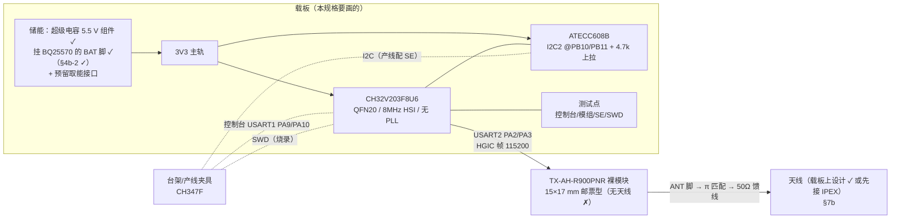
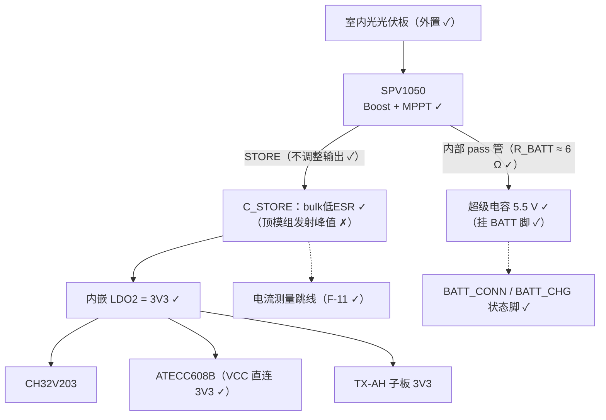
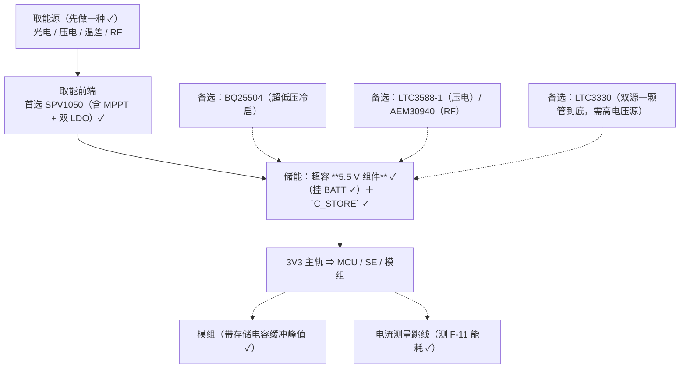

# ORPAH 客户端载板规格（d 步 · 草案 v0.3）

> **状态：草案，未上机** ✗ —— 本文是"要画的那块板"的规格，**不是**已完成的硬件。
> 所有引脚/参数都标了出处；**没有出处的一律写「待核」** ✗，不许按"大概应该"填。
> 2026-10-12 用户拍板的前提：**① 只做 d 步**（载板 + 现有 TX-AH 板）✓；
> **② 电源先电池、预留取能接口** ✓；**③ 模组用现有 TX-AH 板当子板**（排针/杜邦）✓；
> **④ demo 产品：板载尺寸先不定死，优先方便开发和调试** ✓；
> **⑤ 储能 = 超级电容** ✓（~~+ 锂电池 400909~~ ⇒ **2026-10-13 改为不装锂电** ✗，见 ⑩）；
> **⑥ 取能/电源用用户手头已有的芯片** ✓（清单见 §4b）。
>
> v0.2 变更 ✓：新增 §4b（手头芯片 → 取能链路的角色与推荐）、§4c（demo 优先的调试友好设计）；
> U1 封装与 SWD 引脚换成**有出处**的（本仓兄弟库 `fritzing-parts-langhua` 的部件 ✓）。
>
> v0.3 变更 ✓（2026-10-12 当天第二批用户输入）：
> **⑦ 取能想做混合型**（光电 + 压电 + 温差 + 射频/RF）✓，但**可以先只做一种** ✓（RF = 射频能量收集 ✓）；
> **⑧ 储能 = 超级电容约 0.5 F ＋ 锂电 400909（4 mm 厚 / 9×9 mm）** ✓；另外在考虑**核电池** ✓；
> **⑨ 模组是裸模块（邮票型）** ✓ —— `svg.icon.TX-AH-R900PNR_rev_1_icon.svg` = **15×17 mm 精确尺寸** ✓，
> **没有天线** ✗ ⇒ **天线要我们在载板上设计** ✗（见 §7b）。
> ⚠ ⑨ 与前一批拍板的「③ 模组用现有 TX-AH 板当子板」**冲突** ✗ ⇒ 两者取一（见 §8 的问句 ✓）。
>
> v0.4 变更 ✓（**2026-10-13 当天第二批**，用户定）：
> **⑩ 储能只留超级电容：锂电 400909 不装** ✗（太占地方 ✗）；
> **⑪ 超容选「5.5 V 组件」（= 两串 2.7 V ✓）、挂 `BATT` 脚** ✓ ——
> 依据（手册原文＋图 3 ✓）与两条后果（pass 管 ≈6 Ω ⇒ 峰值靠 `C_STORE` ✓；无电池不影响内嵌 LDO ✓）
> 见 §4b 第 5 条 ＋ `carrier-power-spv1050.md` **§2.6** ✓。

## 0. 一句话

把台架上那堆线（`nanoCH32V203` + `CH347F` + `ATECC608B` 测试座 + `TX-AH` 板）**固化到一块载板**上 ✓。
载板上只放 **MCU + 安全元件 + 电源 + 测试点**；模组仍插**现有 TX-AH 板** ✓。

下左是**现在**的台架（要被这块板取代的那堆线 ✓），右上是 d 步目标框图：

> 这台架已**真机跑通** ✓（ES256 + HS256 两条腿、模组侧 `[mbus rx]` 收到整帧）——
> 载板的验收判据就是"把它上面验过的每一条**再验一遍**"（§8）✓。

## 1. 范围

| 做 ✓ | 不做 ✗（本版载板不碰） |
|---|---|
| MCU 最小系统（8 MHz HSI、SWD、心跳灯；**F8U6 没有 NRST/BOOT0 引脚** ⇒ 复位靠断电，见 §3） | 取能前端**定型参数**（等 SPEC F-11 实测） |
| ATECC608B + I2C 上拉 + 去耦 | 外壳 / 佩戴结构 |
| 模组接口（UART-MACBUS 4 线 + 电源）＋ **天线预留**（§7b） | 载板尺寸/形态（demo 不锁死 ✓） |
| 储能（**超容 5.5 V 组件** ✓，锂电不装 ✗）＋ 取能/充电/升压（§4b） | 空口侧可观测读数（`xport` 未通 ✗） |
| 测试点与产线夹具接口 | 路由器侧（属 `orpah-openwrt-demo`） |

## 2. 器件表（出处 = `firmware/Core/board.h`，2026-09-21 上机实测 ✓；U1 的封装/脚名另按《CH32V203 数据手册》✓）

| 位号 | 器件 | 关键参数 | 出处 / 备注 |
|---|---|---|---|
| U1 | **CH32V203F8U6**（QingKe V2 / RISC-V；用户 2026-10-12 定 ✓） | **QFN20 / 3×3 mm / 0.4 mm 脚距**（体积最小 ✗ 是选它的一号理由 ✓）；64K flash / 20K SRAM / 17 GPIO；**2×USART ＋ 只有 I2C2**（I2C1 在这个封装上没引出引脚 ✗）；8 MHz HSI、无 PLL；115200 误差 ~0.6% | 时钟/串口 = `board.h`（台架实测 ✓）；封装与脚名 = 《CH32V203 数据手册》表 3-1-1 / 表 5-1 ＋ 本库 **`fritzing-parts-langhua/svg/CH32V203F8U6/`**（四视图 ＋ `part.CH32V203F8U6.fzp` ✓，2026-10-12 入库 ✓） |
| U2 | **ATECC608B** | SOIC-8：pin4=GND、pin5=SDA、pin6=SCL、pin8=VCC；VCC 2.0–5.5 V、IO 1.8–5.5 V | `board.h` 注释（摘要手册 §2.1）✓ ⇒ **3.3 V 直连** ✓ |
| R1/R2 | I2C 上拉 **4.7 kΩ ×2 → 3V3** | ATECC 的 I2C **必须有上拉** | `board.h` ✓ |
| D1 | 心跳灯（低电平点亮） | 台架板上是 `3V3 → 10K → BLUE LED → PA15` | `board.h` + 出厂 demo 反汇编两证一致 ✓ |
| J1 | 模组接口 | 4 线：`PA2→A10(RX)`、`PA3←A11(TX)`、3V3、GND | `docs/txah-uart-macbus.md` ✓ |
| J3 | SWD 烧录口 | **`PA13`=SWDIO、`PA14`=SWCLK**；★ **没有 `NRST` / `BOOT0` 引脚** ✗（BOOT0 在 F8U6 内部接 GND） | 出处 = 《CH32V203 数据手册》表 3-1-1 ＋ 本库 `svg/CH32V203F8U6/part.CH32V203F8U6.fzp` ✓ |
| — | 模组（**裸模块** ✗） | **TX-AH-R900PNR 邮票型 15×17 mm** ✓；左右两列焊盘、**1.2 mm 间距** ✓；**不带天线** ✗ | 出处 = 用户给的 `fritzing-parts-langhua/svg/TX-AH-R900PNR_rev_1/svg.icon.TX-AH-R900PNR_rev_1_icon.svg`（`width="15mm" height="17mm"` ✓，四边带小弧 = 邮票孔 ✓）＋ 同部件 pcb svg（焊盘 x=±8.0、行距 1.2 mm ✓） |
| Y1 | **天线**（模块不带 ✗） | sub-GHz（业务信道 908/916 MHz ✓）；方案见 §7b | 需泰芯**硬件设计指南** ✗ |
| J2 | 台架/产线排针 | 控制台 + I2C + SWD + 3V3/GND | 本规格新提 ✗（台架上是 CH347F 的 `P2`/`P3` ✓） |
| BT1 | **超级电容（5.5 V 组件）** ✓ —— **不装锂电** ✗ | **电压 = 5.5 V** ✓（= 两串 2.7 V ✓）；容量目标 0.5 F ✓（**型号待选** ✗）；**挂前端 `BAT` 脚** ✓（BQ25570 手册原文与图 3 ✓，见 **§4b-2** ✓）—— 储能到 `VSTOR` 走**内部 PMOS**（`RDS(ON)-BAT` **0.95 Ω** ✓）⇒ ★ **但峰值仍要靠电容顶** ✗（buck 只有 93～110 mA ✓，见 §4b-2 ✓） | 用户 **2026-10-13 定** ✓（锂电不装 ⇒ 省地方 ✓）；选型判据 = `carrier-power-spv1050.md` **§2.6** ✓ ＋ 窗口按 §4b-2 重算 ✓ |
| — | 取能/充电/升压 | 用户手头 8 颗芯片 —— **有厂商出处的选型表见 §4b** ✓；**已定：室内光/光伏 ＋ `BQ25570`** ✓（2026-10-13 拍板 ✓，落地方案见 **§4b-2** ✓、对照见 §4b-1 ✓；`carrier-power-spv1050.md` = **备用/对照** ✓） | 厂商产品页/手册 ✓ |
| — | （候选）**核电池** | 若可用 ⇒ 可去掉取能 ✓（见 §4d） | 用户 2026-10-12 提 ✓ |

★ 储能粗算 ✓（**只是量级判断，不是实测** ✗）：**5.5 V 组件、0.5 F** —— ★ 窗口按 **BQ25570** 取
（**上限 = `VBAT_OV` 5.0 V** ✓、**可用下限 ≈3.5 V**（3V3 轨压差 ✗，**不是** 1.95 V ✗），见 §4b-2 ✓）
⇒ `½C(V1²−V2²)` ≈ **3.2 J** ✓（⚠ 旧版按 2.2～5.3 V 算的 **5.8 J** 已作废 ✗）；
若 60 s 上报一次且能完全回充 ⇒ 平均可用 ≈ **53 mW** ✓。
★ **没有锂电之后**：能量全由超容出 ✓ ⇒ **容量必须按 F-11 量到的“每报能耗 × 要覆盖的暗期时长”倒推** ✗
（`energy.coverage()` 就是干这个的 ✓）；所以现在 0.5 F **只是目标、不是结论** ✗。

⚠ **待核** ✗（没有出处、画板前必须查）：模组供电电流与去耦推荐／ATECC608B 的 0.1 µF
去耦推荐值／**超容的具体型号（`Ri`/自放电/是否内置均衡）** ✓／**`C_STORE` 的容量**（要按发射峰值定 ✗）／
**裸模块的引脚号与天线脚位置** ✓。

★ **画原理图前的「连接表」= `carrier-connections.md`** ✓（网络清单 ＋ 逐器件接法 ＋ 5 条硬规矩 ✓）；
画完**必须**用 `tools/fzz_nets.py` 逐网核对 ✓（与台架那 5 张图同一口径 ✓）。

## 3. 引脚分配（改板改这里 ＋ `board.h`）

★ **口径分两半，别混** ✗：**`USART1` / `USART2` / `SWD` / 心跳灯**四行 = 台架上**已实测** ✓（= `board.h` 现值 ✓）；
**`I2C2 @PB10/PB11`** 那一行 = 脚位照《CH32V203 数据手册》表 ✓（**F8U6 这个封装上 I2C1 没引出引脚** ✗
⇒ 载板只能用 I2C2 ✓）；**固件已支持**编译期切换 ✓（2026-10-13：`Core/board.h` 的 `SE_I2C_USE_2`，
`make SE_I2C=1` 出载板档 ✓ —— 两档都要求**零 warning** ✓，闸门里**两档都编** ✓），
但**载板档仍未上机** ✗（台架跑的是缺省档 = I2C1 @PB6/PB7 ✓ 已上机；上载板后 `make SE_I2C=1` 烧录，
再重跑 `--bench` ✓）。

| MCU 脚 | 功能 | 对接 | 备注 |
|---|---|---|---|
| PA9 / PA10 | 控制台 `USART1` TX/RX | 台架 = CH347F `P2/UART0`（COM23）✓ | 115200 ✓ |
| PA2 / PA3 | 模组数据口 `USART2` TX/RX | 裸模块的 UART0：`A10`(模块 RX) / `A11`(模块 TX) ✓ **交叉** | HGIC 帧、115200 8N1 ✓；★`A10/A11` 是**台架 EVB 的丝印名** ✓，裸模块上对应哪两个焊盘**待按泰芯资料核** ✗ |
| PB10 / PB11 | `I2C2` SCL / SDA | ATECC608B pin6 / pin5 ✓ | 开漏 + 4.7k 上拉 ✓；100 kHz ✓；固件 `make SE_I2C=1` ✓；★ **未上机** ✗（见本节开头） |
| ★ **心跳灯（载板要换脚 ✗）** | 心跳灯，**低电平点亮** ✓ | 载板 D1（**建议 `PB0`** ✓） | ★ 台架是 `PA15` ✓，但 **F8U6 这个封装上 `PA15` 根本没引出** ✗（2026-10-13 从本库部件 `part.CH32V203F8U6.fzp` 的 **21 只脚**读出来的 ✓ ⇒ 载板必须换脚 ＋ **固件要加"板档"开关** ✗） |
| PA13 / PA14 | **SWDIO / SWCLK** ✓ | SWD 烧录口 J3 | 出处 = 《CH32V203 数据手册》表 3-1-1 ＋ 本库 `CH32V203F8U6` 部件脚名 ✓ |
| （裸露焊盘）**pin 0 = `VSS`** | 芯片肚子底下的散热/地焊盘 | 载板 GND 铜皮 | 原厂口径就叫 **`VSS`** ✓（不叫 EPAD ✗）；Fritzing 部件里它**独立成网** ✓ ⇒ 画板时要**特意接到 GND** ✓ |

★ **两条上机踩过的规**（换板子同样适用）✗：① 链接基址必须 **`0x00000000`** ✓（`0x08000000` 的镜像
一条指令都不执行 ✗）；② **下载完必须复位一次** ✓（不复位＝"刷完什么也没有" ✗）——
台架板上有 `RST` 按键 ✓，而 **载板上没有这条引脚** ✗（F8U6 无 NRST）⇒ 载板上的复位 = **断电重上电** ✓。
中断属性必须走 `-DWCH_INTERRUPT_FAST` + MounRiver 工具链 ✓（见 `firmware/README.md` ✓）。

## 4. 电源树（第一版：取能 + 超容，**不装电池** ✗）

★ 口径（沿用协议 §3 / SPEC）：无 RTC ⇒ `ts=0` ✓，服务端用接收时刻 ✓；
"没电了"与"异常失联"是**两类**，固件侧不许混成一个行为 ✗。
储能 = **超级电容（5.5 V 组件 ✓，挂 `BATT` ✓）** ✓（用户 2026-10-13 定 ✓；锂电不装 ✗）；
取能参数（`harvest_mw` / `charge_mj` / `cost_mj`）还是**演示标定值** ✗ ⇒ 靠 §4c 的电流测量跳线去测（SPEC F-11）✓。

## 4b. 取能链路：手头芯片的角色（**8 颗都有厂商出处** ✓，2026-10-13 补齐）

用户手头 8 颗 ✓ —— 按"它在链路里干什么"分三组 ✗。**取能源已定 = 室内光/光伏** ✓
（用户 2026-10-13 ✓）⇒ 前端 **`SPV1050`** 的电路要点见 **`carrier-power-spv1050.md`** ✓
（**公式与出处已补齐 ✓**：手册《DS10044 Rev 7》的 Eq 1～7 ＋ 算例都在那份文件里 ✓；
只剩“随选型走”的 `V_OC(MAX)`／MPPT 比重与 `V_EOC`／`V_UVP` 待定 ✗）。

| 芯片 | 关键参数（**厂商资料** ✓） | 适合的取能源 | 出处 |
|---|---|---|---|
| **SPV1050** | 取能+充电+MPPT 一体；Boost 模式**冷启 550 mV / 30 µA**，起后输入 150 mV～VEOC；Buck-boost 模式冷启 2.6 V；输出 **≤ 70 mA**；VEOC 2.6～5.3 V / VUVP 2.2～3.6 V；**自置 1.8 V 与 3.3 V 两个 LDO** ✓ | PV（含室内光）/ TEG（温差） | ST 产品页 ✓ |
| **SPV1040** | 输入 **0.3～5.5 V**；内置 MPPT；效率 ≤ 95%；TSSOP8 3×4.4 mm | 光伏 | ST 产品页 ✓ |
| **BQ25504** | 输入 **0.6～3 V**（abs 5.5 V）；boost；支持 **Li-Ion/LiPo + SuperCap**；充电电流 ≤ 100 mA；充电电压 2.5～5.25 V；**Solar/MPPT** ✓。★ **它的孪生兄弟 `BQ25570` 多了内嵌 buck** ✓ ⇒ 同口径对照见 **§4b-1** ✓ | 超低压光伏 / 微小温差 | TI 产品页 ✓（＋ BQ25570 手册 Rev G ✓） |
| **TPS61200** | 输入 **0.3～5.5 V**；输出 1.8～5.5 V；开关限流 1.35 A；**Iq 50 µA**；VSON 3×3 mm | 后级升压（超容/单节电池 → 3V3） | TI 产品页 ✓ |
| **LTC3330** | 双输入：**取能输入 3.0～19 V**（buck）／**主电池 1.8～5.5 V**（buck-boost）；无负载 Iq **750 nA**；取能可用时电池 Iq 为 0；输出 ≤ 50 mA；**内置超容均衡器 + 全波桥** ✓ | 压电/高电压源 + 电池**双源** | ADI 产品页 ✓ |
| **LTC3588-1** | 输入 **2.7～20 V**；Iq 950 nA（UVLO 450 nA）；内置全波桥；输出 ≤ 100 mA；可选 1.8/2.5/3.3/3.6 V ✓ | 压电（振动） | ADI 产品页 ✓ |
| **AEM30940** | 输入 **50 mV～4.5 V**，≤ 110 mA；**RF 输入 −18.5 dBm～+10 dBm**；**冷启 3 µW / 380 mV**；两路 LDO（1.2/1.8 V ≤ 20 mA；1.8～4.1 V ≤ 80 mA）；**双芯超容均衡**；QFN28 5×5 mm ✓ | **RF**（含微弱 RF）/ 多种直流源 | e-peas 产品页 ✓ |
| **PCC110** | **RF→DC 转换器**（配 **PCC210** boost：低至 **0.4 V 输入**、**5.5 V @ 50 mA** 输出、效率 ≤ 95%、SOT23-6 ✓）；PCC110 本颗：效率 ≤ 75%、RF **−17 ～ +20 dBm**、频率 **10 MHz ～ 6 GHz**、支持各种调制、SC-70 ✓ | **RF 取能**（配 Powercast 发射器 / RFID 读头 / Wi-Fi 路由 / NFC ✓） | Powercast **PCC110/PCC210 数据手册**（PCCX10 – 2018/04 ✓，用户 2026-10-13 提供 ✓） |

**三条候选链路**（demo 先走能跑起来的，其余留焊盘/排针 ✓）：

**第一版建议** ✓（demo 优先、能先跑起来）：

1. **取能前端 = 首选 `SPV1050`** ✓ —— 一颗就含 MPPT + 充电 + **1.8/3.3 V LDO** ✓，而且 Boost 模式**冷启 550 mV** ✓
   （室内光/温差都够得着 ✓），输出 70 mA ✓；其余 7 颗全**留焊盘/排针**（可后换 ✓）。
   ★ **已定（用户 2026-10-13）：取能源 = 室内光/光伏** ✓ ⇒ 画板要点见 `carrier-power-spv1050.md` ✓。
   ★ **PCC110/PCC210 是 RF 那一条腿** ✗（不是光伏 ✗）⇒ 与 `AEM30940` 同组，留到以后 ✓。
2. **后级 `TPS61200`** ✓ 也留位 —— 它从 **`STORE`**（不直接从超容 ✗）升到 3V3，把 STORE 掉到
   3.3 V 以下的电量也用上 ✓；⚠ 但 STORE 的电此时要经 **pass 管（≈6 Ω ✓）** 从超容来 ✓
   ⇒ **只够轻载** ✗（模组发射峰值必须靠 `C_STORE` ✓，见下面第 5 条）。
3. ⚠ **`LTC3330` 不适合低压光电** ✗ —— 它的取能输入是 **3.0～19 V** ✓ ⇒ 留给**压电/高电压源**，
   或将来做"高压源 + 电池双源"时再上 ✓（它的 750 nA Iq 与内置超容均衡很香 ✓）。
4. **RF** 想单独做一条腿 ⇒ `AEM30940` ✓（−18.5 dBm 起、冷启 3 µW ✓，但 RF 收集的能量量级最小 ✗
   ⇒ 只当"微补充"，不能当唯一源 ✓）。5. ★ **储能接法（2026-10-13 定 ✓）**：**超容挂 `BATT` 脚** ✓（手册原文 “battery **or super-cap**
   connected to **BATT pin**” ＋ 图 3 的 “Battery (Super-Cap)” ✓）、`STORE` 上只留 **`C_STORE`** ✓。
   理由 ✗：超容要给 STORE 补电，得经 **pass 管（`R_BATT` ≈ 6 Ω** ✓，p7）☞ `V_STORE = V_BATT − R_BATT·I_LOAD`
   （p23 原文 ✓）⇒ **峰值电流走这条路会把 STORE 拉垮** ✗，所以峰值靠 `C_STORE` 顶 ✓。
   ★ **不装电池不影响内嵌 LDO** ✓：冷启时 pass 管本来就是断的（“load disconnect … prior the first
   start-up” ✓，p1），`V_STORE` 升到 `V_EOC` 后自动闭合 ✓（引脚说明 p4 ✓）⇒ `LDO1/LDO2` 照常可用 ✓。
   ⚠ **UVP 重激活滞回照旧要留** ✓（手册对 battery **or super-cap** 都要求 ✓，p12 ✓）。
   选型判据（电压档 / 可用能量算式 / `Ri` / 自放电 / 均衡）⇒ `carrier-power-spv1050.md` **§2.6** ✓。
★ **两条必须先量、不然无法定型** ✗：① 取能前端的**可用输出功率**（要能托住模组的发射峰值）；
② **上报一轮的总能耗**（已建模但不是实测 ✗）。⇒ 所以 §4c 把"测电流"做成板上标配 ✓；
**怎么量、量到哪、判据是什么** ⇒ 见 **`carrier-f11-measure-plan.md`** ✓（含"量什么 = `energy_calib` 哪个字段"的一一对应表 ✓）。

### 4b-1 **`SPV1050` vs `BQ25570`（同口径对照，2026-10-13）**

起因（用户 2026-10-13 问 ✓）：为什么选 SPV1050 而不选 BQ25570？⇒ 按**同一套判据**摆数据 ✓，
两边证书都拿到了：SPV1050 = `DS10044 Rev 7` ✓；**BQ25570 = TI 中文版 Rev G（2019-03，46 页）** ✓。

| 判据（同一套 ✓） | **SPV1050** ✓ | **BQ25570** ✓ |
|---|---|---|
| 输入（运行） | 起后 **150 mV ～ VEOC**（boost ✓，p1/p8）；buck-boost 档可到 18 V ✓ | **100 mV ～ 5.1 V** ✓（推荐工作条件 ✓） |
| **冷启** | **550 mV / 30 µA** ✓（≈ **16.5 µW**，算术 ✓）= **略低** ✓ | **600 mV 典型 / 700 mV 最大** ✓（Rev F 从 330/450 提上来的 ✗）；冷启把 VSTOR 充到 **1.8 V** ✓ |
| 最大输入功率 | ✗ 本次未取到该口径 ✗ | **510 mW** ✓（绝对最大 ✓） |
| 静态电流 | ✗ 本次未取（手册有 shutdown/standby 行 ✓） | **488 nA 典型** ✓；ship mode 电池电流 **<5 nA** ✓ |
| MPPT | `R1/R2/R3` 电阻编程 ✓（Eq 4～7 ＋ 官方算例 ✓） | `VOC_SAMP` 接 VSTOR = **80%** ✓；接 GND = **50%** ✓；电阻分压可自定义 ✓ ⇒ **更灵活** ✓ |
| 储能上限 | `V_EOC` ≤ **5.3 V** ✓（外部电阻可编程 ✓） | `VBAT_OV` 外部电阻可编程 ✓（**须 > VIN_DC** ✓；例 5.0 V ✓；充电电压范围 2.2～5.5 V ✓） |
| ★ **储能下限（决定可用能量 ✗）** | `V_UVP` **2.2～3.6 V 可编程** ✓ ⇒ 窗口 **2.2→5.3 V** = `11.6·C` ✓ | **`VBAT_UV` 内部固定 1.95 V 典型** ✓（1.91/2.0 ✓）⇒ 窗口 **1.95→5.25 V** = `11.9·C` ✓ ⇒ **略优** ✓ |
| 负载/储能接法 | 负载→`STORE`、储能→`BATT`（经 pass 管 `R_BATT` ≈ 6 Ω ✓，p7 ✓） | **负载→`VSTOR`、储能→`VBAT`** ✓（原文 ✓，经内部 **PMOS** ✓） |
| ★ **稳压轨** | **两路 LDO**（1.8/3.3 ✓、带使能脚 ✓）＝**线性** ✗ ⇒ 从 5.3 V 出 3.3 V 效率 ≈ **62%** ✗ | **内嵌 buck，标称效率 93%** ✓（Rev 把 98% 改正成 93% ✓；⚠ 曲线与电气特性都以 `VOUT = 1.8 V` 为条件 ✓ ⇒ **3.3 V 档要按曲线外推、待上机量** ✗） |
| ★★ **储能支路阻抗**（决定“储能能不能顶峰值”✗） | `R_BATT` ≈ **6 Ω** ✓（pass 管 ✓，p7）⇒ 200 mA 峰值要掉 **1.2 V** ✗ | **`RDS(ON)-BAT` = 0.95 Ω** ✓（原文“ON resistance of switch between VBAT and VSTOR” ✓，条件 `VBAT = 4.2 V` ✓）⇒ 同样 200 mA 只掉 **0.19 V** ✓ ⇒ **BQ25570 大胜** ✓ |
| 峰值输出 | **≤ 70 mA** ✓ | buck `IOUT` = **93～110 mA** ✓（条件 `VSTOR = 3.3 V` ✓） |
| 外围值 | 图 4/12：**L 值手册未给** ✗；`C_IN` 4.7 µF ✓、`C_REF` 10 nF ✓、LDO 各 100 nF ✓ | 手册电气特性的**标准条件给全** ✓：`CIN` **4.7 µF** ✓、**`L1` = 22 µH（boost）** ✓、**`CSTOR` = 4.7 µF** ✓、**`L2` = 10 µH（buck）** ✓、`COUT` = **22 µF** ✓（引脚说明给的最低位：buck L ≥ 4.7 µH ✓、`VOUT` ≥ 22 µF ✓、`VREF_SAMP` 0.01 µF 低漏 ✓） |
| 封装 | VFQFPN20 **3×3** ✓ | VQFN20 **3.5×3.5** ✓ |
| 资料 | 手册在手 ✓（公式 ＋ 官方算例 ✓） | **手册在手** ✓（46 页，含 20 页应用章节 ＋ EVM 用户指南 ✓） |
| 手头有没有 | **有** ✓ | 没有 ✗（**≈$3.74/1ku** ✓；EVM $108.90 ✓） |

★ **结论（数据说话 —— 包括“改口” ✓）**：
1. **可用能量窗口几乎一样** ✓（`11.6·C` vs `11.9·C`）—— 我先前以为“SPV1050 窗口更大” ✗
   **不成立**（BQ25570 的固定 1.95 V 下限反而更低 ✓）。
2. **两条待核已收窄 ✗⇒✓**（同日晚补取手册）：
   · **buck 标称效率 93%** ✓（Rev 从 98% 改正 ✓；⚠ 曲线/电特性都按 `VOUT = 1.8 V` ✓
     ⇒ **3.3 V 档暂无手册数，待上机量** ✗）；
   · **`RDS(ON)-BAT` = 0.95 Ω** ✓（“switch between VBAT 和 VSTOR” ✓，`VBAT = 4.2 V` ✓）
     —— 而 SPV1050 的 `R_BATT` ≈ **6 Ω** ✗ ⇒ 同样 200 mA 峰值：**0.19 V v.s. 1.2 V** ✗。
3. ⇒ ★ **改口（数据变了结论就变 ✓，不为了面子守旧 ✗）**：
   **BQ25570 在三条硬指标上都更好** —— ★ **稳压轨**（buck 93% v.s. 线性 LDO 62% ✗）、
   ★★ **储能支路阻抗**（0.95 Ω v.s. 6 Ω ✗）、**窗口下限**（1.95 V v.s. 2.2 V ✗）；
   而 **SPV1050 只在冷启略优** ✓（550 mV/30 µA v.s. 600/700 mV ✓）＋ 手头就有 ✓。
   ⇒ **建议：第一版直接用 `BQ25570`** ✓（价 ≈ **$3.74** ✓、有 EVM ✓、外围值手册全给 ✓）；
   **SPV1050 仍留位/备用** ✓（手头有 ✓，可当对照 ✓）。
   ✗ **这一条要用户拍板**（要花钱买件、且 SPV1050 的公式工作要换成它那套：`ROUT`/`ROV`/`ROK`/`ROC` ✓）✓。
4. ★★ **但“可用能量窗口”这件事要按我们的负载重算** ✗ —— 我们负载要的是 **3.3 V** ✗，
   而**输出轨的压差**会把下限抬起来（不是手册上那个 UV 阈值 ✗）：
   · BQ25570 的压差 = **最大输出电流 × buck 高边导通电阻** ✓（手册原文 ✓；`RDS(ON)_BUCK` 高边
     **1.60 / 2.00 Ω** ✓）⇒ 100 mA 时 **0.16～0.20 V**、200 mA 时 **0.32～0.40 V** ✓
     ⇒ `VSTOR` 要 ≥ **≈3.5～3.7 V** 才供得出稳定的 3.3 V ✗；
   · SPV1050 侧同理（LDO 压差我们**没取到具体值** ✗ ⇒ 先按同量级 ≈0.2 V 处理 ✓、上机量 ✓）；
   · ⇒ 两颗的**真正可用窗口（对我们）≈ 3.5→5.3 V** ✓ ⇒ ★ **§2.6 里那个 2.2–5.3 V = 5812 mJ
     要按 3.5～3.7 V 下限重算**（`½·0.5·(5.3²−3.7²)` ≈ **3.6 J**、按 3.5 V 则 ≈ **4.0 J** ✗）
     —— 容量选型**必须用这个下限** ✓（不能拿 1.95 / 2.2 V 去算 ✗）；
   · ⇒ 于是“窗口 1.95 V v.s. 2.2 V”这条差异**对 3.3 V 负载不成立** ✗ ⇒ 改口的三条里**只剩两条**
     （buck 效率 ✓ + 储能支路阻抗 ✓）—— 但那是两条**实打实**的 ✗。
5. ⚠ **改完仍要看的一条** ✗：两边都要**上机量** —— buck 的 3.3 V 档效率/最大电流（按曲线外推 ✗）、
   两颗在 3.3 V 输出下的**真实压差**、以及模组发射峰值下的 `VSTOR`/3V3 压降（→ F-11 ✓）。

### §4b-2 前端落地方案：BQ25570（**已定** ✓）+「100 mA 够 HaLow 用吗」

★ 决定（用户 2026-10-13 ✓）：**第一版前端 = `BQ25570`** ✓；手头的现成模块 = **CJMCU-2557** ✓
（板上两颗电感丝印 `220` / `100` ⇒ 正好对应手册推荐的 `L1 = 22 µH`(boost) / `L2 = 10 µH`(buck) ✓）。
§4 那张电源树 mermaid 仍按 **SPV1050** 画（= 现在的**备用/对照**路线 ✓），第一版按本节走 ✓。

**（1）四条设置公式**（手册 **Eq 2/3/4/5** ✓ —— 公式在 PDF 里是**图片** ✗，
这里是把那一页那一段**渲染出来逐字核**的 ✓；`VBIAS = 1.21 V` ✓，各分压电阻之和建议 **13 MΩ** ✓）：

| 项 | 公式（手册原式 ✓） | 手册算例自检 ✓ | 我们的目标 | 我们的电阻（1% 档 ✓） |
|---|---|---|---|---|
| 稳压输出 | `VOUT = VBIAS·(1 + ROUT2/ROUT1)`（Eq 5） | 8.74 / 4.26 MΩ ⇒ **1.80 V** ✓ | **3.3 V** ✓ | `ROUT1` **4.75** MΩ / `ROUT2` **8.25** MΩ ⇒ 算式复核 **3.31 V** ✓ |
| 过压（充满） | `VBAT_OV = 1.5·VBIAS·(1 + ROV2/ROV1)`（Eq 2，★ 注意 **3/2 因子** ✗） | 5.62 / 7.32 ⇒ **4.18 V** ✓ | **5.0 V**（5.5 V 超容留余量 ✓） | `ROV1` **4.75** MΩ / `ROV2` **8.25** MΩ ⇒ 复核 **4.97 V** ✓ |
| 储能可用（降） | `VBAT_OK_PROG = VBIAS·(1 + ROK2/ROK1)`（Eq 3） | 5.62 / 5.479 ⇒ **2.39 V** ✓ | **3.5 V**（3V3 轨要靠 `VSTOR` 顶 ✗） | `ROK1` **4.12** / `ROK2` **7.87** / `ROK3` **1.02** MΩ |
| 储能可用（升） | `VBAT_OK_HYST = VBIAS·(1 + (ROK2+ROK3)/ROK1)`（Eq 4） | ⇒ **2.80 V** ✓ | **3.8 V** ✓ | 同上（算式复核 **3.52 / 3.82 V** ✓） |

- MPPT：太阳电池的 MPP 是 `V_OC` 的 70～80% ✓ ⇒ **`VOC_SAMP` 直接接 `VSTOR`**（= 80% ✓）；
  要别的比例才用 `ROC1`/`ROC2` ✓ —— 我们**不需要** ✓。
- ⚠ `VBAT_UV` **内部固定 1.95 V** ✓ ⇒ 对**超容正好** ✓、**对锂电太深** ✗
  ⇒ 这又是"不装锂电"的一条好处 ✓。
- ⚠ 负载接 **`VSTOR`**、储能接 **`BAT`** ✓；储能到 STORE 经**内部 PMOS** ✓
  （`RDS(ON)-BAT = 0.95 Ω` ✓）⇒ `V_STORE = V_BAT − 0.95 Ω·I_LOAD` ✓（比 SPV1050 的 6 Ω 好 6 倍 ✓）。

**（2）「100 mA 够 HaLow 用吗」—— 分开三段答**（✗ 不能只答一个"够/不够"）：

1. **峰值：不够，而且本来就该不够** ✗ —— 802.11ah 模块发射是**几百 mA 量级**的**短脉冲**。
   ⚠ 仓里**没有**我们这块模组的发射电流数 ✗（只有 `AT+TXPOWER` 上限 **20 dBm** ✓）⇒ **要实测** ✓。
   buck 的 **93(最小) / 110(典型) mA** ✓ 是**连续**能力 ⇒ 峰值必须靠**电容**顶 ✓（这是常规设计，不是缺陷 ✓）。
   算多大：`C = (I_pk − I_buck)·t_burst / ΔV`（`I_buck` 取 100 mA ✓；`ΔV` = 3.3 V 轨允许的跌落 ✗
   —— 模组的**最低供电电压**还没查 ✗）：

   | `I_pk` | 脉冲长 `t` | `ΔV = 0.3 V` 需要的 `C` |
   |---|---|---|
   | 200 mA | 3 ms | ≈ **1.0 mF** |
   | 300 mA | 3 ms | ≈ **2.0 mF** |
   | 300 mA | 5 ms | ≈ **3.3 mF** |
   | 400 mA | 5 ms | ≈ **5.0 mF** |

   ⇒ 结论（**先按最坏准备**）：3V3 轨要 **≥ 1000～4700 µF 低 ESR**（或轨上挂一颗小超容 ✓）✗
   —— 手册那个 `COUT = 22 µF` **不够** ✗（它是按"无大负载跳变"给的 ✓）。
2. **平均：100 mA 绰绰有余** ✓ —— 设计常态 = **每 60 s 连一次** ✓（SPEC §5.2 ✓）
   ⇒ 平均电流应当在 **mA 级甚至更低** ✓，100 mA **用不完** ✓。
   ⚠ 但反过来说：**若模组必须常驻关联/常收**（RX 典型几十 mA 量级 ✗），100 mA 只是**勉强** ✗，
   而且那个平均功耗**远超室内取能** ✗ ⇒ 所以**必须让模组睡**（占空比）✓ = 省电的主开关 ✓。
3. **真正的瓶颈不是 buck，是取能端** ✗ —— 室内光/光伏是 **µW～mW** 级 ✓
   （3.3 V × 几十 mA ≈ **上百 mW** ✗ ⇒ 差 2～3 个数量级 ✗）⇒ 问题永远是"**占空比能压多低**" ✓，
   而不是"buck 出不出得来 100 mA" ✓。

**（3）⇒ 要实测的三个数**（进 F-11 ✓，见 `carrier-f11-measure-plan.md` ✓）
① 发射**峰值电流与持续时间**（含 `AT+TXPOWER` 实际档位 ✓）；
② **关联/接收常驻电流**（能不能睡、睡下去多少 ✓）；
③ 一次 **唤醒 → 上报 → 收下行 → 回睡** 的**能量**（= `energy_calib` 的 `cost_es256` ✓）
⇒ 有③才能定**超容容量**与**一天能做几次** ✓。

**（4）CJMCU-2557 这块现成模块：四条要先核** ✗
- 它的 **`VOUT` 设成多少**（读 `ROUT1`/`ROUT2` 或上电实测 ✓）—— 我们要 **3.3 V** ✓；
- 它的 **`VBAT_OV` 设成多少**（模块多按锂电 4.2 V ✗）—— 我们要 **≤5.0 V** ✓ ⇒ 可能要换 `ROV1`/`ROV2` ✗；
- 板上**纽扣座是给 CR2032 的** ✗（**不可充** ✗）⇒ 要么装 `LIR2032` ✓，要么把 **5.5 V 超容用导线
  接到 `BAT` 焊盘** ✓（**5.5 V 超容塞不进**那个座 ✗）；
- 它的 `EN` / `VOUT_EN` / `VBAT_OK` 都引出来了 ✓ ⇒ 正好给 MCU 用：**`VBAT_OK` = "储能还行/快没电了"** ✓、
  `VOUT_EN` = 可控 3V3 开关 ✓（省电用得上 ✓）。

## 4c. demo 优先：方便开发和调试（用户 2026-10-12 定 ✓）

- **尺寸先不定死** ✓：按好焊/好探针优先，不必向小体积靠 ✓。
- **每一段电源可跳线/可断开** ✓：取能前端与储能做成**跳线/子板**（可换、可单测 ✓）。
- **电流测量跳线** ✓：主轨与模组支路各留一个（0.1" 排针 + 短接帽 ✓）⇒ 实测 F-11 用 ✓
  （怎么用、两种量法、判据 ⇒ 见 `carrier-f11-measure-plan.md` ✓）。
- **所有关键信号引到 0.1" 排针 + 测试环** ✓：控制台 / 模组 4 线 / I2C / SWD ✓（**没有** `NRST`/`BOOT0` ✗ —— F8U6 不带这两脚 ⇒ 复位只能断 3V3 ✓，可在 3V3 侧留一个跳线/开关便于手动复位 ✓）。
- **丝印标全**（脚名照原厂 ✓）：`PA9/PA10`、`PA2/PA3`、`PB10/PB11`、`PA13/PA14`、`3V3/GND` ✓。
- **电源指示灯**✓（3V3 亮）+ 储能电压测试点（判断"还在充还是已够" ✓）。

## 4d. 候选 D：核电池（若可用 ⇒ 可去掉取能前端 ✓）

用户 2026-10-12 提 ✓：**若能拿到核电池（β 伏打/同位素微电池）⇒ 直接保证终身可用** ✓。

★ 但我必须先把**工程边界**说清 ✗（这条直接决定板子怎么做）：

- 核电池的特点是**功率极低、寿命极长** ✓（典型是 µW 量级 ✗ —— 请拿厂商手册核具体型号的
  输出功率/电压/尺寸/合规 ✓）。⇒ **若平均功率只有 µW 级，就不能省掉储能** ✗：
  模组发射是**峰值功率**（远远高于 µW ✗），必须由**超容缓冲** ✓。
- ⇒ 正确说法是：**核电池替代的是"取能前端"，不替代"储能"** ✓（板子仍需 §4b 的储能部分 ✓）。
- 必须先核（没核之前不进 BOM ✗）：① 输出功率与电压 ✓；② 尺寸/重量（与超容、取能区抢地方 ✗）；
  ③ **合规与辐安规**（含运输/佩戴 ✓）；④ 供货与价格 ✓。

## 5. 测试点 / 烧录 / 产线

| 类别 | 内容 | 为什么需要 |
|---|---|---|
| TP | `PA9`/`PA10`、`PA2`/`PA3`、`PB10`/`PB11`、`3V3`、`GND`、超容正极（即 `BATT` 节点 ✓） | 台架上这五组线**天天要接** ✓（表里每条判据都要用） |
| 烧录 | **只有 SWD** ✓（WCH-Link / openocd / MounRiver 下载按钮）；⚠ 没有 `NRST`/`BOOT0` ✗ ⇒ **WCHISPTool 那条 ISP 路在载板上走不通** ✗（台架上仍可用 ✓），且每烧一次要**断电重上电** ✓ | 烧录由用户执行 ✓ |
| 产线 | **I2C 引出**（SCL/SDA/GND/3V3 排针） | 现有 `tools/se_provision.py` 的夹具是 CH347F 直驱 I2C ✓ ⇒ 载板必须能把 I2C 接出去 ✓ |
| 观测 | 心跳灯 + 控制台 | "烧进去了没有"的最小可视判据 ✓ |

## 6. 布局约束（每条都来自台架上踩过的坑 ✓）

- **模组子板下方禁止铺铜/走线** ✗（天线区）—— 子板方案下这条尤其重要 ✓。
- ATECC608B 紧靠 MCU、`PB10/PB11` 走线短且等长 ✓；上拉 4.7 kΩ 放在 **SE 一端** ✓。
- 储能（超容）与取能前端分区 ✓；**超容靠近 `BATT` 脚、`C_STORE` 靠近 `STORE` 脚** ✓（两条功率回路的环路都要短 ✓）；取能节点做**焊盘跳线**（先不装 ✓）。
- 心跳灯与"上电第一口呼吸"要在任何其它外设之前先开对应端口时钟 ✓（`board.h` 已有此约定 ✓）。
- **天线区净空** ✗（见 §7b）：天线占位下方/周边不铺铜、不放器件、不走线（具体尺寸要泰芯参考设计 ✗）。
- **模组焊盘 1.2 mm 间距** ✓ ⇒ 走线/阻焊留够（别为了省 0.1 mm 把丝印压到焊盘上 ✗）。

## 7. 验收判据（**"载板替代台架"的判据 = 台架上验过的每一条再验一遍**）

| # | 判据 | 台架 | 载板 |
|---|---|---|---|
| 1 | 上电 8 MHz、心跳灯 1 Hz 闪 | ✅ 已实测 | ✗ 待上机 |
| 2 | 控制台 `AT` → `OK`；`AT+SYSDBG=LMAC,1` 每秒一行 | ✅ 已实测 | ✗ 待上机 |
| 3 | `se`：唤醒 / `Random(0x1B)` / `Sign(slot 0)` 全过 | ✅ 已实测 | ✗ 待上机 |
| 4 | ES256 整帧被上游接受（`level=0` / `trust=high`） | ✅ 已实测 | ✗ 待上机 |
| 5 | HS256 降级整帧被接受（`level=1` / `trust=medium`） | ✅ 已实测 | ✗ 待上机 |
| 6 | 模组侧收到整帧（`[mbus rx] N = 帧长 + 8B HGIC 头`） | ✅ 已实测 | ✗ 待上机 |
| 7 | 一键闸门 `py -3.13 tools\run_checks.py --bench` 全过 | ✅ 本机 6/6 ✓ | ✗ 待上机 |
| 8 | 取能/储能参数（F-11） | ✗ 未做 | ✗ 未做（本版只预留） |

★ 判据 7 里有一条**只对某颗芯片成立**的坑 ✗：`check_c4g2_bench.py` 必须带 `--from-keystore`
（按 SN 从密钥库取公钥 ✓），否则换一颗 / 跑降级腿必然假红 ✗（`docs/atecc608b-se.md` §9.1 ✓）。

## 7b. 天线（模块不带 ✗ ⇒ 必须我们做）

★ **这是 v0.3 最大的新增风险** ✗：模组是邮票型、**没有天线** ✓（用户 2026-10-12 确认 ✓）。
sub-GHz（908/916 MHz ✓）的天线对**周围铜/外壳/人体**很敏感 ✗，而 demo 要"方便开发" ✓ ⇒ 建议两步：

| 方案 | 内容 | 什么时候用 |
|---|---|---|
| **A（demo 先走）** ✗ | 载板**不画天线** ✓：留 **IPEX/U.FL 座** ＋ **π 型匹配网络**（3 个 0402 位 ✓）⇒ 先接**外接天线** ✓ | 第一版（天线不好时可马上换 ✓，且能插矢网/网分测 ✓） |
| **B（定型时）** | 载板画 **PCB 天线**（弯折单极 / 倒 F ✓），天线区净空 ✓、50 Ω 馈线 ✓ | RF 要求清楚了再上 ✓ |

**开工前必须要的东西** ✗（否则做出来大概率不匹配 ✓）：

1. 泰芯的**硬件设计指南 / 天线应用笔记**（含推荐天线形式与尺寸、净空要求、参考匹配值 ✓）；
2. **模块 ANT 脚是哪两个焊盘** ✓（目前只知道 EVB 上的 `ANT` 丝印名 ✓）。

**验收判据**（没矢网时也能做 ✓）：① 同距离下**模组报告的 RSSI** 与 EVB 自带天线对比（不低于
EVB 几 dB ✗ 具体阈值等参考设计出来再定 ✓）；② 双向连通 + 数据帧通（`[mbus rx]` ✓）；
③ 有矢网时再加 S11/驻波 ✓（这条目前**没条件** ✗，如实标 ✓）。

## 8. 待定清单（画板前必须消掉 ✗）

1. ~~选型落定~~ ⇒ **已定 ✓（用户 2026-10-13）**：**取能源 = 室内光/光伏** ✓，前端 = **`SPV1050`** ✓
   （备选全套留焊盘 ✓）⇒ 画板要点见 `carrier-power-spv1050.md` ✓（其中四处公式/电阻「待核 datasheet」✗）。
2. ~~PCC110 的官方资料~~ ⇒ **已拿到 ✓**（用户 2026-10-13 给 `PCC110-PCC210数据手册.pdf` ✓）：
   它是 **RF→DC 取能**（配 PCC210 boost ✓，低至 0.4 V 输入 / 5.5 V@50 mA / SOT23-6 ✓），
   **不是光伏那条腿** ✗ ⇒ 归入 RF 组（与 `AEM30940` 同组 ✓）、留到以后 ✓。
3. **裸模块的两个关键信息** ✗：① 数据口的两个焊盘是哪两个（现只有 EVB 丝印名 `A10/A11` ✓）；
   ② **ANT 脚位置** ✓ ＋ 泰芯天线参考设计 ✗（§7b）。
   ★ **第一版先走子板** ✓（用户 2026-10-13 ✓）⇒ 这两条降到"**定型前再要**"✗（不阻塞开画 ✓）。
4. ~~400909 的容量/内阻~~ ⇒ **锂电不装** ✓（用户 2026-10-13 ✓）⇒ 只剩 **超容选型** ✗：
   **5.5 V 组件** 已定 ✓ ⇒ 待定的是 **容量**（← F-11 的“每报能耗 × 覆盖时长” ✓）、
   **型号的 `Ri`/自放电/是否内置均衡** ✗、**`C_STORE` 的容量**（← 发射峰值 ✗）。
5. ~~模组上板形式待确认~~ ⇒ **已定 ✓（用户 2026-10-12：一板两用 ✓）**：同一块载板上
   **既留 TX-AH EVB 子板接口、又画 15×17 mm 裸模块焊盘** ✓（两者不冲突 ✓）——
   ★ **2026-10-13 进一步定：第一版只走子板** ✓（裸模块焊盘**留在板上但不装** ✗）
   ⇒ **不必等泰芯天线资料就能开画** ✓；定型时再改焊裸模块 ＋ 天线（§7b）✓。
6. **载板尺寸与佩戴形态** —— demo 阶段不锁死 ✓（用户 2026-10-12 定 ✓）。

> 诚实边界：本规格**不含**取能定型、天线设计、外壳结构；也**不解决**空口侧读数（`xport` 未通 ✗）
> ⇒ 真机第一阶段能验的是「**上报能不能到服务器**」✓，**不是**定位 ✓。
