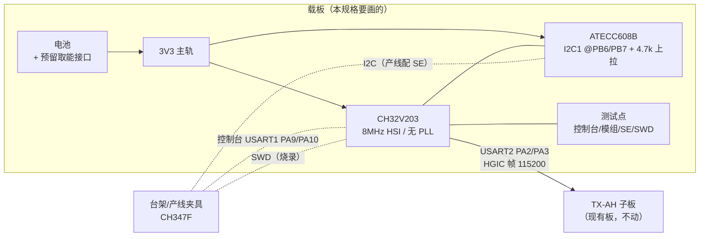
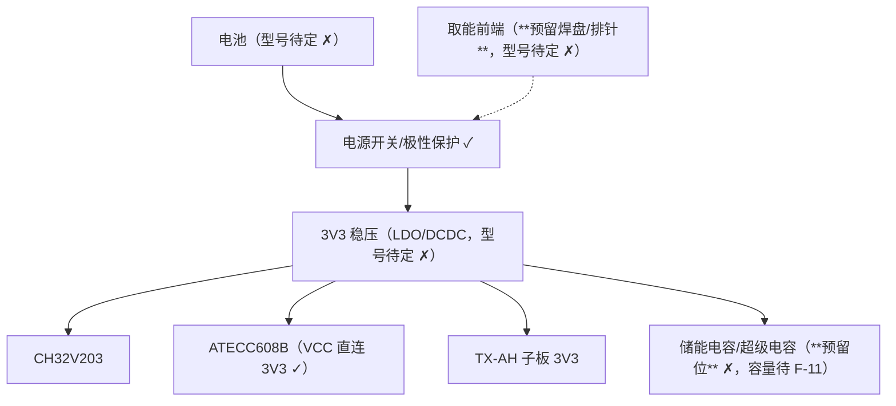
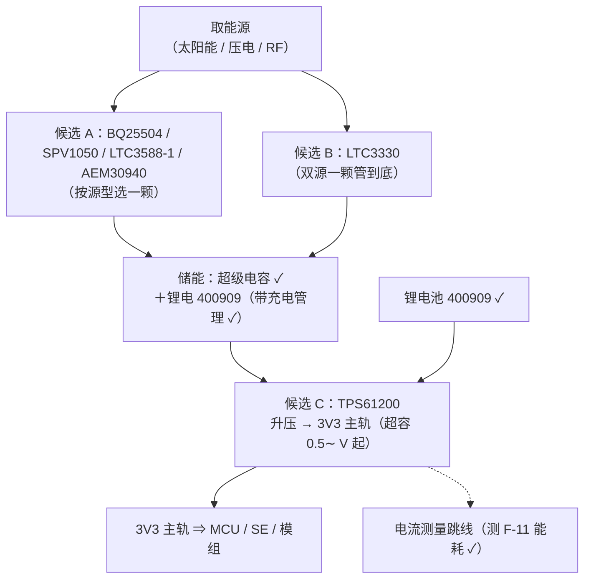

# ORPAH 客户端载板规格（d 步 · 草案 v0.2）

> **状态：草案，未上机** ✗ —— 本文是"要画的那块板"的规格，**不是**已完成的硬件。
> 所有引脚/参数都标了出处；**没有出处的一律写「待核」** ✗，不许按"大概应该"填。
> 2026-10-12 用户拍板的前提：**① 只做 d 步**（载板 + 现有 TX-AH 板）✓；
> **② 电源先电池、预留取能接口** ✓；**③ 模组用现有 TX-AH 板当子板**（排针/杜邦）✓；
> **④ demo 产品：板载尺寸先不定死，优先方便开发和调试** ✓；
> **⑤ 储能 = 超级电容 + 锂电池 400909** ✓（容量/内阻待核 ✗）；
> **⑥ 取能/电源用用户手头已有的芯片** ✓（清单见 §4b）。
>
> v0.2 变更 ✓：新增 §4b（手头芯片 → 取能链路的角色与推荐）、§4c（demo 优先的调试友好设计）；
> U1 封装与 SWD 引脚换成**有出处**的（本仓兄弟库 `fritzing-parts-langhua` 的部件 ✓）。

## 0. 一句话

把台架上那堆线（`nanoCH32V203` + `CH347F` + `ATECC608B` 测试座 + `TX-AH` 板）**固化到一块载板**上 ✓。
载板上只放 **MCU + 安全元件 + 电源 + 测试点**；模组仍插**现有 TX-AH 板** ✓。

下左是**现在**的台架（要被这块板取代的那堆线 ✓），右上是 d 步目标框图：

> 这台架已**真机跑通** ✓（ES256 + HS256 两条腿、模组侧 `[mbus rx]` 收到整帧）——
> 载板的验收判据就是"把它上面验过的每一条**再验一遍**"（§8）✓。

## 1. 范围

| 做 ✓ | 不做 ✗（本版载板不碰） |
|---|---|
| MCU 最小系统（8 MHz HSI、SWD、RST、心跳灯） | 取能前端**具体型号与参数**（等 SPEC F-11 实测） |
| ATECC608B + I2C 上拉 + 去耦 | 天线设计（子板自带） |
| 模组接口（UART-MACBUS 4 线 + 电源） | 外壳 / 佩戴结构 |
| 电池/储能 | **超级电容 + 锂电 400909** ✓（容量/内阻待核 ✗） | 载板尺寸/形态（demo 不锁死 ✓） |
| 取能/充电/升压 | 用户手头 8 颗芯片 ✓（角色初判见 §4b ✗） | 取能前端**定型参数**（等 F-11 实测 ✓） |
| 测试点与产线夹具接口 | 空口侧可观测读数（`xport` 未通 ✗） |

## 2. 器件表（出处 = `firmware/Core/board.h`，2026-09-21 上机实测 ✓）

| 位号 | 器件 | 关键参数 | 出处 / 备注 |
|---|---|---|---|
| U1 | **CH32V203C8T6**（QingKe V2 / RISC-V） | **LQFP48 / 48 脚**；8 MHz HSI、无 PLL；115200 误差 ~0.6% | `board.h`（时钟）✓ ＋ `fritzing-parts-langhua/svg/CH32V203C8T6/part.CH32V203C8T6.fzp`（封装/脚名 ✓） |
| U2 | **ATECC608B** | SOIC-8：pin4=GND、pin5=SDA、pin6=SCL、pin8=VCC；VCC 2.0–5.5 V、IO 1.8–5.5 V | `board.h` 注释（摘要手册 §2.1）✓ ⇒ **3.3 V 直连** ✓ |
| R1/R2 | I2C 上拉 **4.7 kΩ ×2 → 3V3** | ATECC 的 I2C **必须有上拉** | `board.h` ✓ |
| D1 | 心跳灯（低电平点亮） | 台架板上是 `3V3 → 10K → BLUE LED → PA15` | `board.h` + 出厂 demo 反汇编两证一致 ✓ |
| J1 | 模组接口 | 4 线：`PA2→A10(RX)`、`PA3←A11(TX)`、3V3、GND | `docs/txah-uart-macbus.md` ✓ |
| J3 | SWD 烧录口 | **`PA13`=SWDIO、`PA14`=SWCLK** ＋ `NRST`、`BOOT0` | `…/CH32V203C8T6/part.CH32V203C8T6.fzp` ✓（脚名里就写着 SWDIO/SWCLK） |
| — | 模组（**子板**） | 现有 **TX-AH EVB**；若将来上裸模块 ⇒ 本库已有 `TX-AH-R900PNR`（**38 脚 / 16.6×17.9 mm** ✓） | `…/TX-AH-R900PNR_rev_1/part.*.fzp` ✓（待对泰芯规格书核 ✗） |
| J2 | 台架/产线排针 | 控制台 + I2C + SWD + 3V3/GND | 本规格新提 ✗（台架上是 CH347F 的 `P2`/`P3` ✓） |
| BT1 | 锂电池 **400909** ＋ **超级电容** | 电池容量/内阻/厚度、电容容量/漏电**待核** ✗ | 用户 2026-10-12 定 ✓ |
| — | 取能/充电/升压 | 用户手头 8 颗芯片（清单与角色初判见 §4b） | 用户 2026-10-12 给 ✓ |

⚠ **待核** ✗（本文没有出处、画板前必须查手册确认）：模组供电电流与去耦推荐／
ATECC608B 的 0.1 µF 去耦推荐值／§4b 里每颗电源芯片的启动电压、静态电流、输出能力 ✗。

## 3. 引脚分配（**已上机实测** ✓，改板改这里 + `board.h`）

| MCU 脚 | 功能 | 对接 | 备注 |
|---|---|---|---|
| PA9 / PA10 | 控制台 `USART1` TX/RX | 台架 = CH347F `P2/UART0`（COM23）✓ | 115200 ✓ |
| PA2 / PA3 | 模组数据口 `USART2` TX/RX | 模组 `A10`(模块 RX) / `A11`(模块 TX) ✓ **交叉** | HGIC 帧、115200 8N1 ✓ |
| PB6 / PB7 | `I2C1` SCL / SDA | ATECC608B pin6 / pin5 ✓ | 开漏 + 4.7k 上拉 ✓；100 kHz ✓ |
| PA15 | 心跳灯，**低电平点亮** ✓ | 载板 D1 | 台架用板载蓝灯 ✓ |
| PA13 / PA14 | **SWDIO / SWCLK** ✓ | SWD 烧录口 J3 | 出处 = 本库 `CH32V203C8T6` 部件的脚名 ✓ |

★ **两条上机踩过的规**（换板子同样适用）✗：① 链接基址必须 **`0x00000000`** ✓（`0x08000000` 的镜像
一条指令都不执行 ✗）；② **下载完必须按一次 `RST`** ✓（不按＝"刷完什么也没有" ✗）。
中断属性必须走 `-DWCH_INTERRUPT_FAST` + MounRiver 工具链 ✓（见 `firmware/README.md` ✓）。

## 4. 电源树（第一版：电池 + 预留取能）

★ 口径（沿用协议 §3 / SPEC）：无 RTC ⇒ `ts=0` ✓，服务端用接收时刻 ✓；
"没电了"与"异常失联"是**两类**，固件侧不许混成一个行为 ✗。
储能 = **超级电容 + 锂电池 400909** ✓（用户 2026-10-12 定）；取能参数（`harvest_mw` /
`charge_mj` / `cost_mj`）还是**演示标定值** ✗ ⇒ 靠 §4c 的电流测量跳线去测（SPEC F-11）✓。

## 4b. 取能链路：手头芯片的角色（**初判，逐颗待核 datasheet** ✗）

用户手头 8 颗 ✓ —— 按"它在链路里干什么"分三组 ✗（**下表只是初判** ✓，选型前要逐颗核最小启动
电压/静态电流/输出能力；**有 datasheet 就发给我，我把这一小节换成有出处的** ✓）：

| 组 | 芯片 | 链路里的位置（初判 ✗） |
|---|---|---|
| 取能前端（直流/光伏） | **BQ25504**、**SPV1040**、**SPV1050** | 超低压升压 + MPPT 式充电 ⇒ 给储能/电池充 |
| 取能前端（压电/交流） | **LTC3588-1** | 内置整流桥 + 降压，压电/交流取能专用 |
| 取能前端（射频） | **AEM30940**、**PCC110**（待核 ✗） | RF 取能 + 电源管理 |
| 取能 + 电池**双源** | **LTC3330** | 双输入 buck-boost + 电池管理/PowerPath（一颗管到底） |
| 后级升压 | **TPS61200** | 超低压输入升压 ⇒ 把储能/电池抬到 **3V3 主轨** |

**三条候选链路**（demo 先走能跑起来的，其余留焊盘/排针 ✓）：

★ **两条必须先量、不然无法定型** ✗：① 取能前端的**可用输出功率**（要能托住模组的发射峰值）；
② **上报一轮的总能耗**（已建模但不是实测 ✗）。⇒ 所以 §4c 把"测电流"做成板上标配 ✓。

## 4c. demo 优先：方便开发和调试（用户 2026-10-12 定 ✓）

- **尺寸先不定死** ✓：按好焊/好探针优先，不必向小体积靠 ✓。
- **每一段电源可跳线/可断开** ✓：取能前端与储能做成**跳线/子板**（可换、可单测 ✓）。
- **电流测量跳线** ✓：主轨与模组支路各留一个（0.1" 排针 + 短接帽 ✓）⇒ 实测 F-11 用 ✓。
- **所有关键信号引到 0.1" 排针 + 测试环** ✓：控制台 / 模组 4 线 / I2C / SWD / NRST / BOOT0 ✓。
- **丝印标全**（脚名照原厂 ✓）：`PA9/PA10`、`PA2/PA3`、`PB6/PB7`、`PA13/PA14`、`3V3/GND` ✓。
- **电源指示灯**✓（3V3 亮）+ 储能电压测试点（判断"还在充还是已够" ✓）。

## 5. 测试点 / 烧录 / 产线

| 类别 | 内容 | 为什么需要 |
|---|---|---|
| TP | `PA9`/`PA10`、`PA2`/`PA3`、`PB6`/`PB7`、`3V3`、`GND`、电池正极 | 台架上这五组线**天天要接** ✓（表里每条判据都要用） |
| 烧录 | SWD + `NRST` + `BOOT`（WCH-Link / WCHISPTool） | 烧录由用户执行 ✓ |
| 产线 | **I2C 引出**（SCL/SDA/GND/3V3 排针） | 现有 `tools/se_provision.py` 的夹具是 CH347F 直驱 I2C ✓ ⇒ 载板必须能把 I2C 接出去 ✓ |
| 观测 | 心跳灯 + 控制台 | "烧进去了没有"的最小可视判据 ✓ |

## 6. 布局约束（每条都来自台架上踩过的坑 ✓）

- **模组子板下方禁止铺铜/走线** ✗（天线区）—— 子板方案下这条尤其重要 ✓。
- ATECC608B 紧靠 MCU、`PB6/PB7` 走线短且等长 ✓；上拉 4.7 kΩ 放在 **SE 一端** ✓。
- 电池/储能与取能前端分区 ✓，取能节点做**焊盘跳线**（先不装 ✓）。
- 心跳灯与"上电第一口呼吸"要在任何其它外设之前先开对应端口时钟 ✓（`board.h` 已有此约定 ✓）。

## 7. 验收判据（**"载板替代台架"的判据 = 台架上验过的每一条再验一遍**）

| # | 判据 | 台架 | 载板 |
|---|---|---|---|
| 1 | 上电 8 MHz、心跳灯 1 Hz 闪 | ✅ 已实测 | ✗ 待上机 |
| 2 | 控制台 `AT` → `OK`；`AT+SYSDBG=LMAC,1` 每秒一行 | ✅ 已实测 | ✗ 待上机 |
| 3 | `se`：唤醒 / `Random(0x1B)` / `Sign(slot 0)` 全过 | ✅ 已实测 | ✗ 待上机 |
| 4 | ES256 整帧被上游接受（`level=0` / `trust=high`） | ✅ 已实测 | ✗ 待上机 |
| 5 | HS256 降级整帧被接受（`level=1` / `trust=medium`） | ✅ 已实测 | ✗ 待上机 |
| 6 | 模组侧收到整帧（`[mbus rx] N = 帧长 + 8B HGIC 头`） | ✅ 已实测 | ✗ 待上机 |
| 7 | 一键闸门 `py -3.13 tools\run_checks.py --bench` 全过 | ✅ 本机 6/6 ✓ | ✗ 待上机 |
| 8 | 取能/储能参数（F-11） | ✗ 未做 | ✗ 未做（本版只预留） |

★ 判据 7 里有一条**只对某颗芯片成立**的坑 ✗：`check_c4g2_bench.py` 必须带 `--from-keystore`
（按 SN 从密钥库取公钥 ✓），否则换一颗 / 跑降级腿必然假红 ✗（`docs/atecc608b-se.md` §9.1 ✓）。

## 8. 待定清单（画板前必须消掉 ✗）

1. **选型落定** ✗：取能前端三组只能选一颗先做（靠 §4b 的 datasheet 与 §7 的量测）。
2. **电池/超容参数** ✗：400909 的容量/内阻/厚度、超级电容的容量与漏电（两者都影响"缺口能撑多久"）。
3. ~~SWD/BOOT 引脚与封装~~ **✅ 已有出处**（`CH32V203C8T6` = LQFP48，`PA13/PA14` + `BOOT0` ✓）
   —— 若您手上的芯片是**别的封装**（K8T6/QFN…），发我型号我改这一行 ✓。
4. **模组子板的机械**（排针间距/高度/天线朝向）✗ —— 需量现有 TX-AH EVB 的尺寸；
   （若改上**裸模块**，本库 `TX-AH-R900PNR` 已有 38 脚/16.6×17.9 mm 的封装 ✓）。
5. 载板尺寸与佩戴形态 —— **demo 阶段不锁死** ✓（用户 2026-10-12 定 ✓）。

> 诚实边界：本规格**不含**取能定型、天线设计、外壳结构；也**不解决**空口侧读数（`xport` 未通 ✗）
> ⇒ 真机第一阶段能验的是「**上报能不能到服务器**」✓，**不是**定位 ✓。
