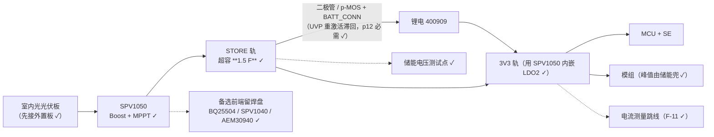

# 取能前端 SPV1050 参考电路要点（第一版：室内光）

> 决定（用户 2026-10-13 ✓）：**取能源先做室内光/光伏** ✓；前端 **首选 `SPV1050`** ✓（规格 §4b）。
> 本文件只做一件事：把"**画原理图前必须定下来的那几处**"列清楚 —— 能引官方的一定引出处 ✓，
> 缺资料的**明确标「待核」** ✗（**不编数字** ✗）。

## 1. 为什么是它（下表全部来自 ST 官方 ✓）

| 项 | 值 | 对我们的意义 |
|---|---|---|
| 冷启（Boost 配置，`CONF` 接供电源侧） | **550 mV / 30 µA** | 室内光的光伏板够得着 ✓ |
| 冷启（Buck-boost 配置，`CONF` 接地） | **2.6 V / 5 µA** | 高电压源/串并联板时用得上 ✓ |
| 冷启**之后**的输入范围 | **150 mV ～ VEOC**（boost）／150 mV ～ 18 V（buck-boost） | 天亮/关灯都在范围内 ✓ |
| 输出能力 | **≤ 70 mA** | 要**托住模组的发射峰值** ✗ —— 峰值数等 F-11 ✓ |
| 储能端 | `STORE` 引脚 = 不调整输出 ✓；内嵌**两路独立 LDO（1.8 V / 3.3 V）**，**各有使能脚** ✓ | **3V3 轨可由它直出** ⇒ 省一颗 LDO ✓；1.8 V 备用 ✓ |
| 保护 | **VEOC 2.6～5.3 V** / **VUVP 2.2～3.6 V**（各 ±1%），**都用外部电阻在 `STORE↔EOC` / `STORE↔UVP` 间微调** ✓；冷启前**负载断开**（保护电池 ✓） | "充到哪停 / 放到哪保护" = **两个电阻** ⇒ §2 第 3 条 ✗ |
| MPPT | **可开可关** ✓ ＋ **可由外部电阻编程** ✓ | 室内光的 MPP 与室外不同 ⇒ **必须可调** ✓ |
| 其它 | 内置 4 个 MOSFET（boost / buck-boost ✓）；电池接入 / DC-DC 有**开漏指示脚** ✓ | 状态可引到测试点 ✓ |

出处：**ST 数据手册《DS10044 – Rev 7》（30 页）** ✓ —— 就是用户 2026-10-13 给的那份 PDF
（文件名是中文，正文是英文 ✓）；下面每一处的**页码/小节**都写在 §2 里 ✓。

## 2. 画原理图前必须定下来的四件事（**公式与出处已齐 ✓**；只剩“随选型走”的值待定 ✗）

### 2.1 配置档：走 **Boost**（`CONF` 接**供电源侧** ✓）
- 引脚依据（p4/p5 ✓）：**Boost** = `CONF` 接输入源、`IN_LV` 接 GND、`IN_HV` 接电感；
  **Buck-boost** = `CONF` 接 GND、`IN_LV` 接电感、`IN_HV` 接输入源 ✓。
- 我们选 Boost（室内光板的电压低 ✓）：冷启 **550 mV / 30 µA** ✓；起后输入 **150 mV ～ VEOC** ✓（p1/p8 ✓）。

### 2.2 保护分压（`EOC` / `UVP`）—— **手册 Eq 1～3**（§6.1，p11 ✓）
内部比较基准 = **`V_BG = 1.23 V`（典型值）** ✓（p4 引脚说明 + p10 ✓）：
- **Eq 1**：`10 MΩ ≤ R_OUT(TOT) = R4 + R5 + R6 ≤ 20 MΩ`（为省漏电 ✓）
- **Eq 2**：`R6 = (V_BG / V_EOC) × R_OUT(TOT)`
- **Eq 3**：`R5 = (V_BG / V_UVP) × R_OUT(TOT) − R6` ⇒ 余下 `R4 = R_OUT(TOT) − R5 − R6`
- 取值范围与约束（p7 ✓）：`V_UVP` = **2.2～3.6 V**、`V_EOC` = **2.6～5.3 V**，
  且必须 **`V_UVP + UVPHYS < V_EOC − EOCHYS`** ✓。
- ★ **分压怎么接（已照手册 Figure 2（p11）核对 ✓）**：
  `STORE ——R4—— ⟦UVP 脚⟧ ——R5—— ⟦EOC 脚⟧ ——R6—— GND`
  —— **`R4` 在顶、`R6` 在底**；两个脚各自把所在节点与内部 **1.23 V** 比 ✓
  （⇒ 上下装反会把“充满点/保护点”全弄错 ✗，画图时对一眼图 ✓）。
- **我们的算例（待选型确认 ✗）**：锂电 400909 ⇒ 取 `V_EOC = 4.20 V`、`V_UVP = 3.00 V`、`R_OUT(TOT) = 15 MΩ`
  ⇒ 按上式：`R6 = 4.393 MΩ`、`R5 = 1.757 MΩ`、`R4 = 8.850 MΩ` ✓
  （★ 这是**按官方公式算的**，不是查来的 ✗ ⇒ 选型定了要复核 ✓；只用超容不装电池时，
  两阈值要落在**超容可用区间**内 ✓）。
- ★★ **超容 ＋ 电池这两件同时挂在 `BATT` 上时，手册另给一条必需的做法**（§6.1 末，p12 ✓）：
  要在 `STORE ↔ BATT` 之间加 **一个二极管（或 p 沟道 MOSFET ＋ `BATT_CONN` 驱动）** 做
  **UVP 重激活滞回** ✓ —— 否则超容放空会让系统**反复重启** ✗
  （原文：“avoids the undesired continuous system reset loop due to full discharge of the CSTORE”）。
  ⇒ **我们的板子正是这个组合** ⇒ **这一条必须画上** ✓。

### 2.3 MPPT 的三个电阻（`R1`/`R2`/`R3`）—— **手册 Eq 4～7**（§6.4，p20/21 ✓）
先定两个源参数：**`V_OC(MAX)`**（最强光下的开路电压）与 **`MPPTRATIO = V_MP/V_OC`**（典型工作点比）；
再定 **`ILEAKAGE`**（建议 0.1～1 µA ✓：越小越省电、但电阻越大 ✓）：
- **Eq 4**：`RIN(TOT) = R1+R2+R3 > (V_OC(MAX) / I_LEAKAGE) × MPPT_RATIO`
- **Eq 5**：`R1 = RIN(TOT) × [1 − V_MPP(MAX)/V_OC(MAX)]`
- **Eq 6**：`R2 = RIN(TOT) × (V_MPP(MAX)/V_OC(MAX)) × (1 − MPPT_RATIO)`
- **Eq 7**：`R3 = RIN(TOT) × (V_MPP(MAX)/V_OC(MAX)) × MPPT_RATIO`
- 约束（p20 ✓）：**`150 mV ≤ V_MPP(MAX) ≤ 2.1 V`**（= `V_EN_TH(MAX)` ～ `V_UVP(MIN) − 100 mV`），
  且 `V_MPP(MAX) < V_OC(MAX)` ✓。
- **手册自带算例**（p21 ✓，可直接当起点 ✓）：`V_OC(MAX)=2.2 V`、`V_MPP(MAX)=0.5 V`、`I_LEAKAGE=0.1 µA`
  ⇒ `RIN(TOT)=16.5 MΩ`、`R1=12.75 MΩ`、`R2=0.94 MΩ`、`R3=2.81 MΩ` ✓
- **不想用 MPPT 时的接法**（p4/p10 ✓）：`MPP_SET` **短到 `STORE`** 即关闭 ✓；
  低阻源（如 USB）⇒ `MPP_REF` 接 GND ✓；高阻源 ⇒ `MPP_REF` 接参考电压 ✓。
- ★ **本项只有 `V_OC(MAX)` 与 MPPT 比重是“我们还不知道的数”** ✗ —— 它属于**选定的那块光伏板** ✓
  ⇒ 买板/定板后填进上面两条式子即可 ✓（**不是手册缺资料** ✗）。

### 2.4 两路 LDO 的使能脚（`LDO1_EN` = 1.8 V / `LDO2_EN` = 3.3 V ✓）
- 引脚说明（p4 ✓）：**拉高使能** ✓；且内部逻辑在**电池未接（pass 管断开）时会同时抑制两路 LDO** ✓（p23 ✓）。
- 我们的用法：**3V3 直接由 `LDO2` 出** ✓（省一颗 LDO ✓）、`LDO1`（1.8 V）备用 ✓
  ⇒ 两个使能脚**各引一个跳线 / 0 Ω** ✓（demo 阶段可手动选 ✓，也能被 MCU 接管 ✓）。

### 2.5 外围元件（手册给了的就照拄 ✓；没给的单独查 ✗）

| 元件 | 值 | 出处 |
|---|---|---|
| 输入电容 `C_IN` | **4.7 µF**（不够就加大 ✓，受 Eq 8/9 的 T1 约束） | §6.4，p21 ✓ |
| `MPP_REF` 上的 `C_REF` | **10 nF** | 引脚说明 p4 ✓ |
| 两路 LDO 输出电容 | **各 100 nF** | §6.5，p22/23 ✓ |
| `STORE` 的储能电容 `C_STORE` | 图里只有符号 ✗ **本手册没给值** ⇒ 由储能选型定 ✓ | 图 4 / 图 12 ✓ |
| 电感 `L`（接 `L_HV`） | ✗ **本手册也没给现成值** —— 要按 `T_ON(MAX)=10 µs`、`T_OFF(MIN)=0.2 µs`、`I_L(PEAK)=140 mA` 的约束选（附录 A，Eq 10～12，p28 ✓），或照 ST 评估板/应用笔记 ✓ | p28 ✓ |
| 状态脚 `BATT_CONN` / `BATT_CHG`（开漏 ✓） | 若用 ⇒ 各 **10 MΩ 上拉到 `STORE`** ✓（`BATT_CONN` = **在 pass 管闭合时被拉低**；`BATT_CHG` = **DC-DC 在开关时被拉低** —— 两个语义手册写得很清楚 ✓） | Figure 2 + §6.1，p11 ✓ |

★ 另两条与画板直接相关的（p5 ✓）：封装 = **VFQFPN20 3×3×1 mm / 0.4 mm 脚距** ✓；
**EP、`GND`、`PGND` 与 `STORE` 的储能电容地要直连（不打过孔）** ✓。

### 2.6 储能：超容怎么选、接哪里（**2026-10-13 定 ✓**）

★ 决定（用户 2026-10-13 ✓）：**只留超级电容，不装锂电** ✗（太占地方 ✗）⇒ 腾出的位置给储能与取能区 ✓。

**（a）为什么是 5.5 V 组件、不是 2.7 V 单体** ✓
（电压档与公式的来源 = Wikipedia《Supercapacitor》✓：单体 **2.1～2.3 V（水系）/ 2.5～2.7 V（有机，主流）**、
锂离子电容（LIC）**3.8～4 V**、离子液体 >3.5 V；能量 `W = ½CV²`、可用能量 `½C(Vmax²−Vmin²)` ✓）
★ **5.5 V 不是另一种体系** ✗ —— 它就是**两串 2.7 V 单体**装在一个壳里 ✓（这就是“5.5 V”的来历 ✓）。
SPV1050 的作业区正好吃满 5.5 V：`V_BATT` 下限 **2.2 V**、`V_EOC` 上限 **5.3 V** ✓（p7/p8 ✓）
⇒ **可用能量 = `½C(V_EOC² − V_UVP²)`** —— 电压按平方算 ⇒ 同容量下差好几倍 ✓：

| 储能（★ 实装 **1.5 F** ✓，2026-10-17 改 ✗ —— 旧文写 0.5 F） | 按 `V_EOC`/`V_UVP` 算的窗口 | 可用能量 |
|---|---|---|
| 2.7 V 单体 | 2.2～2.7 V | **612 mJ**（按 0.5 F ✓ ⇒ 实装 1.5 F = **1.84 J**）|
| **5.5 V 组件** ✓ | 2.2～5.3 V | **5812 mJ**（按 0.5 F ✓ ⇒ 实装 1.5 F = **17.4 J**；≈ **9.5 倍** ✓）|

⇒ **选 5.5 V 组件** ✓（`V_EOC` 取到 5.3 V ✓、`V_UVP` 取到 2.2 V ✓；两端都在手册范围内 ✓）。

★★ **但上面这张表是「器件窗口」，不是我们「用得上的窗口」** ✗（2026-10-13 当天补 ✓，
见规格 `carrier-board-spec.md` §4b-1 第 4 条 ✓）：负载要的是 **3.3 V**，而**输出轨的压差**会把下限抬起来
—— 两颗前端都一样 ✗：
- SPV1050 = LDO（压差**手册值未取到** ✗ ⇒ 先按同量级 ≈0.2 V 处理 ✓、上机量 ✓）；
- BQ25570 = buck，压差 = 「最大输出电流 × buck 高边 `RDS(ON)`」✓（高边 **1.60 / 2.00 Ω** ✓）
  ⇒ 100 mA 时 **0.16～0.20 V**、200 mA 时 **0.32～0.40 V** ✓。
⇒ **对我们真正的可用窗口 ≈ 3.5→5.3 V** ✗ ⇒ 实装 **1.5 F** 的可用能量 = `½·1.5·(5.3²−3.7²)` ≈ **10.8 J**
（按 3.5 V 下限则 ≈ **11.9 J**）—— ✗ **不是 5.81 J**（那个数把 2.2 V 当成了可用下限 ✗，
而且是按 0.5 F 算的 ✗）；★ 首版前端用 **BQ25570** 时上限是 `VBAT_OV ≈ 4.97 V` ⇒ 窗口更窄
（≈ **9.3 J** ✓，见 `carrier-board-spec.md` §4b-2 ✓）。
★ **容量选型必须用 3.5～3.7 V 这个下限** ✓；F-11 实测（含真实压差）之后再定超容容量与 `C_STORE` ✓。

**（b）接哪里：超容挂 `BATT` 脚** ✓（**别**直接并在 `STORE` 上 ✗）
- 依据：手册原文 “For some applications (typically with battery **or super-cap** connected to
  **BATT pin**)” ✓ ＋ 图 3 那个位置直接标成 **“Battery (Super-Cap)”** ✓（p12 ✓）；
  `BATT` = “Load/battery connection pin” ✓（p5 ✓）。
- ⇒ `STORE` 上只留 **`C_STORE`（bulk、低 ESR）** ✓：它顶**模组发射峰值** ✗ ——
  因为储能的电要经**内部 pass 管（`R_BATT` ≈ 6 Ω** ✓，p7）才能到 STORE ✓，手册原文（p23 ✓）：
  `V_STORE = V_BATT − R_BATT·I_LOAD` ✓ ⇒ 峰值电流走这条路会把 STORE 拉垮 ✗。
- ★ **不装电池也不影响内嵌 LDO** ✓：冷启时 pass 管本来就是**断开**的
  （“load disconnect … prior the first start-up” ✓，p1），`V_STORE` 升到 `V_EOC` 后**自动闭合** ✓
  （引脚说明 p4 ✓）⇒ `LDO1/LDO2` 照常可用 ✓。
- ⚠ **UVP 重激活滞回照旧要留** ✓ —— 手册对 battery **or super-cap** 都要求 ✓（p12 ✓，见 §2.2 末条 ✓）。

**（c）选型判据（6 条）** ✓
1. **与 SPV1050 窗口匹配**（上面 (a) ✓）；
2. **容量**：**已定 1.5 F** ✓（用户 2026-10-17 核过实装件丝印 ✗）；现在要算的是“**1.5 F 能覆盖多长暗期**” ✓ ← **等 F-11 实测** ✗；
3. **内阻 `Ri`**：按 **IEC 62391-1 的 “energy storage” 档**（放电电流 `0.4·C·V` ✓）选 ✓；
   **别拿纽扣/内存备份类** ✗（内阻大、只够 µA–mA ✗）；压降按 `ΔV = I_peak·Ri` 校 ✓（峰值 ← F-11 ✓）；
4. **自放电/漏电**：手册级例子 —— 5.5 V/F 组件 20 °C 从 5.5 V 掉到 3 V ≈ **600 h** ✓（对 60 s
   一报无压力 ✓，暗期长才要算 ✓）；这一项直接进 `energy_calib` 的 `store_mj`/`sleep_mw` ✓；
5. **均衡**：两串必须均衡 ✓（无源电阻 / 有源 ✓）—— **有的组件内置、有的没有 ⇒ 买前看规格书** ✗；
6. **温度与寿命**：温度每降 10 °C 寿命翻倍 ✓；电压越低越长寿 ✓ ⇒ 别顶额定跑 ✓
   （我们把 `V_EOC` 留在 5.3 V 以内 ✓）。

**（d）还不能定死的三个数** ✗：容量（← F-11 ✓）、型号的 `Ri`/自放电/均衡（← 选型 ✓）、
`C_STORE` 的容量（← 发射峰值 ✓）。

## 3. 板级要留的位（与规格 §4c「可断开 / 可单测」一致 ✓）

- 取能前端做成**跳线/子板** ✓（可换、可单测 ✓）；
- 主轨 ＋ 模组支路**各一个电流测量跳线** ✓（F-11 用 ✓）；
- 储能电压**测试点** ✓（判断"还在充 / 已经够" ✓）；
- 备选前端**留焊盘、不装** ✓。

## 4. 边界

- 本文件**不给**光伏板选型，也**不下**"室内光够不够"的结论 ✗ —— 那要 F-11 实测 ＋ 光伏板实测 ✓；
- 现在还剩两类“待定”，**性质不同、别混** ✗（§Header 已经区分）：
  ① **随选型走**（不是缺资料 ✓）：`V_OC(MAX)` / MPPT 比重（取决于光伏板 ✓）、`V_EOC` / `V_UVP`
     （取决于电池/超容 ✓）；② **手册本身没给**：`C_STORE` 与电感 `L` 的值（另查评估板/应用笔记 ✓）；
- 本文件里**所有带公式/数值的结论都写了页码或小节号** ✓ —— 想复核就翻那一页 ✓（不许凭记忆改数 ✗）。
