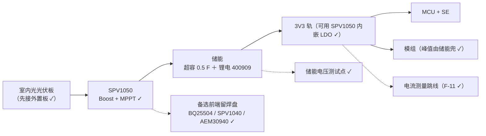

# 取能前端 SPV1050 参考电路要点（第一版：室内光）

> 决定（用户 2026-10-13 ✓）：**取能源先做室内光/光伏** ✓；前端 **首选 `SPV1050`** ✓（规格 §4b）。
> 本文件只做一件事：把"**画原理图前必须定下来的那几处**"列清楚 —— 能引官方的一定引出处 ✓，
> 缺资料的**明确标「待核」** ✗（**不编数字** ✗）。

## 1. 为什么是它（下表全部来自 ST 官方 ✓）

| 项 | 值 | 对我们的意义 |
|---|---|---|
| 冷启（Boost 配置，`CONF` 接供电源侧） | **550 mV / 30 µA** | 室内光的光伏板够得着 ✓ |
| 冷启（Buck-boost 配置，`CONF` 接地） | **2.6 V / 5 µA** | 高电压源/串并联板时用得上 ✓ |
| 冷启**之后**的输入范围 | **150 mV ～ VEOC**（boost）／150 mV ～ 18 V（buck-boost） | 天亮/关灯都在范围内 ✓ |
| 输出能力 | **≤ 70 mA** | 要**托住模组的发射峰值** ✗ —— 峰值数等 F-11 ✓ |
| 储能端 | `STORE` 引脚 = 不调整输出 ✓；内嵌**两路独立 LDO（1.8 V / 3.3 V）**，**各有使能脚** ✓ | **3V3 轨可由它直出** ⇒ 省一颗 LDO ✓；1.8 V 备用 ✓ |
| 保护 | **VEOC 2.6～5.3 V** / **VUVP 2.2～3.6 V**（各 ±1%），**都用外部电阻在 `STORE↔EOC` / `STORE↔UVP` 间微调** ✓；冷启前**负载断开**（保护电池 ✓） | "充到哪停 / 放到哪保护" = **两个电阻** ⇒ §2 第 3 条 ✗ |
| MPPT | **可开可关** ✓ ＋ **可由外部电阻编程** ✓ | 室内光的 MPP 与室外不同 ⇒ **必须可调** ✓ |
| 其它 | 内置 4 个 MOSFET（boost / buck-boost ✓）；电池接入 / DC-DC 有**开漏指示脚** ✓ | 状态可引到测试点 ✓ |

出处：ST 产品页 `SPV1050`（2026-10-13 取 ✓）；数据手册
`https://www.st.com/resource/en/datasheet/spv1050.pdf` ✗ —— **我这边取不到正文**（只有产品页 ✓）
⇒ §2 里那几处**公式/电阻值需要你给 PDF** ✓（和你给 PCC110 手册那样 ✓）。

## 2. 画原理图前必须定下来的四件事（**待核 datasheet** ✗）

1. **配置档**：`CONF` 接哪边 —— 我们走 **Boost**（低压光伏 ✓）；
2. **MPPT**：开还是关、**编程电阻值** ✗（要对着"室内光的 MPP 比例"定 ✓）；
3. **VEOC / VUVP 的两个电阻** ✗ —— 决定"充满点 / 保护点"，必须与 `cell_full_mv` / `cell_empty_mv`
   一致 ✓（规格已把这两个列进可标定项 ✓，见 `carrier-f11-measure-plan.md` §1）；
4. **两路 LDO 的使能脚怎么接**（直连 / MCU 控 / 上拉 ✓）⇒ 建议**引到跳线或测试点** ✓
   （demo 阶段能手动选 ✓）。

## 3. 板级要留的位（与规格 §4c「可断开 / 可单测」一致 ✓）

- 取能前端做成**跳线/子板** ✓（可换、可单测 ✓）；
- 主轨 ＋ 模组支路**各一个电流测量跳线** ✓（F-11 用 ✓）；
- 储能电压**测试点** ✓（判断"还在充 / 已经够" ✓）；
- 备选前端**留焊盘、不装** ✓。

## 4. 边界

- 本文件**不给**光伏板选型，也**不下**"室内光够不够"的结论 ✗ —— 那要 F-11 实测 ＋ 光伏板实测 ✓；
- 上面标「待核」的四处**不能凭感觉填** ✗ —— 电路定型前必须从数据手册抄下来 ✓。
